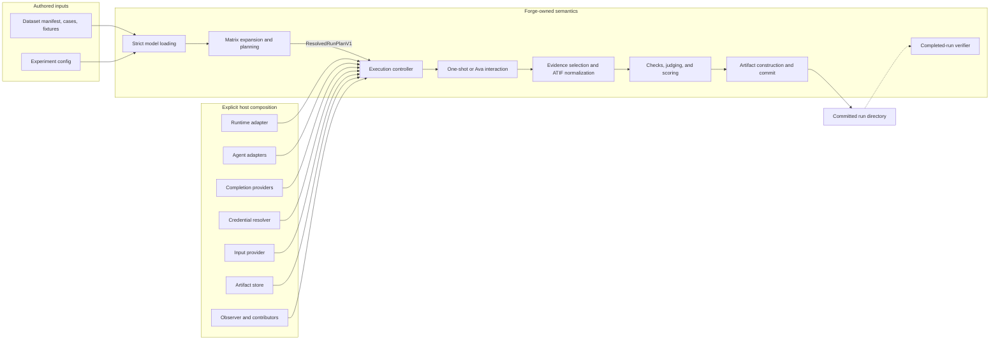
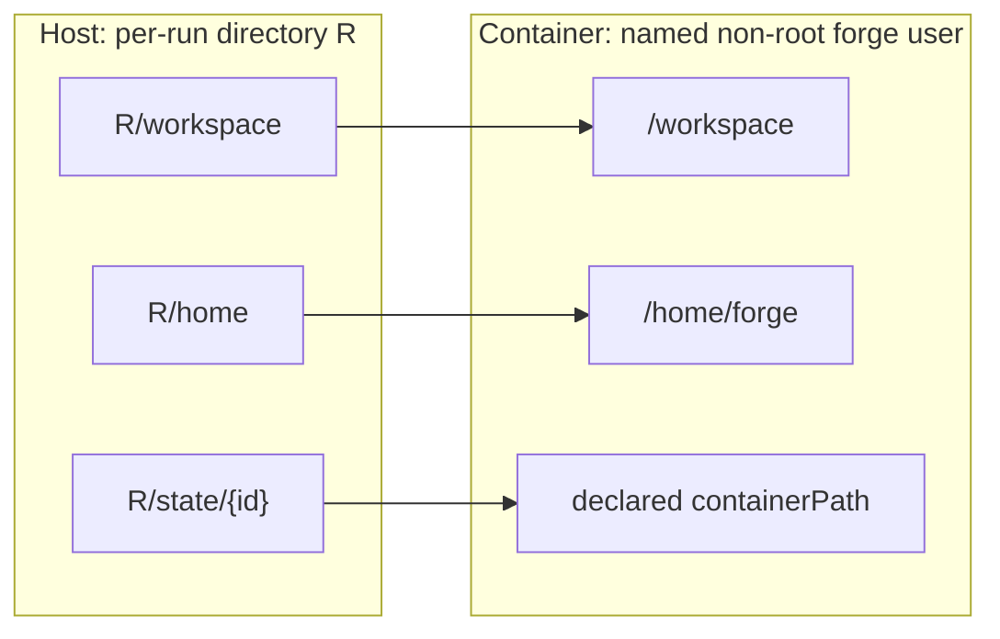

# Forge architecture

This document describes the implemented architecture of Forge. It is a
conceptual companion to the user-facing [README](../README.md): the README
explains installation, consuming published dataset releases, execution, and
results. This document explains the data model, boundaries, control flow, trust
model, and extension points behind Forge's audit records.

Forge records declared intent in `plan.json`, bounded non-sensitive setup
resolutions in `setup.json`, selected evidence, and the resulting evaluation.
Those records support audit and comparison; they do not guarantee identical
reruns or complete capture of external state. Models, network resources,
registries, and other external systems can change independently.

For a file-by-file tour and concrete call graphs, see the
[Forge codebase guide](codebase-guide.md).

Forge is a portable execution harness for coding-agent evaluations. Given a
verified dataset, an experiment configuration, and one matrix selection, it:

1. resolves a complete, immutable run plan;
2. validates that the host can execute the plan without exercising authority;
3. prepares an isolated runtime and applies ordered setup;
4. drives a one-shot or Ava-mediated coding-agent session;
5. stops mutation and selects exact run-owned evidence;
6. evaluates deterministic checks and model-judged criteria; and
7. commits a self-describing local result through one atomic boundary.

The central architectural rule is that Forge owns core interaction, evidence
selection, and scoring order. Host integrations provide mechanisms through
narrow contracts, while the engine preserves the shared lifecycle and scoring
semantics.

## Architectural goals

Forge is designed around five properties.

**Reproducible semantics.** Cases say what is evaluated; experiments say how
cases run; resolved plans materialize declared defaults and planning provenance
for one run. `setup.json` records bounded non-sensitive choices resolved while
realizing that plan. Runtime code does not infer omitted settings from ambient
state.

**Portable mechanisms.** Runtime, coding-agent, credential, completion,
storage, input, search authority, and observation behavior enters through public contracts in
[`src/contracts`](https://github.com/stripe/forge/tree/main/src/contracts). The core does not discover private
implementations or branch on a host environment.

**Authority after validation.** Parsing, planning, setup preflight, agent
requirements, completion-provider requirements, and runtime preflight are pure.
Credential lookup, provider calls, runtime allocation, commands, and workspace
mutation happen only after the complete selection has passed that boundary.

**Evidence before scoring.** Mutable workspace or session state is never used
as grading evidence. Forge first quiesces the runtime, then exposes read-only
capabilities, selects the exact root session, normalizes it to ATIF, redacts
credentials, and derives evaluation inputs from that sealed state.

**Atomic, verifiable results.** Companion artifacts are staged with hashes and
sizes, runtime cleanup runs, and `result.json` plus the run directory become
visible at one rename boundary. A verifier re-reads all claimed bytes and
checks cross-artifact invariants before downstream publication.

## System overview



There are two kinds of dependency injection, kept intentionally separate:

- `ForgeEngine` fixes **semantics**: parsers, planning behavior, and the
  immutable registry of setup action implementations.
- `ForgeComposition` supplies **authority and mechanisms** for one execution:
  runtime, agents, completion providers, credentials, inputs, storage, and
  optional observation or supplemental artifacts.

This separation prevents a plan from being parsed with one setup action
implementation and executed with another, while also preventing executable
host capabilities from leaking into the benchmark document.

## The benchmark data model

Forge keeps authored definitions, resolved inputs, and execution identities distinct.

| Object | Responsibility | Important contents |
| --- | --- | --- |
| Dataset | Versioned evaluation payload | Manifest of case identities, case definitions, fixture files |
| Eval case | What is evaluated | Task or prompt, context, invariant setup, interaction mode, turn limit, checks, judging criteria, example answer |
| Experiment | How cases run, defined by an experiment config | Dataset pin, treatments, agent/model matrix, runtime, harness models, resources, repetitions, retry policy, timeout |
| Experiment run | One resumable batch from an experiment | Experiment run ID, selected plans, checkpoint, attempt history, and aggregate report |
| Eval run | One execution attempt for a selected plan | Eval run ID, isolated lifecycle, committed artifacts, and evaluation outcome |
| Resolved run plan | Complete input to one eval run | One case/treatment/agent/repetition, merged setup, materialized defaults, runtime and model selections, provenance |

The wire types live in [`src/model/types.ts`](https://github.com/stripe/forge/blob/main/src/model/types.ts); strict
parsing lives in [`src/model/parse.ts`](https://github.com/stripe/forge/blob/main/src/model/parse.ts).
The installed Forge release defines their schemas; authored inputs have no
separate `schema_version` field. Dataset and experiment versions identify those
inputs independently of Forge format compatibility.

### Dataset loading and integrity

[`loadDataset`](https://github.com/stripe/forge/blob/main/src/model/loaders.ts) treats the manifest as an exact
case inventory:

- `manifest.json` identifies the dataset and lists one entry per case: its
  `id`, `version`, and case-definition `path`;
- every manifest case path must exist, and every `case.yaml` or `*.case.yaml`
  file under `cases/` must appear in the manifest;
- every other regular file under the root is a fixture;
- symbolic links and special files fail;
- paths must be canonical, dataset-relative POSIX paths;
- entry count, depth, individual document size, and total bytes are bounded;
  and
- case IDs and paths are unique, and each case definition must declare the
  same `id` and `version` as its manifest entry.

Fixtures used by built-in `forge/write` steps are their `dataset_path`
sources. A source must name a payload file or a directory containing one,
excluding case definitions and directories containing them. `loadDataset`
checks case setup and retains discovered file and nonempty directory paths in
`LoadedDatasetV1.inputPaths`. Planning checks the combined case and selected
treatment setup against that index without reading the filesystem, so
`validate` and `plan` reject missing treatment sources before execution.
Hosts constructing loaded datasets may supply the index or own existence
validation themselves; planning still excludes case definitions. Custom
actions and agents may read payloads outside these built-in write checks.

Case and dataset versions are independent labels. Change the dataset
`version` whenever any case version changes or a case is added or removed.
Forge records the case version in resolved plans through the case
definition; it does not compare versions at load time.

Forge does not hash the manifest, case definitions, or fixtures. The
experiment pins only the dataset ID and version, so the dataset version is the
identity of its case set and must change with it. Each resolved plan embeds
the full case definition, so `plan.json` and the experiment checkpoint bind
the case content that ran; fixture bytes are not recorded. Hosts that need
content integrity must govern it outside Forge, for example by requiring a
case version change for every case or fixture edit.

The optional `dataset.path` locates the manifest for the CLI, relative to the
experiment file. Programmatic hosts can continue supplying a loaded dataset
directly; the location is excluded from resolved plans and execution
semantics. Planning refuses to combine a loaded dataset with a different ID
or version.
`RunInputProvider` later gives setup and agent adapters read-only, path-safe
access to dataset payloads. The path index records load-time existence, not
content integrity or later filesystem changes. Setup reads current bytes and
rejects an empty source directory instead of silently skipping its copy.

Because every file under the root is readable payload, experiments and
documentation live outside the dataset root and point at it with
`dataset.path`. See the
[sample experiment](https://github.com/stripe/forge/blob/main/experiments/stripe-integration-public-evals/README.md)
for the layout and commands.

### Cases, treatments, and setup ordering

A case owns invariant setup because it is part of the task definition. A
treatment is one experimental arm and owns only its additional setup. When a
selection is resolved, Forge creates one ordered list:

```text
resolved setup = case setup + selected treatment setup
```

That order is score-affecting and cannot be changed by an adapter. A baseline
treatment may have an empty setup list; it is still an explicit matrix choice.

### Matrix expansion and selection

An experiment matrix declares either one flat Cartesian product or an ordered
list of groups, each with explicit case, treatment, and agent axes. Repetitions
and retry policy belong to the whole matrix. Strict parsing rejects mixed
forms, missing group axes, and duplicate selections after agent defaults.
The case axis contains canonical dataset-relative YAML file paths. Expansion
checks the loaded dataset pin and resolves manifest-listed paths to the IDs
read from their case definitions. IDs remain the selection and report identity; resolved
plan provenance records both the ID and manifest path.

A grouped matrix keeps case-specific treatment and model combinations separate:

<!-- grouped-matrix:start -->
```yaml
matrix:
  repetitions: 2
  retries: 0
  groups:
    - id: payment
      cases:
        - cases/examples/payment.case.yaml
      treatments:
        - baseline
        - payment-plugin
      agents:
        - adapter: claude-code
          provider: anthropic
          model: claude-sonnet-4-6
        - adapter: claude-code
          provider: anthropic
          model: claude-opus-4-6
    - id: marketplace
      cases:
        - cases/examples/marketplace/case.yaml
      treatments:
        - baseline
        - marketplace-plugin
      agents:
        - adapter: claude-code
          provider: anthropic
          model: claude-opus-4-6
```
<!-- grouped-matrix:end -->

This fragment assumes both case paths are in the manifest and all three
treatments are defined. It produces **12 selections**: eight for payment and
four for marketplace.

[`expandExperiment`](https://github.com/stripe/forge/blob/main/src/planning/planner.ts) expands each product in stable
authored order:

```text
group → case → treatment → agent → repetition
```

The flat form behaves as one unnamed group. Explicit groups may declare an
optional `id`, unique within the experiment and matching
`[a-z0-9][a-z0-9._-]*` with at most 128 characters. Flat matrices do not accept
`id`. Unnamed groups retain their existing selection format; no positional ID
is generated. Distinct group IDs do not permit duplicate resolved combinations.

Named groups retain their ID as `selection.group_id` in plans, results,
checkpoints, and report run rows. Membership checks require the complete
case/treatment/agent tuple to coexist in one group and any supplied group ID
to match it. Planning fills an omitted ID from the matching group. Adding,
removing, or renaming a group ID changes its plan digests and prevents resume
against the original saved plans.

The CLI's `--group <id>` selector intersects with other filters; unknown group
IDs and empty intersections are errors. Resume uses the saved selections and
rejects new selectors, including `--group`.

The experiment-level `retries` value is experiment run policy and does not
create a new semantic selection. `executeEval` executes one resolved plan once;
an experiment run controller is responsible for retrying that selection.

A `RunSelection` chooses exactly one case, treatment, complete agent selection,
and zero-based repetition. Codex selections include `hook_trust`; new plans
materialize its `native` default, while saved plans may omit it. OpenCode selections
include their explicit `model_profile`, and optional `endpoint` and
`upstream_providers`, in selection identity, plans, results, checkpoints, and
report grouping. The CLI requires
filters to resolve to one entry for `plan`. `run` resolves and purely preflights
every matching plan before executing them with bounded concurrency. The CLI loads the dataset from
the experiment config and permits selectors such as `--case` to restrict execution.

The shared controller exposed through `@stripe/forge/experiment` checkpoints
attempts in a strict `experiment.json` under
`results/experiments/<experiment-run-id>/`, outside the immutable eval run
directories. Every new invocation receives a distinct experiment run ID.
The checkpoint records its producing `forge` build identity and binds that ID
to its directory. Each entry records its selection, canonical plan SHA-256,
and ordered attempts with a unique eval run ID and `running`, `completed`, or
`errored` state. Errored attempts retain a stable error code and an optional
`diagnostic` with the execution phase, reason (`failure`, `timeout`, or
`cancelled`), and a bounded message. Execution-boundary diagnostics appear in
progress events, inspection outcomes, and report rows even when no run artifact
was committed. Older records may omit them. Arbitrary host callback errors
still retain only a stable code; callers must not copy raw error strings into
these records. Committed role-player failures recover their diagnostic from the
verified result, including after a checkpoint interruption. A bounded
worker pool executes pending plans;
one coordinator serializes reservations, checkpoint mutations, and writes so
out-of-order completions cannot overwrite one another. `jobs` defaults to one
and is scheduling policy, excluded from plan identities. Checkpoint updates use
synced temporary files and atomic rename. A local lock directory is published
with a unique owner marker to prevent simultaneous writers. Recovery removes only the exited
owner's marker and an empty lock directory, so delayed cleanup cannot remove
a replacement owner's lock. Committed artifact locations are compared after
resolving filesystem aliases, including symlinked output directories.

Alongside `experiment.json` and `report.json`, the experiment root holds
`events.jsonl`. The controller sends progress to its callback immediately and
queues each validated event for one background writer as canonical JSON with
`experiment_run_id` and an `observed_at` UTC observation time. The states are `started`, `resumed`, `running`, `completed`, `skipped`,
and `errored`, plus `agent_usage` after each completed agent turn with counters.
Usage events carry a one-based `turn` and per-invocation `usage`; selection events
retain `selection` and `run_id`, and errors
retain the same stable code and optional credential-redacted diagnostic as
stderr. Resume appends a `resumed` marker after inspecting prior attempts
and before scheduling pending work.
The callback and stderr keep their existing `resuming` state name. Both stderr
and `events.jsonl` also receive `agent_usage` records, one per reported completed
turn. A saved usage event advances `last_event_at`. Readers from older Forge
releases may classify this new state as unavailable.

The log format belongs to the checkpoint's Forge release. Records are bounded
to 64 KiB and new logs use mode `0600`. Controller observation policy bounds the
pending queue to 1 MiB, each append to 250 ms, and final drain to 500 ms.
Scheduling and stderr do not wait for individual appends. A timed-out append
disables further recording for that invocation and cancels unissued writes;
an already-issued filesystem operation may settle later. Permanent filesystem
failures, such as a permission error, also disable recording. Transient failures
are not retried for the same event; later events may record recovery. Log I/O
failures and queue overflow are counted as gaps. Returned summaries include optional
`progress_log: {state: "unavailable", reason, affected_events}` when gaps occurred.
Reasons are `io_error`, `io_timeout`, `buffer_full`, and `recording_error`
(the first observed reason is kept). The next successfully saved event includes optional `recording_gap`
with the same shape for preceding gaps. Counts include dropped events and
writes whose completion is unknown after failure or timeout. Unexpected background
writer errors disable recording with `recording_error`; they cannot reject a
completed experiment or replace its primary error. Direct validation of progress
contracts still throws for schema drift, and low-level parser/writer functions
still surface programming errors to their callers.

Writes are not synced. Separator and body use one write, and short writes count
as I/O failures. Interruption can leave a torn line. The read-only tail reader
bounds reads to 128 KiB and 250 ms, tolerates interrupted final records, and
reports missing, empty, interrupted, invalid, unsafe, oversized, unreadable,
timed-out, or identity-mismatched observations as typed unavailable states. The compatibility reader
returns no event when unavailable. Neither last-event time nor the absence of
a terminal event establishes liveness or completion; use checkpoint outcomes
and the lock owner together. The log is optional for older folders and is never
an input to resume decisions, judging, scoring, verification, or regrade.
Completed-run file inventories apply only within `runs/<eval-run-id>/`.

`forge status --experiment-run <directory> [--json]` observes the checkpoint,
last complete event, and local lock owner without locking or writing. Its pure
summary counts latest selection states, treating an empty attempt list as
`pending`; failure groups include all errored attempts, including retries later
completed. Group keys are error code and optional diagnostic phase, reason,
and message; absent diagnostics form their own group. In-flight groups use
adapter, provider, and model and list the latest `running` eval IDs.
The JSON summary contains `experiment_run_id`, `counts`, `failures`,
`in_flight`, `last_event_at` (null without an event), `event_log`, `token_rates`, and
`liveness`. `event_log` preserves the tail reader's bounded unavailability
reason or reports `available` with a `complete` or `interrupted` tail. It never
copies the raw event payload. Liveness records `state` (`alive`, `stale`,
`no_lock`, or `unknown`) and `pid` (null without a known owner). Unknown
liveness adds a fixed reason: `invalid_lock`, `io_error`, `io_timeout`,
`probe_error`, or `observation_error`.
`token_rates` uses a trailing 60-second window at `observed_at`, with basis
`per_turn` and a typed availability state. Its model groups sum input plus output
for exact checkpoint attempts and selections, including errored attempts;
duplicate run/turn records count once. Future and expired records do not
contribute. Each group records `turns` and `turns_with_total`; an unknown input
or output makes its rate null with reason `missing_counters`. An unsafe sum
makes it null with reason `overflow`. No usage events means unavailable with
reason `no_usage`. A model with only expired or future usage reports has a null
rate with reason `no_recent_usage`; a recent turn reporting zero tokens gives zero.

The recent-rate reader shares the event reader's fixed unavailability reasons
and 250 ms wait budget. It allocates from the file size, up to an 8 MiB tail.
Missing, invalid, unsafe, unreadable, timed-out, or identity-mismatched logs make
rates unavailable. Interrupted tails, an omitted prefix (`truncated`), and saved
`recording_gap` markers also make rates unavailable; partial totals are not
presented as a current rate. It retains `truncated` and `invalid_records`
metadata for coverage. Unexpected recent-reader failures degrade to bounded
`observation_error`. Undetectable recording gaps can still undercount. Completed
eval totals are never treated as recent turn deltas. Usage arrives after
`AgentSession.send`, not during a CLI invocation.

Bounded checkpoint reads use one open file handle, so an atomic replacement
does not mix versions. Buffers use the observed file size plus one byte;
growth during the read is rejected instead of parsing a truncated prefix.
Each file observation uses the shared 250 ms read budget. Timeout stops the
command waiting and prevents new reads once an issued operation settles;
already-issued filesystem calls can settle later. Other files are separate
observations; no consistent
cross-file snapshot or artifact verification is implied. Empty lock directories
are stale and a disappearing owner is reported as no lock. Lock enumeration
reads at most two entries. Malformed or unreadable locks report unknown;
missing, torn, invalid, newer-format, or mismatched event logs report their
availability without failing the checkpoint summary. Only an unreadable or
invalid checkpoint or a checkpoint/directory identity mismatch fails status. PID probes use signal zero on this host; permission
denied still indicates a live process. Locks record no host or process start
identity, so copied folders and PID reuse can mislead liveness. See the README's
[status workflow](../README.md#results-and-scores) for usage and exit codes.

`--resume <experiment-run-id>` requires an explicit ID and loads that
experiment run's saved selections. Bare `--resume` is rejected. The resolved
plans must retain their original checksums. Resume independently verifies prior eval run
artifacts and their plan checksum before
skipping an entry, including recovery after a commit/checkpoint interruption.
Execution errors, committed role-player failures, missing results, and invalid
artifacts receive new attempt IDs. Completed failed or partial evaluations are
kept. One errored entry does not stop other entries. Cancellation or coordinator
failure stops new scheduling and signals active callbacks; the controller waits
for every callback to finish cleanup before releasing its lock.

The controller also writes a derived `report.json` with its producing `forge`
build identity after workers
drain, while still holding the experiment run lock. It reads the last durable
checkpoint and uses the same verified latest-attempt recovery as resume,
reusing bounded inspection metadata from the invocation. The scorecard groups
repetitions by case/treatment/agent and separates execution coverage from
completed evaluation scores. Coverage uses only saved selections; combinations
absent from the matrix are outside its denominator. Aggregate scores follow the
selected distribution, and treatment comparisons require matched case and
complete agent coverage. Its checkpoint digest and generation time bind it
to that snapshot. Atomic replacement preserves the previous report if writing
fails. Reporting errors surface on normal completion; after cancellation or
coordinator failure, reporting is best effort and preserves the primary error.
Resume does not read the report, so it can regenerate a missing or corrupt
scorecard without rerunning valid completed evaluations. Report fields and
denominators are documented in the README's
[results and scores](../README.md#results-and-scores).

Embedding hosts supply resolved plans, an engine, a pure preflight composition,
and an execution callback. The callback may construct per-run host resources
and composition around execution by that same engine, honoring cancellation and
finishing cleanup before settling. The host retains input loading, command
grammar, publication, and evaluation exit policy. The shared
controller requires verified local artifacts below its selected root; it is
not a remote worker protocol. It does not alter `executeEval` or its scoring
semantics. See the README's
[experiment run workflow](../README.md#running-experiments).

The command stage exposed through `@stripe/forge/experiment/cli` composes shared
operational options with host-defined arguments, validates invocation rules,
selects experiment run IDs/roots, and restores saved selections before invoking the
host loader. The loader supplies resolved plans, pure capability descriptors,
and an execution closure. Generated inputs remain alive until workers drain;
the command stage then awaits prepared-input disposal. The loader owns partial
cleanup on rejection, and workers own scoped runtime/resource cleanup.

Bounded verified outcomes include skipped selections and separate evaluation
status from execution completion. Remote publication follows the shared stage,
with destination-specific retry state outside the execution checkpoint. A
read-only experiment run inspection API verifies latest immutable commits against
saved plan digests without regenerating inputs or altering execution state,
supporting independent publication retries. The public CLI uses this same
command stage while retaining its own grammar, input loader, rendering, and
exit policy.

### Plan resolution

[`resolveRunPlan`](https://github.com/stripe/forge/blob/main/src/planning/planner.ts) validates experiment references and
produces a deeply frozen `ResolvedRunPlanV1`. It:

- checks dataset and experiment compatibility;
- checks that the selection is present in the matrix;
- resolves a role-player model for multi-turn cases and a judge model when
  judging criteria are non-empty, using each experiment override or the
  `openai` / `gpt-6.1-sol` default;
- concatenates case and treatment setup;
- validates built-in dataset sources against the available path index and
  action-bundle pins;
- chooses the effective prompt and records its source;
- materializes the turn limit and other defaults;
- materializes an authored Docker `native` platform from an explicit
  host-supplied platform selection; and
- records the dataset, experiment, and case identities, installed
  Forge package, and action-bundle implementation pins.

Unused host models are omitted from the plan. Used models are cloned and
frozen in the plan before provider preflight or credential lookup; runtime
execution and saved-plan parsing never infer a missing model. See the README
for [model overrides and credentials](../README.md#requirements--credentials).

Plans use canonical JSON with recursively sorted object keys and retained array
order. The `plan.json` artifact descriptor binds these bytes to `result.json`.

## Engines, action registries, and compositions

### `ForgeEngine`: immutable semantics

[`createForgeEngine`](https://github.com/stripe/forge/blob/main/src/engine.ts) constructs one immutable setup action
registry and closes over it for every operation:

- parse cases, experiment configs, setup steps, and resolved plans;
- load datasets and experiment configs;
- resolve run plans;
- preflight and execute runs; and
- verify completed runs.

The exported `defaultForgeEngine` contains built-in actions only. An embedding
host may import trusted action bundles and construct a different engine, but
YAML never names code to import. Bundle namespace, version, and implementation
digest must match at parsing, planning, execution, result, and verification
boundaries. See [setup action bundles](setup-action-bundles.md).

### `ForgeComposition`: explicit mechanisms and authority

[`ForgeComposition`](https://github.com/stripe/forge/blob/main/src/contracts/composition.ts) is supplied per host and
contains:

| Capability | Role | Authority |
| --- | --- | --- |
| `RuntimeAdapter` | Allocate, isolate, quiesce, and dispose the execution environment | Runtime mechanics and command execution |
| `AgentAdapter` map | Drive the selected coding agent and collect its exact session evidence | Agent-scoped runtime commands |
| `CompletionProvider` map/resolver | Host-side Ava and judge model calls | Declared completion credentials only; no workspace or commands |
| `CredentialResolver` | Resolve opaque references | Secret lookup only for explicitly requested references |
| `RunInputProvider` | Read dataset payloads | Read-only access below one dataset root |
| `RunArtifactStore` | Stage and atomically commit results | One run namespace in the result store |
| Optional `AttemptDiagnosticsStore` | Persist bounded observations independently of results | Attempt namespace only; never scoring authority |
| `RunObserver` | Receive lifecycle and agent usage events | No control; failures are ignored |
| `RunArtifactContributor` list | Add supplemental files | Only below `extensions/<contributor-id>/` |

The composition does not define setup semantics. Conversely, the engine's
setup registry does not provide runtime authority.

## Execution lifecycle

[`executeEval`](https://github.com/stripe/forge/blob/main/src/execution/execute.ts) is the public automated
controller. It owns the following phase order.


### 1. Parse and pure preflight

Forge checks the supplied plan's recorded Forge package version before parsing
its contents against the engine's action registry and reserializing it
canonically. Versions must match exactly whenever either producer or reader is
outside the `X.Y.Z-dev.*` channel. Two development versions may use current
strict shapes on a best-effort basis, without a compatibility or reproducibility
guarantee. The authored experiment does not pin a Forge version; a newer package
can resolve a fresh plan for an older dataset. Forge then:

- selects the agent adapter by exact ID;
- obtains and validates the agent's pure evidence identity;
- preflights every setup action and binds its later `apply` operation;
- merges agent and setup executable, state-directory, variable, and credential
  requirements;
- resolves completion providers for the explicit `role_player` and `judge`
  purposes and validates their pure requirements; and
- asks the selected runtime to synchronously validate the plan and combined
  requirements.

No credentials are resolved, providers called, runtime allocated, commands
run, or workspaces inspected during this phase. Ordinary `forge validate` uses
this same boundary for every matrix selection; a `native` Docker experiment is
preflighted as both supported concrete platforms without host discovery. The
explicit `forge validate --host` readiness check additionally queries the
Docker server and uses `ForgeEngine.validateRuntime` to prepare temporary runtimes,
verify the pinned agent, apply ordered setup, finalize it, and check configured
plugin MCP connections through the native client. All selected plans finish
pure preflight and resolve setup/MCP credentials before allocation. Model and
completion credentials are not resolved. Claude uses native `mcp list`; Codex
uses app-server initialization and `mcpServerStatus/list`, without a thread or
turn. No model calls or MCP tool invocations occur. Checks report MCP auth
separately from untested model auth and dispose temporary runtimes on all paths.
Setup can have external side effects, so host validation is explicit. Ordinary
validation stays pure; host validation supports the same selection filters.

The separate opt-in `validate --probe-models` runs after all selected plans
pass pure preflight. Agent adapters and completion providers may expose
`probeModel`, a pure factory returning a `ModelProbe` with a credential-free
endpoint and an authority-bearing `run` method. These contracts are exported
from the package root, along with `ModelProbeResult` and its outcome and reason
types. The CLI prints target names and roles without endpoint URLs, then runs
probes in order. Missing capabilities and factory failures yield
`other` / `probe_unavailable` for that target; other models still run. Built-ins
resolve only their model credential through the supplied resolver and send one fixed prompt directly to their configured API, with no
case content or runtime allocation. Ava and judge probes reuse each provider's
structured request serialization and response parsing, and validate the test
object locally. A malformed transport envelope yields `other`; a valid envelope
with invalid structured content yields `missing_structured_output`. HTTP model
errors require recognized model-specific codes or the provider's exact
model-not-found signal. Ambiguous errors stay `other` with `http_error`.
Results contain an outcome, optional allowlisted reason, and optional HTTP
status, never URLs, provider bodies, or credential errors. The command validates
and copies these fields even for custom probes. Built-ins follow no redirects
and read at most 64 KiB. The command enforces a one-minute deadline (or a lower
provider timeout) across credential lookup, transport, and custom capabilities,
even when they ignore cancellation. A timed-out or throwing probe produces a
bounded failure and the next model still runs. Caller cancellation stops the
command. Embedding callers of `ModelProbe.run` own the same deadline duty.
Probes do not change plans, artifacts, or scoring. They test model access and
host structured output, not native CLI behavior or runtime connectivity; see
the [validation workflow](../README.md#run-your-first-experiment).

The Claude agent coordinate `disable_experimental_betas: true` opts into its
native compatibility environment setting. The CLI can resolve it from
`CLAUDE_CODE_DISABLE_EXPERIMENTAL_BETAS=1` (`0` clears it). It participates in
selection identity, saved plans, report grouping, and resume checks. Codex
rejects this coordinate. MCP readiness does not verify model gateway behavior.

### 2. Resolve credentials and completion transports

Runtime credentials begin as opaque references. Forge assigns their scopes
from the declaration source rather than trusting an adapter-supplied scope:

- a setup action may request a setup-scoped credential;
- an agent requirement receives agent scope;
- a setup action may separately declare a credential the later agent needs.

The resolver is called only for the selected plan's declared bindings. Plain
variables remain structurally separate from resolved secrets, and the ambient
host environment is never copied wholesale.

`forge/credentials` lets a case or treatment declare additional agent credentials
by runtime environment name. Each name maps to the opaque reference `env:NAME`;
the declaration grants no automatic host lookup. The CLI requires an explicit
`--credential-env` binding unless a selected integration already supplies one.
Embedding hosts authorize and resolve references through their credential
resolver. Missing bindings or values fail before runtime allocation. See
[additional API credentials](../README.md#additional-api-credentials) for the
case, treatment, and launch configuration.

Completion-provider credentials use a separate path. They are resolved per
purpose (`role_player` or `judge`), remain host-side, and are passed only to the
selected provider. An optional provider `preflight` runs here, after resolution
but before runtime allocation.

All resolved secret values become inputs to the output-safety boundary. Forge
redacts them from host-completion prompts and responses, normalized evidence,
interaction audit, and judge workspace evidence; setup receipts, ordinary core
artifacts, contributed artifacts, and result metadata must pass secret scans.
Native source artifacts and explicitly enabled diagnostic excerpts are restricted exceptions.

### 3. Prepare runtime and agent

The runtime receives the resolved environment and the combined executable and
state-directory requirements. It returns a `PreparedRuntime` with:

- mutable workspace and declared state directories;
- an optional host-only bounded file import into declared state;
- logical runtime paths;
- uncredentialed, setup-scoped, and agent-scoped command projections;
- `finalizeSetup`, `quiesce`, and idempotent `dispose` lifecycle methods.

The agent's `prepare` method gets a narrower projection: mutable state and an
uncredentialed command runner only. Built-in agents use it to verify the pinned
CLI version without receiving model credentials.

### 4. Apply and finalize setup

Setup actions execute strictly in plan order. Each prepared action receives:

- the mutable workspace and dataset input provider;
- only the state directories it declared;
- an uncredentialed runner, or exactly its declared setup credentials; and
- the already-fixed agent and runtime selections.

An action may return bounded, non-sensitive JSON for `setup.json`, such as a
plugin installation receipt. A resolution records every material setup-time
choice not already fixed by the plan that could explain different realized
behavior, such as the installed plugin version and source revision. Digest
fields serve an expected-content check, artifact verification, or a documented
content-identity workflow such as comparing installed plugin snapshots.
Resolutions do not include credentials or private host paths. `forge/write`, `forge/command`, and `forge/credentials`
return no resolution.
Once all actions succeed, Forge calls `finalizeSetup()` once. This closes setup
command authority and asks the runtime to seal any state directory declared
immutable for interaction.

### 5. Run the interaction

Forge opens one persistent `AgentSession`. Every completed turn must report a
safe, stable session ID; changing identity between turns is a contract
violation. Agent text, tool calls, tool inputs, optional cost and usage,
session identity, and optional tool results are snapshotted at the boundary so
later adapter mutation cannot change the driver ledger.

`AgentToolCall.result` optionally carries `content` (text, limited to
1,048,576 UTF-16 code units), `isError`, and `truncated` (native content was
unavailable or omitted). Forge redacts result text before this boundary's limit
is applied; oversized text retains a marked prefix and sets `truncated: true`.
The same limit applies after audit redaction. The interaction audit retains this
optional object; old turns may omit it.

`AgentTurn.usage` optionally supplies `AgentTokenUsage`: strict nonnegative safe
integer or null counters named `input_tokens`, `cached_input_tokens`,
`output_tokens`, and `reasoning_tokens`. Input includes cache reads and writes;
reasoning is a subset of output. Codex's stream parser returns cumulative thread
snapshots. Its agent session subtracts the prior snapshot to report each invocation;
a new thread starts from zero. An unknown counter or baseline, or a counter reset,
makes that delta null. Each snapshot becomes the next baseline, so known counters
can recover on the following invocation. A failed Codex send invalidates the
baseline: the next resumed invocation has unknown deltas and establishes a new
baseline, so failed-invocation spend is not attributed to a later turn.
Claude Code supplies per-invocation
`result.usage` for the main agent loop, with cache reads and creation added to
input. Its output already includes reasoning; the reasoning breakdown stays null.
OpenCode sums unique step-finish usage with cache reads and writes added to input,
and adds native reasoning to native output to make output inclusive. Missing output
or reasoning leaves inclusive output null; an unsafe sum also becomes null.
Malformed optional native counters degrade to null without invalidating a
completed transcript. OpenCode native evidence omits malformed optional metrics
with a fixed `value_omitted` warning. Execution converts malformed third-party
usage blocks to all-null counters. Saved result and report schemas remain strict;
invalid stored contracts are not silently rewritten.
Unsupported counters remain null. Execution clones and freezes counters, sums
them across completed turns into optional `result.agent.usage`, and emits an
`agent_usage` observer event with a one-based turn index. An absent turn counter
makes that total null; wholly absent usage omits the result field. Overflowing
sums become null. `ExecuteEvalInput.observer` adds a per-run observer alongside
the composition observer; experiments use it without replacing host compositions.
Observer failures cannot change interaction outcomes. These
observations do not enter plans, digests, scoring, or transcript selection.

Reports retain optional `agent_usage` in completed run rows and validate optional
`agent_usage_by_model` sums against those rows. Groups span cases and treatments
by adapter, provider, and model, with eval counts and counts with usage; missing
counters propagate null. Only latest completed effective outcomes contribute.
Regrade reports keep source agent usage. Results and reports without usage
remain valid. Host completion usage stays in `completion_calls`.

One-shot and multi-turn interaction are described separately below.

### 6. Quiesce before evidence

After interaction, Forge calls `quiesce()`. The runtime must stop new mutation,
wait for active commands, stop the execution environment, and return a
`SealedRuntime` containing read-only workspace and state-directory interfaces.

Neither native evidence collection nor evaluation receives the prepared
runtime. This type and lifecycle boundary makes “score mutable state” an
adapter contract violation rather than an optional convention.

### 7. Select and normalize evidence

When at least one agent turn completed, the selected adapter reads only the
exact root session identified by the driver. Forge validates session identity
and completed-turn coverage, chooses native or fallback evidence, normalizes it
to the pinned ATIF version, and redacts all resolved secrets. A zero-turn
role-player failure instead gets explicit system-only fallback evidence. The
full process is detailed in [Evidence architecture](#evidence-architecture).

### 8. Evaluate

Deterministic file checks read the sealed workspace. If judging criteria exist,
Forge builds a positive projection of the redacted ATIF trajectory with an explicit policy,
collects bounded workspace text, invokes the judge provider, and records the
exact evidence made available to it.

### 9. Stage, dispose, and commit

Forge constructs canonical companion artifacts and their descriptors, asks
optional contributors for namespaced supplemental artifacts, and stages all
bytes in an artifact transaction. It then disposes the runtime. A cleanup
failure at this late point becomes a warning in the final result rather than
hiding otherwise completed evidence.

Finally, the store writes `result.json`, syncs staged files, and renames the
staging directory into `runs/<run-id>`. Before that rename there is no completed
run. Any earlier failure rolls back staging and best-effort disposes the
runtime.

## Runtime architecture

The core runtime contract in [`src/contracts/runtime.ts`](https://github.com/stripe/forge/blob/main/src/contracts/runtime.ts)
is implementation-neutral. It models capabilities by lifecycle state:

```text
RuntimeAdapter
    prepare()
       │
       ▼
PreparedRuntime ── finalizeSetup() ── interaction continues
       │
       ├── dispose() on any path
       │
       └── quiesce()
              │
              ▼
         SealedRuntime
         (read-only evidence capabilities)
```

External runtimes are represented in the plan by a namespaced adapter ID,
platform, and bounded public JSON config. The composition's adapter must match
that ID and implement pure synchronous preflight. Private paths, credentials,
or inferred host settings do not belong in runtime config.

Workspace `listFiles` accepts optional `excludeDirectoryNames`: case-sensitive,
literal directory basenames. Names must be safe, non-empty workspace path
segments; paths, `.` and `..` are rejected. Matching directories and their
descendants are omitted before counting entries or descending, including when `under` is
inside an excluded directory. Files and symlinks with those names remain
listed. On entry overflow, implementations reject with `WorkspaceEntryLimitError`
from `@stripe/forge`, carrying `maxEntries` and the bounded, lexically sorted
`entries` reached before traversal stopped. Entries survive overflow shallowest
first, then by code-unit path order at each depth, and the retained subset is
returned in code-unit path order. A budget consumed by shallow directories can
leave no files in that subset. Other failures, including cancellation, still
reject without partial evidence.

### Built-in Docker runtime

[`src/runtime/docker`](https://github.com/stripe/forge/tree/main/src/runtime/docker) implements `forge/docker`
with the Docker CLI. Forge verifies its packaged Dockerfile and entrypoint,
builds an image with pinned Claude Code, Codex, and OpenCode versions, and records the
built image ID. Image builds begin during runtime preparation or explicit
`validate --host`; ordinary validation, planning, and a resume that skips every
selection do not build an image. A runtime adapter shares its build per platform and build network,
and Docker's content cache can reuse layers across invocations.

Each run uses a non-root container with a read-only image filesystem. On hosts
which expose a non-root Unix UID, Forge builds the image's named `forge` user
with that UID so host and container views of bind-mounted files have the same
owner. A root host keeps the non-root fallback UID `10001` and assigns
host-written runtime files to it. The effective UID is retained in runtime
metadata alongside the immutable image ID. Forge limits CPU, memory, processes,
and writable `/tmp`; drops Linux capabilities; blocks privilege escalation;
and does not mount the Docker socket. Commands go through `docker exec` as
argument lists, without an implicit shell.

Docker uses its normal network unless the plan declares `runtime.network: host`.
The separate `runtime.build_network: host` applies only to image builds. Both
are optional strict fields in authored and resolved configs. The CLI resolves
`FORGE_DOCKER_NETWORK` and `FORGE_DOCKER_BUILD_NETWORK` (`host` or `default`)
before planning. Effective values participate in plan identity and resume
checks. Setup and interaction, including a replacement container after setup,
use the same run network. Optional `runtime.proxy` fields (`http`, `https`,
`no_proxy`) hold bounded nonsecret settings. The CLI resolves explicit
`FORGE_HTTP_PROXY`, `FORGE_HTTPS_PROXY`, and `FORGE_NO_PROXY` before planning.
URL credentials, query strings, and fragments are rejected. Docker's standard
proxy build args supply cold builds; upper- and lowercase variables supply
setup and agent commands. Proxy bindings cannot conflict with agent/setup
environment requirements. Proxy settings do not alter packaged image assets.
The built-in runtime has no domain allowlist.

#### Run-owned paths and mounts

For one run, `R` is the temporary host directory
`<temporaryRoot>/stripe-forge-run-<random>`. Forge uses bind mounts, not named
Docker volumes. The Docker daemon must be able to access `R`. The first three
rows are bind mounts; `/tmp` is a container-local tmpfs rather than a host
directory.

| Source | Container target | Purpose | Examples | Host access |
| --- | --- | --- | --- | --- |
| `R/workspace` | `/workspace` | The case working directory: setup populates it, the agent edits it, and checks evaluate it. | A file the case asks the agent to create; source files copied by `forge/write`; files changed by the agent. | `PreparedRuntime.workspace` is mutable until quiescence; `SealedRuntime.workspace` is read-only afterward. |
| `R/home` | `/home/forge` | An isolated writable `HOME` for the non-root agent process, without mounting the host user's real home. | Tool-owned settings and caches such as `.config/...` or `.cache/...`, except paths replaced by more-specific state mounts. | No general home filesystem capability is exposed by the runtime contract. The Docker adapter retains the backing path only to mount and clean it up. |
| `R/state/{id}` | The requirement's `containerPath` | Named state explicitly requested by an agent or setup action; each ID gets its own mount and lifecycle. | Claude `<session-id>.jsonl`; Codex `sessions/.../rollout-...jsonl`; `installed_plugins.json` and plugin caches; a host-imported tool under a sealed `/opt/...` target. | Available by ID through `PreparedRuntime.stateDirectories`; mutable until quiescence, or until setup finalization when sealed, then read-only through `SealedRuntime.stateDirectories`. Trusted host imports also target a declared state ID. |
| Memory-backed tmpfs | `/tmp` | Bounded ephemeral scratch space on an otherwise read-only container root filesystem. | Temporary files created by CLIs and subprocesses. | None. It has no path below `R` and disappears with the container. |

“Host access” describes the public runtime capability, not the Unix mode of the
backing directory. Those modes are listed below. The diagram shows only the
host-to-container bind mounts:



Forge sets these directory modes on the host:

| Host directories | Mode | Why |
| --- | --- | --- |
| `R`, `R/state` | `0700` | Other host users cannot reach the run's files. |
| `R/workspace`, `R/home`, nested home mount targets and their parents, each `R/state/{id}` | `0777` | The run-owned directories remain writable across native Linux and Docker file-sharing implementations. Their private `0700` ancestor prevents access by other host users. |

The container sees the mounted directories' modes. A sealed state mount becomes
read-only to the container even though its host directory remains `0777`.
Forge creates nested home mount targets and their parents before starting
Docker, so the daemon cannot leave root-owned directories that block agent
settings writes or host cleanup.

- **Setup:** All bind mounts are writable. A state mount goes under
  `/home/forge`, or under `/opt` when it will be sealed.
- **Agent interaction:** `finalizeSetup` closes imports, stops admission of new
  setup commands, and waits for active setup commands. If state must be sealed,
  Forge starts a new container with the same host files and makes only those
  state mounts read-only. Otherwise it keeps the setup container. Forge then
  verifies that every declared executable resolves to a regular file executable
  by the final container user. No files are copied.
- **Finish:** `quiesce` stops commands and the container before Forge reads
  evidence; `dispose` removes the container and `R`.

Trusted host code can use `PreparedRuntime.importHostFile` during setup to copy
a SHA-256-verified file into declared state. Setup actions and agents cannot
call it. This low-level capability currently verifies the copy
but does not add an import receipt to `setup.json`; that is a provenance gap for
integrations where the imported contents can affect evaluation behavior.

The built-in agents disable their own approval and sandbox mechanisms because
Docker provides the isolation boundary. A custom runtime must provide
equivalent isolation.

## Setup architecture

Setup has two stages implemented by [`src/setup`](https://github.com/stripe/forge/tree/main/src/setup):

1. `preflight()` validates an action, declares requirements, and binds the
   exact later operation without authority.
2. `apply()` receives least-privileged runtime capabilities after preparation.

The executor normalizes and merges requirements, rejects conflicts in
executables, paths, variables, credential bindings, and state-directory
semantics, and freezes the prepared steps. It never looks up a different
handler during application.

The built-ins are:

- `forge/write`: copy inline bytes, a dataset file, or a nonempty dataset
  directory tree to a safe workspace-relative path;
- `forge/command`: execute an explicit argv vector from a safe
  workspace-relative directory, without credentials;
- `forge/credentials`: declare agent-scoped credentials without issuing setup
  commands or mutating state;
- `forge/plugin`: resolve a registered plugin name for the selected agent
  adapter, install it, and retain a verified installation receipt; and
- `forge/web-search`: configure one per-eval host MCP tool and disable native
  search on Claude Code, Codex, and OpenCode.

Action IDs are namespaced but have no individual version suffix. Breaking
changes to their payload or behavior require updating affected benchmark
inputs. Built-ins own the reserved `forge` and `stripe` namespaces. Trusted
extension bundles own exactly one other namespace, cannot replace built-ins,
and must produce canonical `with` payloads that are fixed points under their
parser. Bundle manifests still pin the host implementation by version and digest.

Plans retain `forge/plugin`'s short registered name. Pure preflight selects its
native distribution and declares agent-scoped MCP credential requirements using
policy fixed by the Forge version. Setup installs the current marketplace entry,
configures its existing MCP connection, and fingerprints the installation.
The `setup.json` receipt records resolved native IDs, catalog commit, installed
version, distribution path, available source commit, inspected policy exclusions,
and the installed-tree fingerprint. Uninspected policy exclusions remain absent.
Results and verified `ExperimentRunArtifact` metadata copy built-in plugin
receipts in setup order under optional `plugin_installations`; absence means not
recorded. Both experiment and regrade reports retain these verified observations.
These identify the catalog snapshot and observed contents; plugin state remains
writable during interaction. See
[Marketplace plugin treatments](plugin-action.md) for registered names and
installation semantics.

### Host web search

`forge/web-search` has an empty, strict `with` object. It occurs once in a
run's ordered setup. Put it in every compared treatment to make search a shared
condition; the action does not propagate itself to other treatments. The
[README](../README.md#host-web-search) owns CLI configuration and authoring.

An embedding host explicitly supplies `ForgeComposition.webSearch` with a
`baseUrl` and opaque `credential` reference. The base URL excludes the API
version; Forge appends `/v1/responses`. It must use HTTPS, except HTTP for
loopback tests, and contain no credentials, query, or fragment. Pure preflight
validates this authority and the selected harness before any credential lookup
or allocation. Docker
requires the existing explicit `runtime.network: host`; external runtimes must
also make host loopback reachable. The Docker daemon and Forge process must
share host loopback; remote daemons are unsupported by this mechanism. The
engine resolves the credential with
purpose `web_search`, starts one loopback HTTP listener on a random port per
eval, and grants its random bearer as agent-scoped `FORGE_WEB_SEARCH_TOKEN`
(reference `forge.web-search-token`). The upstream key never enters runtime
credentials, commands, or workspace files. `SetupApplyContext.webSearchUrl`
carries only the engine-owned endpoint during setup;
`SetupPreflightContext.agentStateDirectories` supplies the selected adapter's
layout declarations so Codex configuration uses the run-owned home. The random
route URL is routing metadata, not a credential: it is written into client
configuration and can appear in workspace evidence or judge input. It is not
in the redaction/secret-scan set; the separately required bearer and upstream
key are. The route is inert after the listener closes before evidence selection.

Setup preserves other MCP entries and writes `web_search` into Claude's
workspace `.mcp.json`, Codex's run-owned `config.toml`, or OpenCode's workspace
`opencode.json`. Authorization uses each client's environment-reference syntax.
Forge checks the connection after ordered setup. Claude gets `WebSearch` in
`--disallowedTools`; every Codex invocation gets `-c web_search="disabled"`;
OpenCode's action requirements explicitly set `OPENCODE_EXPERIMENTAL`,
`OPENCODE_ENABLE_EXA`, `OPENCODE_EXPERIMENTAL_EXA`, `OPENCODE_ENABLE_PARALLEL`,
and `OPENCODE_EXPERIMENTAL_PARALLEL` to `false`. In pinned OpenCode 1.19.0,
[these flags](https://github.com/anomalyco/opencode/blob/v1.19.0/packages/opencode/src/effect/runtime-flags.ts)
control [native search availability](https://github.com/anomalyco/opencode/blob/v1.19.0/packages/opencode/src/tool/registry.ts)
for the adapter's fixed `forge` provider, across all agents, before permission
rules. Authored wildcard/legacy permissions cannot enable the unavailable tool.
This also turns off features enabled by the broad experimental flag; that is
part of this action's condition. Conflicting credential-backed declarations for
these variables fail pure preflight under the existing environment rules.
These controls
apply only to plans containing the action. Ordinary network access and page
fetch tools remain available.

The stateless MCP listener exposes `call_web_search` with a single nonblank
`query` of at most 4,000 trimmed characters. It authenticates a random route and
bearer, accepts POST only, caps request bodies at 32 KiB and headers at 16 KiB,
and admits four concurrent requests with at most eight connections. Header and
request timeouts are 10 and 15 seconds. Each host request has a 120-second
absolute deadline and a 4 MiB response cap. The fixed request selects
`gpt-4.1-mini`, `tools: [{type: "web_search", external_web_access: false}]`, and
`include: ["web_search_call.action.sources"]`. The result contains the trimmed
query, elapsed seconds, backend search count, and up to 200 deduplicated HTTP(S)
URLs with optional titles truncated to 512 UTF-16 code units. URLs containing
credentials are excluded. Provider
answer text and usage are withheld from the agent. Failures return a bounded,
content-free MCP tool error. A response with a string status other than
`completed`, including `failed` or `incomplete`, is a backend failure even with
HTTP 200 and no error field. The engine closes and drains the listener at
quiescence, before evidence selection, and in failure cleanup.

`setup.json` records the tool, backend model, URL-only behavior, endpoint kind,
external-access flag, and native-search policy. `result.json.web_search` records
`provider: "forge/web-search"`, `native_search: "disabled"`, and `usage`:

| Counter | Meaning |
| --- | --- |
| `usage_complete` | False when any backend request failed or supplied unavailable usage, or a total overflowed; numeric counters then retain confirmed partial totals. |
| `tool_calls` | Authenticated, parsed MCP `tools/call` requests for `call_web_search` with an ID, including invalid queries. Auth, method, oversized-body, malformed-JSON, invalid-envelope, and rate-limit rejections are excluded. |
| `search_count` | Sum of upstream `web_search_call` output items; one agent call may perform multiple searches. |
| `input_tokens`, `output_tokens`, `total_tokens` | Sum of Responses `usage` totals. |
| `cached_input_tokens`, `reasoning_tokens` | Optional input-cache and output-reasoning subsets from Responses usage details; a response that omits the details marks `usage_complete: false`. |

Counters are nonnegative safe integers or null. No calls means zero with
`usage_complete: true`. Failed requests and missing, malformed, or inconsistent
metadata set `usage_complete: false` without discarding confirmed counts from
other calls. Each counter stays null only if no attempted backend call supplied
a count for it, or its confirmed sum overflowed. Known zero counts are retained;
unknown spend is never inferred as zero. Accounting cannot fail an eval or alter
scores. There is no pricing;
these counters are the input for future cost estimation. They are stored per
eval and are not yet aggregated into experiment reports. Completed-run
verification binds the condition and setup receipt to the plan. Without the
action, the result field is absent and no search credential is resolved.

The upstream URL, provider revision, search index, and returned page contents
are not pinned or saved by this feature. Source links are discovery evidence;
Forge does not claim they were opened or that reruns will return identical
results. Host networking exposes reachable host services; it provides no network
isolation. `validate --host` installs this configuration and tears down the listener, but
does not probe this search connection through the native clients.

**Validation gap:** Real harness runs have not established tool discovery,
search invocation, or native-search exclusion for this action:

- Claude Code: headless `-p` loading of project `.mcp.json` without approval.
- Codex 0.149.0: effective MCP tool availability and enforcement of
  `-c web_search="disabled"` on initial and resumed turns.
- OpenCode 1.19.0: delivery of the action's MCP declaration to the run-owned
  configuration (the adapter ignores workspace `opencode.json`), and native
  search exclusion through the declared false flags.

Before relying on comparisons, run a search-requiring one-case live smoke per
harness. Confirm `tools/list` reaches the listener, `usage.tool_calls > 0`, and
no native search event in the selected evidence. Configuration and fake-runtime
checks alone do not establish these properties; zero tool calls prove no use.

## Interaction architecture

### Coding-agent adapters

An [`AgentAdapter`](https://github.com/stripe/forge/blob/main/src/contracts/agent.ts) owns four mechanisms:

1. pure runtime requirements and evidence identity;
2. pre-session initialization;
3. persistent coding-agent session execution; and
4. exact-session native evidence collection.

It does not choose the case prompt, setup order, turn policy, evidence
fallback, judge projection, score, or artifact layout.

Forge ships these adapters:

- **Claude Code** verifies the pinned CLI, starts with an explicit session ID,
  resumes that exact ID on later turns, parses `stream-json`, stores project
  logs in declared run-owned state, and supports native marketplace plugin
  installation.
- **Codex** verifies the pinned CLI, creates an isolated `CODEX_HOME`, explicitly
  selects its Responses-compatible provider and credential, supports native
  marketplace plugins, uses `codex exec --json`, resumes the exact session ID,
  and reads the matching rollout file from run-owned state. Before every send,
  it filters the run-owned user config to validated marketplace/plugin
  settings, project trust, and hook enablement/review state, then loads those
  settings. Plugins and sessions share the same writable home state. The
  selected hook policy applies on every turn; see
  [Marketplace plugin treatments](plugin-action.md) for its scope.

- **OpenCode** uses an explicit OpenAI-compatible Chat Completions endpoint and
  API key. It runs the native `build` agent with automatic permission approval,
  preserves prompts through a declared-state file supplied to stdin by a Node
  launcher, and resumes only the session ID observed on the first turn. Its
  XDG configuration, data, cache, prompts, and exports live under one declared
  `opencode-state` directory. Sharing, updates, and live model-catalog fetching
  are disabled; the main and small model are the selected gateway alias.

OpenCode requires `model_profile` on the experiment's agent selection during
pure capability preflight. Its strict shape is
`{limit: {context, output}, reasoning, temperature, attachment}`: limits are
positive safe integers, output cannot exceed context, and the three capabilities
are explicit booleans. Claude Code and Codex reject the field. The adapter writes
the profile plus `tool_call: true` into its generated
`provider.forge.models[selection.model]` entry and supplies the provider package,
endpoint, and scoped credential. The main and small model use that same alias.

An OpenCode selection may also name an `endpoint` (lowercase letters, digits, and
underscores; rejected for Claude Code and Codex). The name is experiment config:
it is part of selection identity, so arms that differ only by endpoint are
distinct selections, and it is recorded in `plan.json` and in the selection copy
in `result.json` and report coordinates. It is not a score or headline field.
Routing is host-only: the CLI maps the name to an API root and key from
`OPENCODE_ENDPOINT_<NAME>_BASE_URL` and `OPENCODE_ENDPOINT_<NAME>_API_KEY`
(credential reference `opencode.endpoint.<name>.api-key`). Forge does not write
URLs, hosts, or keys into the plan, results, or reports. Redaction covers
resolved credential values, not URLs, so text the agent echoes (for example its
base URL) can appear in normalized transcripts, and the restricted native
artifact retains raw bytes. An unconfigured name fails pure preflight. Because the plan
records only the name, the same name can resolve to different hosts on different
machines; Forge does not capture that mapping.

An OpenCode selection may also set `upstream_providers`, 1 to 16 unique
provider slugs in preference order (rejected for Claude Code and Codex). It is
experiment config like `endpoint`: part of selection identity, so arms that
differ in providers or order are distinct selections and report groups, and it
is recorded in `plan.json` and the selection copy in `result.json`. For a pinned
selection the adapter writes `options.provider = {order, allow_fallbacks: false}`
into the generated `provider.forge.models[alias]` entry; unpinned selections
generate the same config as before. By reading OpenCode v1.19.0 and
`@ai-sdk/openai-compatible` 2.0.41, config model `options` are merged into the
call options (`provider/provider.ts`, `session/llm/request.ts`), passed through
`ProviderTransform.providerOptions` under the provider ID `forge`
(`session/llm.ts`, `provider/transform.ts`), and the SDK's `getArgs` spreads
keys outside its own schema, such as `provider`, into the request body.
End-to-end delivery has not been captured from a live or fake-upstream run, and
Forge does not record which upstream provider actually served a call.

A workspace `opencode.json` is ignored. Automatic project configuration,
external skill, and AGENTS.md/CLAUDE.md discovery are disabled or unsupported.
Before each turn, the launcher rejects implicit global config files, discovered
global agents/plugins/skills, the legacy home `.opencode` directory, and stored
provider login state; these could otherwise change the selected model through
native config merging.

OpenCode's `forge/plugin` installer materializes the same Claude-format Stripe
bundle used by Claude Code and Codex into run-owned state. It loads only the
bundle's skills and MCP connection through generated native configuration.
The adapter merges that fragment with its generated model config and restores
the combined snapshot on every turn. See the [plugin contract](plugin-action.md)
for source selection, authentication, supported bundle behavior, and installation
receipts. `createOpenCodeAdapter` accepts explicit `baseUrl`, `endpoints`, `credential`, `id`,
`executable`, `expectedVersion`, and logical `layout`
options; the CLI supplies its endpoint and credential binding as documented
in the [README](../README.md#opencode-setup).

All adapters support explicit logical layouts for external runtimes and reject
runtime paths that do not match the pinned adapter layout. Built-in adapters and
completion providers use the Forge package version as their implementation
identity; independently released integrations supply their own versions. Narrow
configuration metadata records endpoint and layout modes separately. Preflight
validates and snapshots this metadata before any credentials or resources are
resolved; results retain the snapshots rather than rereading mutable host objects.

### One-shot mode

One-shot mode sends `plan.interaction.effective_prompt` exactly once to the
persistent session. The single completed turn is recorded with stop reason
`task_complete`. It needs no host completion provider unless judging criteria
later require a judge.

### Ava multi-turn mode

[`AvaRolePlayer`](https://github.com/stripe/forge/blob/main/src/interaction/ava.ts) is an engine-owned state machine,
not an adapter or completion-provider feature. The provider supplies only
structured completions.

Ava privately derives up to six high-level needs from the case task and context.
Each has a description and an `acceptance` statement, each at most 240 characters.
The runner freezes both at initialization. Continuation prompts judge against
that acceptance statement and forbid adding conditions or requiring more detail
once it is met. Both initialization and continuation prompts present context as
binding constraints: no need or demand may contradict it,
and any choice it allows satisfies the relevant need. It focuses on one
remaining need at a time and emits user messages of at most 500 characters. The
runner does not forward the private need model as an agent message. A shared
rule in initialization and continuation prompts forbids revealing, quoting,
copying, or summarizing private IDs, descriptions, acceptance statements, the
checklist, or remaining needs. Ava must speak as a developer in its own words
about the focused outcome. Runtime validation rejects internal need ID tokens
(`need_` followed by digits as a whole word) and verbatim copies of full
non-focused need descriptions that have at least four whitespace-separated
words and 24 characters. Description matching ignores case and normalizes
whitespace to single spaces before applying both thresholds and comparing.
Ordinary checklist/grading words and shorter descriptions are prompt-only.
Acceptance statements and focused descriptions are also prompt-only. A
paraphrase or a short private value can leak undetected, as can acceptance
text; the shared prompt rule covers these cases. Schema, size, and
single-message format checks remain. A false disclosure rejection can exhaust
retries and fail the eval, so the runtime does not compare other private text.
Ava initializes before the first agent answer unless the configured opening is
terminal. With a nonterminal configured initial prompt, a needs-only completion
runs before that opening is sent verbatim; otherwise Ava generates the opening
and needs together.
The first agent answer follows the continuation path in both cases.
Nonterminal configured openings therefore cost one additional Ava call per eval.
Configured openings containing the stop sentinel skip initialization and keep a
null private-state audit: the runner sends the opening once and stops after the
agent's answer.

Runs produced before needs were initialized ahead of the first answer and
acceptance was fixed have different Ava semantics. Plans record the Forge version,
with no separate Ava version.

[`runConversation`](https://github.com/stripe/forge/blob/main/src/interaction/conversation.ts) alternates Ava decisions
and sends through one agent session. Except for terminal configured openings,
Ava assesses every completed response, including the final allowed turn.
The loop stops with:

- `task_complete` when no needs remain or a configured sentinel turn completes;
- `max_turns` after the final response has been assessed; or
- `role_player_error` after structured-output/request retry exhaustion.

Each Ava decision uses the shared [host completion retry policy](#host-side-completion-providers).
Exhaustion is a recordable interaction outcome, not a fatal run error. If it
happens before the first agent turn, Forge emits a system-only fallback
trajectory and records a null agent session identity.

Exhausted decisions record a final `message` alongside the error type, attempt
count, and summary explanation in `interaction.json` and `result.json`.
Parse messages identify invalid JSON, the first fixed-schema path/category,
or the specific Ava format rule violated (such as a list or code fence).
They never include rejected responses, received values, or unknown keys.
Request messages retain a bounded, credential-redacted provider error message,
using the same policy as criterion judging. Standalone Ava callers can provide
`redactionSecrets` in execution options for custom invokers. These diagnostics
do not change retries or stop semantics.

`interaction.json` is a post-run audit of public turns plus Ava's needs, their
acceptance statements, and decision history. Older records may omit `acceptance`.
It is never an execution input and is never supplied to the criterion judge.

### Host-side completion providers

[`CompletionProvider`](https://github.com/stripe/forge/blob/main/src/contracts/completion.ts) is deliberately less
powerful than an agent adapter. It receives a provider-neutral prompt, explicit
model and purpose, strict response schema, resolved provider-owned credentials,
and an abort signal. It receives no workspace, command runner, agent session,
or Ava state.

The completion runtime:

- selects providers during pure preflight;
- resolves credentials independently for each purpose;
- runs optional credential-aware provider preflight before runtime allocation;
- redacts prompts before dispatch and responses before parsing;
- validates response size, usage, cost, and stop metadata; and
- retains only safe call summaries in `result.json`.

The built-in Anthropic and OpenAI providers use Node's native `fetch` with
strict structured output through Messages and Responses respectively. The
OpenAI provider disables response storage, normalizes cached input usage, and
ignores reasoning blocks. Both bound requests, responses, and duration, reject
redirects, and expose errors without provider response bodies. OpenAI projects
`uniqueItems` out of generation schemas; Ava still validates uniqueness locally.
Provider-specific output budgets account for reasoning tokens without changing
Ava or judge validation. Compatible endpoints and credentials are explicit host
configuration; neither enters plans or results. See the README's
[credentials](../README.md#requirements--credentials) for CLI bindings.

Ava and criterion judging share one retry policy per logical request:

- HTTP 429, and HTTP 503 with a valid `Retry-After`, have six retry waits.
  Their base delays are 2, 4, 8, 16, 32, and 64 seconds. Jitter scales each
  delay to 75–100% of its base. `Retry-After` seconds or an HTTP date can
  increase that single delay, capped at 64 seconds. Zero, past, or smaller
  hints never shorten the scheduled backoff.
- A recognized `insufficient_quota` error is permanent and ends the request
  without another call or wait, including when HTTP 429 carries `Retry-After`.
- HTTP 400, 401, 403, 404, recognized invalid-request/authentication errors,
  and malformed structured output use the short 1- and 5-second schedule.
- Other failures, including unclassified custom-provider errors, HTTP 5xx
  without the rate-limit signal, transport errors, and timeouts, get three
  retries with 4-, 16-, and 64-second base delays and the same jitter.

Rate-limit, short, and fallback retries each have a separate budget per logical
request. Mixed failures can use at most 12 calls in total. Failures that cannot
be classified use the bounded fallback schedule; non-finite random samples use
the full scheduled delay. Cancellation interrupts waits and prevents further
calls. The active plan timeout still bounds retries. Clock, random source, and sleep can be
supplied through Ava and judge execution options for deterministic hosts.
The exported legacy attempt constants describe the short schedule. Observation
callbacks cannot change retry or cancellation outcomes. If the measurement
clock fails, the per-call wait stays absent (unknown) rather than becoming zero.

Built-in HTTP failures carry a `CompletionTransportObservation` with origin
`host_transport` through the public `CompletionInvocationError`. It includes
HTTP status and, when valid, normalized `retry_after_ms`, a request ID, and a
recognized provider error code. OpenAI reads only `x-request-id`; Anthropic
reads only `request-id`. IDs must be at most 128 ASCII letters, digits,
underscores, or hyphens and begin with a letter or digit. The error-envelope
parser reads at most 16 KiB and accepts only the
[recognized code/type values](https://github.com/stripe/forge/blob/main/src/contracts/completionObservation.ts).
Bodies, arbitrary headers, and endpoint URLs are never retained. An unreadable
or locked error body leaves the provider error code unknown while preserving
validated headers and status. Cleanup does not wait for stream cancellation.

`result.json.completion_calls` retains the first 1,024 provider calls per
eval, including failures before a later success. Optional `http_status`,
`request_id`, `provider_error_code`, `retry_ordinal`, `retry_wait_ms`, and
`disposition` fields record each subattempt. Ordinals start at zero for each
Ava decision or judge criterion. Dispositions are `succeeded`, `failed`,
`retry`, `rate_limit_retry`, or `exhausted`; waits measure elapsed sleep,
bounded by the selected delay, including interrupted waits.
`completion_call_totals` counts all calls, failed calls, omitted summaries,
and measured `rate_limit_wait_ms`, even after the cap. Regrades retain these
records and counters for their new judge calls only; their reports do not
include waits from the source run. Runs without judging criteria retain
their source-run totals with the unchanged evaluation. Reused older regrades
without counters leave the wait total absent. Older results may omit the new
fields. These are observations and do not change plan digests. Attempts that
fail before result commit retain a bounded projection in attempt diagnostics when
recording is available.

## Evidence architecture

Agent-session evidence has three distinct records:

| Record | Purpose | Score-bearing? | Sensitivity |
| --- | --- | --- | --- |
| Driver turn ledger | Proves the user message and completed agent invocation for each turn | Used to validate coverage | Redacted in persisted audit |
| Canonical `trajectory.json` | Portable normalized ATIF evidence used to derive judging inputs | Yes | Credential-redacted |
| `native/<adapter>/session.*` | Exact selected root-session bytes for audit/debugging | No | Restricted and unredacted |

### Exact-session selection

After quiescence, Forge asks the adapter for evidence using the session ID
observed during interaction. Adapters must read that exact source; selecting the
newest session by directory scan is forbidden. Native artifact metadata must
match the selected session and, when normalized native evidence is available,
its source format.

[`selectAgentEvidence`](https://github.com/stripe/forge/blob/main/src/evidence/selection.ts) parses the adapter's ATIF
candidate and checks that it covers every completed driver turn: the same
logical turn count, the same ordered user prompts, and visible response or tool
activity for every completed invocation. Native text and tool payloads need not
be byte-identical to live output because the two protocols are lossy
projections. Codex additionally requires assistant text when the live response
had text, and at least the observed count of every comparable tool kind,
including each named MCP tool. Native-only tool discovery cannot compensate for
a missing executed tool. These are lower-bound coverage checks, not exact
one-to-one matching; they apply by native source format, including for custom
Codex adapter IDs. OpenCode's `opencode-session-json` source preserves the
same part snapshots as its live stream: coverage requires the observed
assistant text and unique tool call IDs, names, and inputs for every turn.
Tools are correlated by ID because parallel completion order can differ
from the export's creation order.
These checks also run during completed-run verification.

If the adapter reports that native evidence is unavailable, invalid, or
incomplete, or if a structurally valid candidate fails completed-turn coverage,
Forge constructs bounded ATIF from the driver turns and marks completeness as
`fallback`. It records why fidelity was lost; fallback is never silent. A
malformed candidate labeled `available` is an adapter contract violation and
aborts the evidence phase. Optional native detail loss may instead produce
`partial` evidence with warnings.

Driver fallback preserves every ordered user prompt and a visible response
marker for every completed invocation. Assistant text, tool calls, tool
arguments, and tool results may be deterministically truncated to stay within ATIF
safety bounds. Fallback retains at most 256 calls across the run, reserving tool
activity for each turn. Arguments over 4,096 UTF-16 code units, depth 16, or
128 JSON values become a marked JSON text prefix rather than an empty object.
Unsafe or lossy input values use the judge-visible `forge_omitted_arguments` key
with an omission marker.
Available tool-result text retains up to 8,192 code units per call, correlated
with its invocation and error state. Claude Code supplies tool-result text,
Codex supplies command and MCP output, and OpenCode supplies tool output or
errors. A started-only Codex command or MCP call has an unavailable marker and
makes no claim about success or failure. Native media bytes are omitted
explicitly. Missing driver results cannot be recovered by fallback. Resolved
secrets are redacted before these
prefixes are clipped. Assistant, argument, result, and call-count truncation
has a visible marker and adds a `value_omitted` warning. Scoring consumes this
exact bounded trajectory; judging receives its declared root-behavior projection
subject to the [whole-prompt budget](#judge-visible-projection). If Ava
fails before any agent turn, the system-only fallback instead identifies
`role_player_error` and has no agent session ID.

When an adapter captured the exact root-session native source, those bytes remain a
restricted supplemental artifact even if normalization falls back. The built-in
adapters do not filter, redact, normalize, or reserialize that copy, and do not
crawl sibling sessions or subagent traces. It can contain prompts, credentials,
private reasoning, tool payloads, and file contents; it is excluded from judging
and scoring. Local storage writes it mode `0600`, and its descriptor carries
`sensitivity: restricted` for custom stores and publishers to respect.

### ATIF normalization

Forge pins `ATIF-v1.8` to Harbor v0.23.0 commit
`1e5c5c6db929a10a140d05e606882c671ae20729` and its RFC. Its package release
identifies normalization behavior. `schema_version` is required; explicit JSON
`null` is preserved where the pinned contract treats null and omission
equivalently, while conditional multimodal fields must be omitted when
inapplicable. The parser rejects cyclic, exotic, sparse, non-finite, overly deep,
or oversized JSON graphs before recursive schema validation. The canonical
trajectory may retain agent messages, reasoning, tool calls/results, metrics,
copied context, system context, media references, and embedded subagent data
when supplied by the adapter and permitted by ATIF.

Known non-conversation metadata is ignored explicitly. Unknown conversational
records, attachments without renderable or explicitly classified content,
unsupported content blocks, sidechains, and compaction make native evidence
incomplete and trigger whole-trajectory fallback. Loss of optional detail such
as an invalid timestamp instead adds a partial-evidence warning. Unsupported
record diagnostics identify a safe category and line number, never payload
values.

Claude attachment records with string-valued `rendered[].content` become ATIF
system steps in native order, retaining rendered text and valid timestamps;
`extra` identifies the native record and attachment types. They stay excluded
from criterion judging. A `hook_success` record is bookkeeping only when its
validated output has a single nonempty `additionalContext` repeated in the
immediately following rendered `hook_additional_context` record. That following
record supplies the system step; missing or mismatched pairs trigger fallback.
Empty session-context bookkeeping is ignored. Prompt snapshots stay in the
restricted native source and add a partial-detail warning until their per-call
semantics can be normalized faithfully.

Claude queued-command attachments support `commandMode: task-notification`
with the known attachment shape and exactly one rendered text part. The part
must be a newline-delimited `system-reminder` ending in one complete
`task-notification` payload that exactly equals the prompt; header text is
retained. This becomes a system step without adding a user turn. Notices stay
in ATIF but are excluded from the judge projection: the judge cannot see the
background task output or context they carry. Other modes, including unverified
queued user prompts, and missing or mismatched text trigger `source_incomplete`
with an `attachment/queued_command` diagnostic and line.

Batching-reminder bookkeeping with the known model/text shape and no rendered
content is omitted with a partial-detail warning that gives its record count
and first line, regardless of repetition. Recognized `api_error` system records
from `request_retry` are ignored like `turn_duration`: they add no step or
warning and do not reduce normalization completeness. Retry error bodies stay
in the restricted native source. Compaction boundaries and summary flags
remain `source_incomplete`, with their location and the unresolved loss of
earlier turns made explicit.

Codex selects a single matching root UUID rollout under its isolated
`CODEX_HOME/sessions`, validates session metadata, and records source format
`codex-rollout-jsonl`. Actual user turns are distinguished from injected
AGENTS.md and environment context, which become system steps. Function and
custom-tool calls retain native call IDs, arguments, and correlated outputs;
tool-search calls and returned tool definitions remain correlated tool behavior.
Web-search completion snapshots must match a completed `web_search_call` with
a nonempty ID in the same turn. Search, page-open, and page-find actions become
one `web_search` tool call with the recorded query and action. Missing or unknown
actions and non-completed statuses trigger fallback. Image-view snapshots
validate the path of their matching `view_image` call, including native file
URLs. Relative arguments require an absolute cwd recorded for that turn. The
existing call and output supply the evidence without adding a duplicate call.
MCP-qualified calls require a matching `McpToolCall` completion snapshot verified
against the call and result. A missing snapshot triggers fallback even if an
output includes `is_error`; another completion type cannot substitute. A
completed invocation does not override an MCP `isError` result. Bare resource
listing calls stay ordinary function evidence when no snapshot claims them.
When a snapshot identifies one as MCP, Forge restores its server identity and
requires the output to equal its single text block.

Supported Codex MCP text and image blocks may carry opaque `annotations` and
`_meta` objects under the existing JSON graph bounds. Native MCP results also
accept a result-level `_meta` object or `null` (treated as absent); other types
trigger `source_incomplete` fallback. This field remains snapshot-only. Exec
stream results accept `_meta` of any JSON type and opaque `structured_content`
of at most 1 MiB each when serialized, within the depth limit and the
stream-wide byte and node budgets, which every line of one `codex exec`
invocation shares. A single line may use the whole 16 MiB stream budget, since
one command can print several megabytes; its tool result text is redacted and
then truncated at the interaction boundary. These fields
are omitted from the driver turn. The discarded metadata's type cannot fail a live turn.
Native evidence retains the verified rendered `structuredContent` or content
mirror. Metadata in recorded rendered output is preserved after credential
redaction; snapshot-only metadata is not added to judge evidence. Supported
metadata alone does not reduce completeness.
Recognized MCP truncation retains exactly the shortened text, truncation, and
omitted-item markers recorded in native output. Forge verifies the retained
text and omission counts against the full snapshot without restoring hidden
text. A `value_omitted` warning marks that trajectory `partial`. Unknown or
mismatched truncation, including a clipped timing header that cannot be
reconstructed from the snapshot, triggers fallback.

Codex tool results may be strings or supported content-block arrays. Text stays
judge-visible. Native image bytes and URL references stay only in the restricted
source; normalized results contain an explicit omission marker and
`value_omitted` warning, retaining the text as `partial` evidence. Forge does not
fabricate image-file references, fetch image URLs, or attach those native bytes
to a text-only judge. Incomplete, compacted, ambiguous, or unsupported
conversation records still trigger whole-trajectory fallback.

OpenCode exports the exact session after each completed turn, while commands
are still permitted. The CLI writes stdout directly to a regular file in declared
state to avoid losing buffered pipe output at exit. The launcher checks file size
every 10 ms and at exit, stops exports over 16 MiB, and removes oversized files.
This permits brief overshoot between checks; it is not a disk quota. The adapter
reads at most 16 MiB, checks JSON and session identity, and retries a JSON parse
failure or successful empty capture once. Truncation is recognized from JSON
structure and incomplete terminal UTF-8, without relying on parser error text.
JSON cut off at the end becomes `source_truncated`, with the captured byte count
in its warning, including 0 for repeated successful empty captures. Missing or
failed captures stay `source_unavailable`; other malformed JSON or mismatched
identity stays `source_invalid`. A bounded, session-bound receipt in transient
state distinguishes successful empty capture from an export never recorded.
Before another turn, the adapter invalidates the previous export so a failed
capture cannot leave stale native evidence eligible. An export failure preserves
the completed driver turn; cancellation propagates. After quiescence, evidence
collection only reads the saved state. Normalization
validates session/version/model identity and retains user text, assistant text,
reasoning, correlated tool results and errors, and available usage. Compaction,
attachments, unsupported conversation parts, or incomplete tools trigger
explicit fallback. Exact parseable session exports remain restricted artifacts
even when their content cannot be normalized. Native auto-compaction remains
enabled; turn replies retain assistant text before and after compaction but
exclude the summary message immediately preceding a synthetic continuation,
rejecting ambiguous sequences. Compacted exports fall back before native text
reconciliation, so the driver trajectory uses that summary-free reply.

Before persistence or scoring, Forge redacts every resolved run and completion
secret from the normalized trajectory. Provenance in `result.json` records:

- source kind and native format;
- exact session ID when applicable;
- adapter ID and version;
- normalization completeness and warnings; and
- replacement count for the saved normalized evidence.

### Judge-visible projection

The judge does not receive the full trajectory. Forge derives a deterministic,
positive allowlist from the redacted root trajectory:

- include user and visible agent steps in original order;
- include step identity, source, messages, tool-call IDs/names/arguments, and
  tool-result content/error state;
- exclude system and copied-context steps;
- exclude reasoning, timestamps, metrics, model/provider metadata, arbitrary
  extras, and subagent references/trajectories; and
- omit agent steps without nonempty message/media or retained tool behavior.

Opaque tool arguments and results remain because they are observable behavior,
even when a nested key is named `reasoning_content`. Image and audio references
remain, but their bytes are not loaded into the text-only judge request.
Tool results without a source-call ID remain visible, with correlation retained
when supplied. An exact boolean `observation.results[].extra.is_error` is
promoted to judge-visible `is_error`; other result extras are excluded. Subagent
work is visible only through root messages/tool results or separately selected
workspace text. The judge prompt instructs it not to infer or reward private
reasoning.

The projection policy is declared in
[`src/evaluation/judgeTranscript.ts`](https://github.com/stripe/forge/blob/main/src/evaluation/judgeTranscript.ts).
`judge-evidence.json` stores that policy and the exact steps supplied to every
criterion; its producing Forge release governs interpretation and verification.
Consumers can reproduce the transcript JSON with canonical serialization of
`transcript.steps`. Normally, the verifier requires bytewise canonical equality
with `createJudgeTranscriptProjection(trajectory)` from `@stripe/forge`.
`judgeCriteria` accepts a validated projection rather than an arbitrary string;
bounded-JSON graph preflight still applies before recursive validation.

Execution budgets transcript bytes against the complete criterion prompt's
1,048,576-byte UTF-8 limit. Instructions, the largest rendered criterion with
the optional example-answer section, and all collected workspace text take
priority. The transcript receives the remaining bytes, and every criterion
uses the same selection. `selectJudgeEvidence` exposes this pure choice for
already-sized inputs; there is no fixed transcript byte cap. Each authored
criterion remains limited to 65,536 characters.

If the native projection exceeds that budget, Forge selects the existing
completed-turn driver fallback, saves it as `trajectory.json`, and records a
`value_omitted` warning explaining that native evidence exceeded the judge
budget. Completeness becomes `fallback`; captured native bytes remain a
restricted artifact. If the driver projection also exceeds the budget, judging
uses workspace evidence with an empty transcript. In that case alone,
`judge-evidence.json` records `transcript.omitted: "judge_budget_exceeded"` and
`transcript.steps: []`. The verifier requires fallback driver provenance and
recomputes the budget from the plan and recorded workspace text to establish
that the stored driver's projection exceeds it. Verification checks consistency
with recorded workspace text; it does not reconstruct the workspace. The
omission field identifies code-only grading even when native evidence was
already unavailable. `result.json` also records completeness `fallback` and a
`value_omitted` evidence warning that grading used workspace evidence only.
Empty steps without the omission record still require the ordinary projection
equality check.

Budget selection never trims transcript contents or reduces workspace text to
make room. Existing workspace collection and canonical ATIF bounds still apply.
Transcript overflow degrades evidence instead of failing evaluation; mandatory
prompt text, including the empty transcript JSON, must still fit the unchanged
whole-prompt and provider limits.

## Evaluation and scoring

Evaluation consumes sealed workspace evidence and the selected redacted
trajectory. Criterion judges receive a separately redacted workspace subset.

### Deterministic checks

[`src/evaluation/checks.ts`](https://github.com/stripe/forge/blob/main/src/evaluation/checks.ts) supports file-created,
file-exists/absent, and bounded content-regex checks. It reads only requested
workspace paths, does not follow symbolic links, records exact base64-encoded
bytes in `workspace-evidence.json`, and executes regular expressions in a
bounded VM context. The containing artifact checksum protects this evidence;
individual entries have no digest. This artifact is emitted only when at least
one deterministic file check exists; it is not a workspace snapshot.
An absence check requires a successful inspection establishing that the path
is missing. Failed reads retain any inspected file existence, with an issue;
unavailable content cannot pass a content check. Cancellation propagates
through evidence collection.

### Criterion judging

`judging_criteria` accepts strings or strict objects with nonblank `value`,
optional `label`, and optional `requirement_level`. Strings become unlabeled
objects with that text as `value`. Omitted levels default to SHOULD. Parsed
cases, resolved plans, and results always contain an explicit requirement level:

| Level | Meaning | Scored |
| --- | --- | --- |
| `MUST` | Required criterion | Yes |
| `SHOULD` | Recommended criterion; the default when omitted | Yes |
| `OPTIONAL` | Telemetry or insight | No |

Write each value as a complete, concrete expectation that can pass or fail.
For example, use “Sets `billing_mode` to `flexible`” instead of “Uses the proper
billing mode.” State prohibited behavior as an expectation of absence, such as
“Does not create a second subscription.” Prefer deterministic checks for
conditions they can establish through programmatic inspection.

A MUST criterion must contain the whole uppercase word `MUST`, including
`MUST NOT` for prohibited behavior. This writing guardrail runs during case,
plan, and result parsing. Scoring uses only `requirement_level`; it never infers
a level from wording. An omitted level remains SHOULD even when the text says
MUST. Labels are repeatable categories matching `[a-z][a-z0-9_]*` and do not
affect scoring. A case with criteria must keep at least one scored criterion.

```yaml
judging_criteria:
  - The integration creates a Checkout Session.
  - label: correctness
    requirement_level: MUST
    value: The integration MUST set billing_mode to flexible.
  - label: source
    requirement_level: OPTIONAL
    value: The agent consulted the subscription documentation.
```

Every criterion is judged, including OPTIONAL criteria. Only its text is sent
to the judge; authored metadata is attached to the ordered result afterward.
`result.json.evaluation.judging_criteria` retains every text, outcome,
explanation, requirement level, and optional label. Source-consultation criteria
are model judgments about the available evidence, not verified network telemetry.

Each judging criterion is judged independently against:

- the judge-visible transcript projection with its declared policy;
- bounded, eligible text collected from the sealed workspace; and
- the optional authored example answer.

Workspace collection skips symlinks, agent state, dependencies, build output,
and lockfiles. It passes directory exclusions to the workspace so ignored trees
are neither traversed nor counted against the entry limit. Known binary filename
formats (including databases and archives) are omitted without reading them.
Other files are omitted if their bytes contain
non-text controls or cannot be decoded as strict UTF-8; Forge never strips or
replaces these bytes to make a file judge-visible. Binary omissions record the
path, reason, and size when known in bounded `workspace_binary_omitted` warnings.
They mark workspace evidence incomplete, without implying a failed criterion.
The judge receives the same omission markers saved in `judge-evidence.json`.
Intelligible representations of databases, archives, and other binary artifacts
are an area for future expansion; no extraction or conversion is performed.
These exclusions apply to workspace text collection; deterministic file checks
and transcript tool results retain their existing evidence policies.

Its hard bounds are 10,000 listed entries,
depth 32, two seconds, 512,000 bytes read, 20,000 characters per file, and 80,000
rendered characters total. On entry overflow, the collector keeps the files
reached in the partial listing in lexical order, subject to the remaining
collection bounds. It also bounds overlong listings returned by external
runtimes. A `workspace_entry_limit_reached` warning tells the judge that the
listing was truncated and names the limit. Recovery uses `WorkspaceEntryLimitError`;
older runtimes may ignore exclusions and throw a plain error. A legacy limit-message
check preserves their entry-limit warning, with an explicit unavailable warning
when no partial listing was supplied. Their lost file text cannot be recovered.
`judge-evidence.json` records the redacted workspace subset, warnings, and exact
projected transcript for audit and regrade. Its optional `workspace.truncated`
flag records whether any collection or rendering bound was hit, including per-file
text truncation, rather than only listing truncation. `workspace.complete: false`
also covers omissions and read failures that hit no bound. Older artifacts may
omit `truncated`; absence does not mean false, so readers must also inspect
`workspace.complete` and warnings.

Criterion judging uses the public `DecisionModel` contract from
`@stripe/forge`: `decide` takes a text `state`, typed `questions` keyed by
caller IDs, a signal, and an optional retry ordinal. Its response requires
`answers` keyed by those IDs. Optional `model` and `usage` annotations are for
embedding hosts; `judgeCriteria` does not consume, verify, or persist them.
Execution and regrade bind the judge independently and record usage through
the completion runtime. Choice is the only question and answer primitive.
A question has `instructions` and `criteria` mapping each option to its meaning.
An answer has `type: choice`, `choice`, `probabilities`, a derived `confidence`,
and a nonblank explanation bounded to 65,536 characters.

`createCompletionDecisionModel` adapts an explicit completion callback to this
contract. Its strict wire schema requests `{answers: {<id>: <choice answer>}}`
with choice, probabilities and explanation; it does not request confidence.
Forge derives confidence as the largest normalized probability, measuring
concentration rather than correctness. The adapter may supply optional model
and usage annotations. No separate decision endpoint is built in.
`judgeCriteria` accepts a decision model or a prompt-only callback; callbacks
must return the current choice wire schema. Each criterion uses the stable
question ID `criterion` and these options:

| Choice | Meaning |
| --- | --- |
| `met` | The supplied evidence establishes that the criterion was met. |
| `not_met` | The supplied evidence establishes that it was not met. |
| `insufficient_evidence` | The evidence cannot establish either outcome, for example because relevant code was not captured. |

Local validation requires exactly the declared options and finite probabilities
in [0, 1]. Sums from 0.98 through 1.02 are accepted and normalized to 1; larger
errors are rejected. After normalization, the reported choice must be a maximum
or within 0.000001 of one. Forge keeps that choice, including exact and near
ties, and never substitutes another option or favors `met`. A clearly
non-maximal choice is rejected with `choice_not_argmax`. Typed decision-model
answers use the same rule, and their confidence is recomputed. Saved decisions
use the same choice tolerance; their distributions must sum to 1 within
0.000001 and agree with stored confidence. Invalid answers use the
malformed-output retry budget and record a fixed rejection `reason`, without
caller IDs, field paths, or received values.

New criterion results record `decision` with the canonical answer fields
except explanation (kept in the existing `explanation`), plus
`thresholded_outcome` and `thresholds`. The choice sets `passed`: `met` is
true; `not_met` and `insufficient_evidence` are false. A `met` choice at 0.75
therefore still passes. Independently, `CRITERION_DECISION_THRESHOLDS` derives
`thresholded_outcome`: a `met` or `not_met` choice needs at least 0.80, otherwise
it yields `insufficient_evidence`. This release policy is stored as data and
does not set the headline score. Insufficient-evidence choices remain in
scored denominators. `passed: null` still means a judge error and has no
decision. Result parsing verifies the distribution, thresholded outcome,
thresholds, and passed flag together. Old results without the optional fields
retain their shape and scores; older strict readers cannot read new fields.

Evaluation-level `evidence_warnings` records trajectory normalization and
workspace collection warnings once, tagged by source. Criteria use
`evidence_warnings_ref: evaluation` to refer to that shared list. It is capped
at 64 warnings and 16 KiB, with an explicit `evidence_warnings_truncated` marker;
full source warnings remain in saved evidence. These observations do not affect
plan digests or force a verdict. The prompt shows fixed trajectory capture
status (complete, partial/fallback, unavailable, or unknown), with no warning
messages or paths. Workspace warnings remain in the existing workspace text.
Completed-run verification checks the shared warning list against saved evidence.
Regrades reconstruct it from the source result and judge evidence.
`judgeInputFromSavedRun` accepts optional `evidence` provenance; omitting it
marks trajectory completeness as unknown. Direct judging callers can pass
`evidenceWarnings` to `judgeCriteria` and as the optional third argument of
`scoreEvaluation`; `evaluateRunEvidence` accepts the same optional input.
Unresolved warning references get an explicit unknown record when scored;
artifact parsing rejects a reference without its shared list.

At most four criteria run concurrently, with temperature 0, a 1,024-token
response limit, and a strict one-criterion JSON schema. Each uses the shared
[host completion retry policy](#host-side-completion-providers) with independent
retry counts. Exhaustion records that criterion with `passed: null`, a bounded explanation, and an `error` containing
`type` (`parse_error` or `request_error`), `attempts`, and `message`. The final
unsuccessful attempt determines the error type. Other criteria continue, and
the run commits its evidence, valid judgments, checks, and safe completion-call
summaries.
Request diagnostics retain only the final error's message, redacting all
resolved credentials before truncating to 4,096 characters. They omit stacks,
causes, and other error properties; non-Error throws use a generic message.
Custom completion providers must keep messages free of sensitive
non-credential data such as request/response bodies. The same policy applies
to role-player request errors. Standalone `judgeCriteria` callers can supply
`redactionSecrets` in execution options for their custom invoker's diagnostics.
Parse diagnostics identify invalid JSON or a fixed rejection reason, never raw
responses, caller question IDs, unknown keys, or received values.
`parseCriterionJudgment` reports malformed input as a one-attempt parse error.

Cancellation, oversized prompts, and dispatch invariant failures remain fatal.
The execution controller binds `validateRequest` on the completion decision
adapter to ensure final defensive redaction cannot change the already-audited
evidence. This validation runs outside the retryable provider call; failure
cancels peer judgments and prevents commit.

Reports count choices of `insufficient_evidence` separately from
`judging_criteria_low_confidence`: how many met or not-met verdicts the judge
gave with less than 0.80 probability under the current stored rule.
Summary and case groups carry corresponding `insufficient_evidence` and
`low_confidence` counts of evaluations and criteria, including OPTIONAL criteria.
They overlap existing statuses without changing score views. Run evaluations
store warnings once; failed-criterion entries reference that list. Missing
warning records produce an explicit unknown marker. Failure details are capped
at 100 entries and 64 KiB of compact JSON per evaluation; `criterion_failures_omitted` records
missing entries without changing counts.

Reports remain bounded to 64 MiB. Before serialization, Forge counts JSON bytes
without building an oversized string. It first omits failure details and warning
text, with counts and a fixed omission marker. If run and case rows still do not
fit, the report retains its summary and checkpoint digest with empty detail
arrays and `details_unavailable: {reason: size_limit, runs, cases}`. Readers can
check summary consistency but cannot recompute its aggregates from missing rows.
The checkpoint and saved runs remain the complete source; inspection and regrade
use them independently of report detail. Old reports may omit the new fields.

### Score and status

The headline view is `must_should_average`. Report statistics include optional
`headline: {view: 'must_should_average', score, evaluations}` in the overall
summary and each case/configuration group. New reports always emit it; older
reports without it parse unchanged. The score is the mean of completed
evaluations' saved non-null `score`, with equal weight per evaluation. Null
scores, pending selections and execution errors are excluded; the count names
the evaluations used, and the mean is null when that count is zero. Checks-only
evaluations contribute their saved zero. The headline weights evaluations
equally, while `criterion_scores.recommended.avg` pools valid MUST and SHOULD
judgments with equal weight per criterion. Existing views remain unchanged.
Report JSON puts the headline first within each statistics object, followed by
the other keys in canonical order. The run and regrade CLI summaries also put
the named view first. `regrade.json` and `RegradeExperimentSummaryV1` have the
same optional headline. Report parsing verifies present headlines against run
rows; summary-only reports can check their counts but cannot rebuild the mean.

Report evaluations add optional `mean_confidence: number | null` and
`expected_score: number | null`. They are derived from saved decisions on valid
MUST and SHOULD judgments. The first averages their derived confidences; the
second averages P(met), the expected contribution of a pass worth 1. Both use
only criteria with a decision; OPTIONAL criteria, judge errors and older
judgments without decisions are excluded. Insufficient-evidence choices still
contribute P(met). No eligible decisions gives nulls. `EvaluationResultV1`
keeps the source decisions without storing these report projections again.

Summary and case/configuration statistics add optional
`mean_confidence: {mean, evaluations}` and
`expected_score: {experimental: true, mean, evaluations}`. Each mean gives one
vote to each completed evaluation with a non-null value. Zero votes gives a
null mean. Expected score is an experimental view of stated probabilities;
it does not replace the choice-based headline or establish calibration.
Report and regrade JSON keep the headline first. Regrade invocation summaries
also carry these optional statistics. Old reports without the fields retain
their shape. Present aggregates verify against run rows; summary-only reports
check availability and count bounds without reconstructing means. Run rows
check ranges and availability but cannot recreate means without the saved
criterion decisions. All existing scores, statuses and plan digests stay the same.

The numeric score is passes divided by valid MUST and SHOULD judgments, with
equal weight per criterion. `judging_criteria_passed`, `judging_criteria_total`,
and `judging_criteria_errored` count those two groups; the denominator is total
minus errored. OPTIONAL criteria affect neither score nor status. File checks
are independent pass constraints and do not change that ratio. Any scored
judge error takes precedence over normal evaluation statuses, without discarding
valid judgments or check outcomes. Only `requirement_level` determines scoring
inclusion.

Reports preserve per-run passed, total, and errored counts for all three
classifications and verify that MUST plus SHOULD match the scored counts and
ratio, while OPTIONAL errors match the excluded error count. Each run's
`criterion_scores` reports Required (MUST) and Recommended (MUST + SHOULD), each
with Strict and Avg scores. Strict is unresolved (`null`) for an empty set or
any errored judgment in that set; its aggregate uses only fully judged,
nonempty sets. Avg pools valid judgments, including those from partly judged
evaluations. Each set's `evaluations` counts completed evaluations containing
that set, including all-error sets, rather than either score's denominator.
Blend gives `0` for any judged MUST failure, even alongside MUST errors.
Otherwise, a MUST error leaves its gate unresolved (`null`). Once all MUST
pass, Blend uses the valid SHOULD pass fraction; with no SHOULD criteria it
is `1`, while all-error SHOULD leaves it `null`. SHOULD-only evaluations use
their valid pass fraction; empty views are unscored. Blend aggregates average
non-null evaluation scores after applying each gate. These report views ignore
checks and do not change saved evaluation scores, status, pass rates, or
judge-error reporting. Parsing verifies each view
against the per-classification counts, then verifies summary and
case/configuration scores against the run rows. Aggregates use only the latest
completed effective outcome per selection. Disjoint `criteria_by_requirement`
groups preserve MUST failures, SHOULD failures, and OPTIONAL telemetry.
The README defines the
[score formulas and aggregate denominators](../README.md#understand-scores).

| Situation | Status | Score |
| --- | --- | --- |
| No judging criteria; all checks pass | `passed` | `0` |
| No judging criteria; a check fails | `failed` | `0` |
| Some scored criteria errored; at least one received a valid judgment | `judge_error` | Passes / valid scored judgments |
| Every scored criterion errored | `judge_error` | `null` |
| All scored criteria and checks pass | `passed` | `1` |
| Some scored criteria pass, or checks pass while scored criteria do not all pass | `partial` | Criterion pass ratio |
| No scored criterion passes and checks do not establish partial success | `failed` | `0` |

Interaction stop reason and evaluation status are separate. For example, a
`max_turns` run can still pass its evidence-based evaluation.

Experiment reports keep execution `errored` counts separate from
`judge_errors: {evaluations, criteria}` in the overall and case/configuration
statistics, including OPTIONAL errors excluded from scoring. Rows retain
`judging_criteria_errored` and `judging_criteria_excluded_errored`; per-criterion
error details remain in the referenced result. `completed` and execution
coverage include committed judge-error evaluations. Pass rate excludes only
evaluations with scored judge errors from its denominator. The judging mean
averages per-evaluation scores with at least one valid scored judgment,
including incomplete evaluations; all-error and checks-only scores are
excluded. Ratios are `null` when their denominator is zero.
Resume retains committed judge-error evaluations, preserving the coding-agent
execution and evidence. A CLI run can exit successfully with judge errors;
consumers must inspect the report to establish grading completeness.

Regrade comparison separates artifact loading from pure analysis.
`diffRegradeExperimentRun` uses experiment inspection and completed-run
verification to select source attempts. The loader separately reads the checkpoint
through its existing parser to distinguish never-attempted selections,
uncommitted running attempts, recorded execution errors, and completed attempts
that fail verification. Recorded state stays internal to the diff; public
experiment outcomes are unchanged. The loader checks each recorded selection,
plan digest, and latest attempt ID against the inspected outcome before using
that state. A changed identity is unavailable; reads are not a transactional
snapshot. Running without a verified commit means in progress or interrupted;
inspection does not determine liveness. Verification failures exclude that
source, without discarding valid pairs.

The shared saved-regrade reader checks format, run ID, source digest, and judge
identity before reuse or comparison. It reads only regular files without
following a final symlink, up to 16 MiB per file. Before reading, it allocates
from the reported file size plus one probe byte; growth beyond that reported
size makes the record unavailable. The diff loader reserves at most 64 MiB for
its result and regrade read buffers, including probe bytes and failed reads.
Per-file and shared limits are checked before allocation or reading. Exhausting
the shared budget stops loading with a read-limit issue and retains loaded
pairs. Checkpoint reads and the existing verifier have separate bounds.
It visits at most 100,000 regrade directory entries. Its 30-second read deadline
and caller cancellation return an unavailable summary even if a dependency does
not settle. They do not cancel an underlying filesystem operation. Inspection
uses the existing checkpoint parser and artifact verifier; these comparison
limits do not replace those components' bounds.

`compareRegradeResults` pairs evaluations by run ID and source result digest,
validates evaluation scores and statuses, and requires matching ordered criterion
definitions and deterministic checks. Invalid pairs produce typed issues;
remaining eligible pairs must share one regrade judge before aggregation. Judge
errors are separate from paired pass/fail agreement, with source errors visible
even when a regrade is missing. Output contains criterion indexes and error
categories, excluding rubric text, explanations, and raw error messages. Neither
operation changes artifacts, scores, plans, or judge inputs, or invokes a model.
See the README's [regrade workflow](../README.md#regrade-saved-runs) for coverage,
denominators, and exit codes.

## Result and artifact architecture

A completed run always contains:

```text
runs/<run-id>/
├── result.json
├── plan.json
├── setup.json
├── trajectory.json
└── interaction.json
```

Conditional and supplemental files are:

```text
workspace-evidence.json             # deterministic file checks exist
judge-evidence.json                 # one or more criteria were judged
native/<adapter-id>/session.<ext>    # exact restricted root-session source
extensions/<contributor-id>/...     # optional host contribution
```

The Forge package version defines core plans, results, setup receipts,
interaction, and evidence formats. Plans record their producer under
`provenance.forge`; results use `forge`. Standalone experiment run checkpoints and
reports also carry `forge`, while companion files inherit their release from
the result. Readers check release compatibility before interpreting generated
contents. ATIF trajectories retain their upstream `ATIF-v1.8` discriminator.

`FORGE_BUILD_IDENTITY` contains the installed package version and optional
`commit_sha` and `dirty` diagnostics captured at package build time. A build
without Git provenance still records its package version. Consumers never
derive producer identity from their own Git checkout. Source diagnostics are
provenance, not another compatibility gate; canonical hashes still bind the
exact recorded plan and artifact bytes.

`result.json.evaluation` is the sole canonical evaluation result, governed by
the producing Forge release. The other core files serve distinct audit roles:

- `plan.json`: exact canonical declared execution input;
- `setup.json`: ordered action audit and bounded material setup resolutions;
- `trajectory.json`: full selected, normalized, redacted ATIF trajectory;
- `interaction.json`: driver turns, stop reason, and Ava audit;
- `workspace-evidence.json`: exact requested bytes used by deterministic
  checks; and
- `judge-evidence.json`: exact reduced transcript and workspace evidence made
  available to criterion judges.

`result.json` summarizes run identity, selection, Forge and bundle
versions, runtime and agent provenance, completion calls, interaction, evidence,
evaluation, timing, stop reason, warnings, and descriptors for every companion
file. It is the commit marker and therefore is not listed in its own artifact
array.

Codex also counts exact native MCP dispatch refusals independently of ATIF
normalization. The optional `AgentNativeEvidenceResult.mcpToolRefusals` has
`state: available` with a safe nonnegative integer `count`, or
`state: unavailable` with `reason: source_unavailable`, `source_invalid`, or
`source_incomplete`. The scan uses the same bounded, exact-root-session rollout.
It matches failed MCP completion snapshots, counts each call ID once, and retains
no tool names or error text. Unrelated normalization failure preserves a valid
count; unreadable or malformed source produces an unavailable observation.
Adapters that do not record this observation omit the member.

A positive count or an unavailable observation adds a `mcp_tool_refusals` result
warning with fixed text and the typed observation in its optional
`mcp_tool_refusals` member. Invalid adapter observations degrade to
`source_invalid`. These warnings survive driver fallback and appear in optional
`warnings` on verified experiment artifact metadata and report run rows,
including resumed and regraded reports. Report warnings contain at most one MCP
refusal warning. Zero counts produce no warning. Absence can therefore mean zero,
an older run, or an adapter that did not record counts; it proves no tool health.
This observation does not change plans, evidence selection, scores, or judge
inputs. New readers accept old results and reports without these optional fields;
older strict readers may reject new fields.

### Transactional local store

[`createArtifactStore`](https://github.com/stripe/forge/blob/main/src/results/localStore.ts) implements a two-phase
local transaction:

1. create a private `.staging/<run-id>-*` directory;
2. validate and exclusively write every companion file;
3. parse the final result and require descriptor equality with all staged
   files;
4. write and sync `result.json`;
5. sync the staging directory; and
6. rename it to `runs/<run-id>` and sync the parent directories.

Duplicate run IDs, paths, missing descriptors, descriptor mismatches, unsafe
paths, and collisions fail the transaction. Restricted native artifacts are
mode `0600`; ordinary artifacts are mode `0644`.

### Attempt diagnostics

`AttemptDiagnosticsStore` is an explicit, optional composition capability, separate
from `RunArtifactStore`. The experiment controller supplies a local store by
default at `diagnostics/<eval-run-id>/attempt.json`. Single-eval hosts may supply
`createAttemptDiagnosticsStore({root})` through `composition.attemptDiagnosticsStore`.
The root's parents must exist. The store resolves that explicit host root once,
so output aliases remain usable; links beneath the resolved root are rejected. The host owns
retention and deletion; there is no background retention service.

`attempt.json` uses `schema_version: forge-attempt-v1` and its own Forge producer
identity. Its strict, canonical record binds the run ID, optional experiment run
ID, selection, and plan digest. Reservation is flushed before dispatch; execution
start is recorded at entry and flushed after pure preflight. UTC fields record
reservation, start, first failure, cleanup completion, and finish. Monotonic
elapsed milliseconds measure failure, cleanup, and finish from execution entry;
wall-clock changes do not determine durations. Checkpoints and report rows expose
known start/finish times and recording availability. Older records may omit them.

The recorder persists phase boundaries and completed host-call observations. It
retains at most 256 completion subattempt summaries within 128 KiB, using the
result's shared retry fields and provider/model identity, with totals and omitted counts afterward. Calls still in flight
may lack summaries in an interrupted snapshot. Records and referenced excerpts
share a 512 KiB retained-byte cap. Safe failure messages follow the existing
credential-redaction boundary.

Built-in agent sessions receive an optional `AgentDiagnosticsCapture` capability with
redaction callbacks; resolved secrets remain inside execution. Each invocation records an exec/resume
operation label, verified CLI version, process metadata, and typed rejection
locations. `CommandResult.capture` and `CommandExecutionError.capture` optionally
expose bounded partial stdout/stderr, observed byte counts, truncation flags,
monotonic duration, exit code, and an observed signal. These bytes are local to
the adapter; ordinary diagnostics use a positive structural projection. The
built-in command runner captures while running under the combined output bound
and delivers stdout lines and decoded stderr chunks. Observation exceptions
cannot control command execution. Signals describe the command-runner process
(the Docker CLI for `docker exec`), not proof of container or agent termination.
Custom runners may omit partial capture.

The final 20 structural stdout event summaries and first failure survive parser
rejection. They include known event/item types, observation times, safe status,
and tool exit codes, without messages, reasoning, commands, arguments, or output.
Unknown names become `unknown`. Advisories accepted by the parser do not
reserve the first-failure slot. Before the turn these are the pinned CLI's
settings and model-metadata notices. During the turn they are the exact
long-thread compaction warning item and top-level `Reconnecting... n/m (…)`
events, which Codex retries itself; exhausted retries still end in
`turn.failed` or a nonzero exit. Any other error event or item is fatal. Optional HTTP statuses from typed error fields
or recognized HTTP/status text carry origin `agent_reported`, not direct
transport attribution. Nonzero tool exits are recorded without making the turn
fatal. A nonzero process exit remains fatal even if its stdout parses; a parser
rejection is retained alongside the process rejection. Rejections carry an
adapter-owned code, a one-based line index when available, and a fixed schema
path, never an untrusted field name. An incomplete stream is rejected at end of
stream without a line index; it does not make the last event a failure. Capture
only reconstructs a rejected event at an observed, nonblank line. See the
[typed record schemas](https://github.com/stripe/forge/blob/main/src/diagnostics/agent.ts).
This diagnoses `codex exec --json` stdout; the native rollout reader in
`evidence.ts` remains a separate source.

Invocation boundaries are flushed before launching the command and after it
settles. Boundary records pass `'invocation_boundary'` as the capture callback's
third argument so the engine excludes those waits from the execution timeout.
Adapters must not mark observations made while the command is running as
boundaries. New structural observations trigger background flushes at most once
per five seconds; the execution clock keeps running during those writes. At most
64 invocation records fit within 64 KiB, dropping the oldest with an omitted
count. Process capture is partial when the command output cap drops bytes, and
unsupported when a rejecting custom runner provides no metadata. Sources are
`codex_exec_json`, `claude_stream_json`, and `opencode_run_json`. Claude and
OpenCode retain their known event types and failure flags; unknown names become
`unknown`. Codex additionally retains its item, tool-exit, HTTP, and typed parser
rejection details. OpenCode model-step finishes are not labeled completed driver
turns.

Restricted failure excerpts default to off. Hosts enable
`composition.restrictedDiagnosticExcerpts`, or users pass the README's
[run option](../README.md#results-and-scores). This policy never enters authored
inputs, plans, or their digests. Stores must advertise `supportsRestrictedExcerpts`
and honor the optional excerpt argument to `write`; otherwise restricted capture
is marked unsupported. Only the latest saved failed invocation has CLI-event and stderr excerpt
references: at most 128 KiB of the last 20 event excerpts plus the first
failure/rejected event, and a 32 KiB stderr tail. Event text is individually bounded; truncation is explicit even
when fewer than 20 fit. Failure text gets space before preceding events. Each
excerpt includes its line index, including malformed JSON. The operation label
replaces argv. Redaction precedes truncation and retains overlap across stderr
chunks; unresolved text at an output cutoff is withheld.
These remain sensitive excerpts, not exact native evidence. They never enter
reports, progress, scoring, or shared result artifacts.

Failed attempts may also include optional `failure_evidence`, with
`partial_trajectory` and `native_log` sections. Each has a capture state:
`disabled`, `unsupported`, `unavailable`, `available`, or `truncated`; an `empty`
partial trajectory means no agent turn completed. Partial-trajectory metadata
counts completed turns, tool calls, and retained turns without copying their
content. Optional `reason` codes distinguish `not_started`, `too_large`, `timed_out`,
`identity_conflict`, `not_supported`, and `read_failed`. Missing or unreadable
sources for a known native session share `read_failed`. If no agent session has
opened or no native session ID is known, `not_started` means no read was attempted.
An in-progress snapshot can omit a reason until the
native read completes. A partial projection failure also carries a reason;
unsupported text capture uses `not_supported`. Older attempts can omit sections
and reasons.

When excerpts are enabled, each section can reference one restricted companion
by size and SHA-256, capped at 64 KiB each. The partial ATIF trajectory retains a
suffix of validated completed driver turns. Text is redacted before capping each
message at 4,096 bytes and identifiers at 256 bytes, with an omission marker.
Each turn keeps at most 20 tool calls, with arguments explicitly omitted.
If JSON escaping still puts a single turn over budget, drop tool calls until its
messages fit. Dropped turns, calls, arguments, or text mark it truncated.
It is diagnostic data and never a substitute for a scored
trajectory. A failed invocation does not become a completed turn.

For an exact session known to the adapter, the engine tries to quiesce before
disposal, allowing up to 60 seconds for the stop barrier. Once sealed, a separate
500 ms deadline bounds the native read; stopping the runtime does not consume
that read budget. Both timeouts record `timed_out`. Runtime teardown still owns
completion of any started stop barrier and may outlast the diagnostic wait.
The existing source reader bounds still apply (at most 16 MiB), then redaction
precedes tail retention. Without a retained completed export, unreadable,
oversized, ambiguous, missing, or slow sources become `unavailable`.
Claude supplies its assigned session ID; Codex can
supply an observed thread ID through the optional diagnostic-only
`observeSessionId` callback. Conflicting observations disable that lookup and
never choose an execution session. OpenCode can supply its last completed,
identity-checked export through the optional `nativeSession` callback during
`send`, before returning its turn, or report an export failure through
`nativeSessionUnavailable`. The engine publishes that staged export only after
validating the completed turn. A retained earlier export
is marked `capture_point: completed_turn` and `through_turn` names the completed
driver turn it covers. If a newer source cannot be read, `reason` records that
loss even when the earlier export is retained. Older exports may omit coverage.
A source read after failure is marked `failure`. The earlier export cannot
show work from later turns or the failed invocation.
Native readers can report typed causes through the optional
`AgentEvidenceContext.onNativeArtifactUnavailable` callback; a custom reader
returning no source without a cause yields `read_failed`. These callbacks do not
alter evidence selection or expose error text.
No extra OpenCode export command runs during failure cleanup.

Each attempt has one serialized writer, atomic replacement, increasing revisions,
and idempotent identical terminal writes. Concurrent observations coalesce while
a write is active. Restricted excerpts are synced and atomically renamed below
`restricted/<sha256>.json` (CLI events or partial ATIF) and
`restricted/<sha256>.txt` (stderr or native tail)
before their descriptors enter `attempt.json`. Reads verify their size and digest;
missing or mismatched excerpts reject that diagnostic record independently of
completed results. Superseded excerpts and interrupted writes can leave
unreferenced private files. The store keeps earlier digest files so readers
holding older snapshots can still verify them; hosts own retention and deletion.
The retained-byte cap covers the current snapshot and its references, not all
historical files in the directory. The local store uses fixed or digest-derived
filenames, private directories (`0700`), private files (`0600`), and rejects symlinks. One host process owns the
root; the experiment lock supplies process exclusion. As with the result store,
trusted host code must not replace ancestor directories during I/O.

The engine partitions a fixed two-second total write allowance: one second for
reservation and progress, half a second for the first failure, and half a second
for terminal publication. Exhausted progress cannot consume the failure or
terminal allowance. Awaited diagnostic writes pause the execution time allowance;
caller cancellation remains active. Recording failures yield a generic warning
without changing committed artifacts or scores. Diagnostic warnings do not await
observers. Stores must honor cancellation before publishing a snapshot. Finished
snapshots ignore late observations and lifecycle updates. Abrupt host loss can
lose pending observations.

Resume preserves historical files and checks supported, readable records against
the selected attempt identity, separately from scored artifacts. All diagnostic
history reads share one two-second deadline and caller cancellation. After the
deadline, remaining attempts become unavailable without further store reads.
Missing, malformed, newer-format, unsafe-permission, unreadable, or timed-out
diagnostics become `unavailable` in checkpoints and reports. Resume continues
with at most one generic history warning per invocation; it does not repair or
relax file modes. An identity conflict in a readable record checked before the
deadline stops resume and releases the lock. Custom stores
signal that conflict with the exported `AttemptDiagnosticsIdentityError`; other
read failures mean unavailable history. Returned host records are also parsed
and identity-checked by the controller. Caller cancellation still stops resume.
Diagnostics cannot satisfy completed-run verification and are never used for
judging, fallback evidence, scoring, or regrade. Plan digests exclude observations.

### Completed-run verification

[`verifyCompletedRun`](https://github.com/stripe/forge/blob/main/src/results/localStore.ts) does more than verify
hashes. It also requires:

- producer-release compatibility before parsing result or companion contents;
- the directory name to match `run_id`;
- every declared artifact's size and SHA-256 to match;
- no undeclared files, symlinks, or special files;
- canonical plan bytes to match their artifact descriptor and result summary;
- recorded criterion text, labels, and requirement levels to match the plan;
- workspace evidence with no unknown fields;
- `setup.json` to match ordered plan actions and valid plugin receipts, plus
  any `result.json.plugin_installations` copy;
- `interaction.json` to match result summaries;
- trajectory session identity and completed-turn coverage to match the
  interaction;
- zero-turn role-player failures to use the system-only fallback shape;
- conditional canonical artifacts to exist exactly when required; and
- judge evidence to match the stored trajectory projection, or carry the
  verified driver-budget omission described in [judge-visible projection](#judge-visible-projection).

`criterionResultMatchesDefinition` from `@stripe/forge` compares a recorded
judgment's text, label, and requirement level
with its authored criterion. Embedding hosts with their own result envelopes
use the same check. String definitions and omitted levels mean SHOULD.

Publication is deliberately outside `executeEval`. A caller should verify the
committed local run before passing it to a host-owned publisher.
Standalone public setup, interaction, and judge-evidence parsers require
`{forgeVersion: result.forge.version}` as their explicit parse context. This
context inherits the producer release without repeating it in every companion
file; stored-run verification supplies it automatically.

## Security and trust boundaries

Forge does not claim that every extension is untrusted. Instead, it makes trust
and authority explicit. The installed Forge code and host Docker daemon remain
trusted.

| Boundary | What is trusted | What Forge still enforces |
| --- | --- | --- |
| Authored YAML/JSON and dataset bytes | Untrusted data | Strict schemas, bounded input, canonical paths, exact case inventory |
| Setup action bundle code | Trusted host code | Explicit import, pinned identity, namespace isolation, pure preflight, constrained apply capabilities |
| Runtime adapter | Trusted mechanism | Exact plan adapter ID/config validation, pure preflight, lifecycle-shaped capability projections |
| Agent adapter | Trusted integration, untrusted output | Exact selection match, bounded turns, stable session ID, native-evidence parsing and coverage |
| Completion provider | Trusted transport, untrusted response | Purpose-specific credentials, bounded requests/responses, strict output parsing and retries |
| Workspace and native logs | Untrusted evidence | Read only after quiescence, path and byte limits, no symlink traversal; normalized outputs are redacted while exact native bytes are restricted |
| Observer | Non-authoritative | Receives only lifecycle metadata; rejection cannot affect the run |
| Artifact contributor | Trusted extension | Namespaced paths, collision checks, secret scan, store validation |

Other important safeguards include:

- credentials are opaque references in authored data, plans, events, and
  results;
- command contracts are argv arrays, so shell parsing is opt-in and visible;
- diagnostic messages retain only bounded, credential-redacted error messages,
  never stacks, cause chains, raw command output, or rejected model responses;
  trusted custom providers and adapters must keep error messages free of
  sensitive non-credential data such as prompt bodies and file contents;
  credential-resolution failures retain generic execution messages because the
  complete redaction set is not yet available;
- opt-in diagnostic excerpts remain restricted after redaction and use the
  independent [attempt store](#attempt-diagnostics), outside reports and results;
- judge inputs are derived by allowlist after credential redaction;
- native source is explicitly marked restricted, excluded from judging and
  scoring, and selected by exact session identity rather than “newest session”;
  and
- serializers reject non-JSON values instead of silently projecting them.

Redaction matches exact resolved secret values; it does not detect transformed
or partially leaked values. The evaluated agent receives its selected provider
and API credentials and outbound network access, so it can intentionally disclose
those credentials. Use restricted, short-lived keys with appropriate account limits.
The built-in runtime provides no domain allowlisting or offline execution mode;
custom network policy requires an explicit runtime implementation. Ava and judge
providers receive benchmark prompts and the evidence needed for their roles.

## Failure, cancellation, and cleanup semantics

Newly resolved plans record `limits.evaluation_timeout_ms`, defaulting to
`DEFAULT_EVALUATION_TIMEOUT_MS` (five minutes). The optional field is accepted
in experiment configs and saved plans, with the same positive integer and
24-hour bound as `limits.run_timeout_ms`. The package root exports the default
constant. Experiment parsing and planning materialize it; saved-plan parsing
preserves its absence and canonical bytes. Older strict readers reject the
new field. The new plan policy changes plan digests, so a fresh resolution
cannot resume an experiment saved with the shared-budget policy.

The run timeout covers preflight through quiescence. Once quiescence succeeds,
Forge checks the remaining run budget before starting the fresh evaluation
budget. Evidence collection, normalization, judge workspace collection, judge
calls and retries, deterministic checks, contributors, and finalization share
that second budget through the check before atomic commit starts. Finalization
gets the time remaining in the evaluation budget, not a fresh allowance.
Awaited diagnostic-store writes remain outside both budgets. Saved plans
without the field retain the shared run timeout through the original lifecycle.
Runtime readiness checks use only the run timeout and do not evaluate evidence.

The caller's abort signal stays active across both budgets. Evidence reads,
judge calls, deterministic evidence collection, and artifact contributors stop
waiting on abort even if a dependency does not settle. Contributor failures
belong to `artifact_stage`; late contributions cannot enter the transaction.
Host integrations must still honor cancellation to stop their underlying work.

Artifact-store calls have no cancellation contract. Forge awaits each begin or
write before handling expiry and rolling back, and checks the deadline again
before committing. Runtime disposal is also awaited with teardown authority;
expiry during disposal prevents commit after it settles. Once atomic commit
starts, Forge awaits its outcome even if the deadline or caller signal fires,
so it cannot report failure while a commit later publishes a completed run.
These waits are not hard I/O bounds; custom stores and runtimes must bound their
own operations. A stalled store or cleanup can still delay completion.

Timeout messages name the active budget, its limit, and the execution phase.
Fatal errors are mapped to stable `ForgeExecutionError` codes and the phase in which
they occurred. The controller attaches a credential-redacted diagnostic of at
most 4,096 characters after all credentials have been resolved. It uses only the
error's message, never its stack, cause, or other properties. Built-in agent
process failures include the exit status without copying stdout or stderr.
Caller cancellation and the plan timeout keep the `aborted` code but have
distinct diagnostic reasons. The first signal to abort determines that reason,
even if the other signal fires during cleanup. A new abort during cleanup does
not replace the fatal error that started it. Caller-provided abort reasons
are not persisted. On any failure Forge:

1. freezes the first failure, its UTC time, and elapsed time;
2. flushes attempt diagnostics before rolling back an open artifact transaction;
3. disposes a prepared runtime, stopping mutation with teardown authority; and
4. records cleanup failures separately, finalizes diagnostics, and surfaces the
   frozen error.

Cleanup does not rely on an already-aborted execution signal. Runtime disposal
is idempotent, and the Docker implementation waits for an in-progress quiesce
barrier before removing resources.

Two retry systems are internal score semantics, separate from experiment run
retries:

- Ava exhaustion commits `role_player_error` as a completed run; and
- judge exhaustion commits a distinct per-criterion error, preserving other
  judgments and excluding errors from scores.

Observer failures never change execution. A runtime disposal failure after
artifact staging becomes a result warning so the completed evidence can still
be committed; failures before that point remain fatal.

## Public entry points

| Entry point | Purpose |
| --- | --- |
| `@stripe/forge` | Schemas, loaders, planning, execution, evaluation (including choice decisions and the completion adapter), results, attempt diagnostics, setup, and composition contracts |
| `@stripe/forge/atif` | Current ATIF parser, serializer, normalization types, and constants |
| `@stripe/forge/atif/v1.8` | Explicitly versioned ATIF v1.8 surface |
| `@stripe/forge/cli` | CLI runner and injectable composition seam for host-owned wrappers |
| `@stripe/forge/experiment` | Shared local scheduling, checkpoints, resume, automatic scorecards and their parser/types, verified outcomes, and read-only inspection |
| `@stripe/forge/experiment/cli` | Extensible shared run/resume command stage and operational option definitions |
| `@stripe/forge/regrade` | Regrade verified saved runs with a chosen judge, and compare saved verdicts and scores |
| `@stripe/forge/agents/claude-code` | Claude Code adapter, stream parser, and evidence loader |
| `@stripe/forge/agents/codex` | Codex adapter, stream parser, and exact-rollout evidence loader |
| `@stripe/forge/agents/opencode` | Experimental OpenCode Chat Completions adapter, stream parser, and exact-session export loader |
| `@stripe/forge/providers/anthropic` | Direct Anthropic and Messages-compatible host completion provider |
| `@stripe/forge/providers/openai` | OpenAI Responses-compatible host completion provider |
| `@stripe/forge/runtime/docker` | Forge Docker adapter and pinned runtime metadata |
| `@stripe/forge/setup` | Built-in handlers plus action-bundle and setup-executor contracts |
| `@stripe/forge/testing` | In-memory inputs/workspaces/stores, fake runtime and agent adapters, scripted completion providers, test plans, and runtime conformance checks |
| `@stripe/forge/package.json` | Package metadata |

## Default CLI composition

The `@stripe/forge` ESM package root exports the engine, contracts, model,
planning, execution, evaluation, setup, and result APIs through
[`src/index.ts`](https://github.com/stripe/forge/blob/main/src/index.ts).
See [public entry points](#public-entry-points) for the complete
export inventory and specialized implementations.

The public CLI in [`src/cli.ts`](https://github.com/stripe/forge/blob/main/src/cli.ts) is a thin host around the same
engine APIs:

- `validate` loads inputs, expands every selection, resolves plans, constructs
  the default composition, and runs pure preflight; optional model probes test
  selected endpoints, while `--host` checks runtime readiness;
- `plan` selects one entry and prints canonical plan JSON;
- `run` supplies its argument validation and input loader to the shared
  experiment run command stage for bounded execution and explicit resume;
- `status` summarizes saved experiment progress and probes its local lock owner;
- `regrade` judges saved evidence again with a selected model; and
- `regrade diff` compares saved evaluations without a host composition or credentials.

Its default composition registers the built-in Docker runtime, Claude Code,
Codex, and OpenCode agent adapters, Anthropic and OpenAI host completion providers, an explicit
environment-backed credential resolver, a directory input provider, and the
local artifact store. Embedding hosts can replace this composition or use an
external runtime without changing core lifecycle semantics.

## Repository map

| Path | Responsibility |
| --- | --- |
| [`src/model`](https://github.com/stripe/forge/tree/main/src/model) | Wire types, strict parsing, hashes, path policy, and safe loaders |
| [`src/planning`](https://github.com/stripe/forge/tree/main/src/planning) | Matrix expansion, case-file selection, and canonical resolved plans |
| [`src/contracts`](https://github.com/stripe/forge/tree/main/src/contracts) | Public capability interfaces and authority boundaries |
| [`src/setup`](https://github.com/stripe/forge/tree/main/src/setup) | Built-in actions, immutable registries, requirement aggregation, and ordered execution |
| [`src/execution`](https://github.com/stripe/forge/tree/main/src/execution) | Lifecycle controller, completion runtime, phase events, and stable errors |
| [`src/interaction`](https://github.com/stripe/forge/tree/main/src/interaction) | Engine-owned Ava prompts/state machine and persistent conversation loop |
| [`src/agents`](https://github.com/stripe/forge/tree/main/src/agents) | Coding-agent execution/evidence adapters |
| [`src/providers`](https://github.com/stripe/forge/tree/main/src/providers) | Host-side completion transports |
| [`src/runtime`](https://github.com/stripe/forge/tree/main/src/runtime) | Workspace/command mechanics and built-in Docker runtime |
| [`src/evidence`](https://github.com/stripe/forge/tree/main/src/evidence) | Native evidence validation, coverage, and driver fallback |
| [`src/atif`](https://github.com/stripe/forge/tree/main/src/atif) | Pinned ATIF v1.8 schema, parser, serializer, and normalization envelope |
| [`src/evaluation`](https://github.com/stripe/forge/tree/main/src/evaluation) | Workspace checks, judge projection/evidence, criterion judging, and scoring |
| [`src/results`](https://github.com/stripe/forge/tree/main/src/results) | Result schemas, two-phase local store, and cross-artifact verification |
| [`src/security`](https://github.com/stripe/forge/tree/main/src/security) | Credential redaction and secret scanning |
| [`src/testing`](https://github.com/stripe/forge/tree/main/src/testing) | Public fakes, memory adapters, fixtures, and conformance helpers |
| [`datasets`](https://github.com/stripe/forge/tree/main/datasets) | Sample datasets, each holding only its latest version |
| [`experiments`](https://github.com/stripe/forge/tree/main/experiments) | Runnable experiments and release documentation for the sample datasets |
| [`test`](https://github.com/stripe/forge/tree/main/test) | Package-level and end-to-end orchestration tests, with eval inputs under `fixtures/` |
| [`examples`](https://github.com/stripe/forge/tree/main/examples) | Offline external-runtime composition demo |

## Current limitations

The public CLI and built-in composition currently have these limits:

- Claude Code, Codex, and experimental OpenCode are the built-in agents. Cursor and interactive human
  controllers are not included. Codex uses API-key execution, without ChatGPT
  login.
- OpenCode currently accepts only `openai-compatible` Chat Completions.
  Protocol compatibility alone does not establish model compatibility. Native
  OpenRouter, OpenAI Responses, Anthropic, OAuth/subscription login, and remote
  OpenCode servers are not supported; gateways can expose their own exact aliases
  through Chat Completions.
- Multi-turn automation uses fixed Ava semantics. Anthropic and OpenAI are
  built-in host completion providers; other providers require an explicit
  [completion-provider implementation](#host-side-completion-providers) and
  cannot replace Ava's lifecycle.
- Deterministic evaluation supports file creation, existence, and regex content
  checks. Post-agent test commands and static-analysis checks are not built in.
- The Docker adapter accepts the Forge-owned image. Custom images, mounts, and
  network policies beyond the host option need a host-supplied [runtime adapter](#runtime-architecture).
- Execution is local, with bounded concurrency and explicit resume. There is no
  distributed scheduler, automatic experiment retry loop, remote publisher, or
  hosted execution service. `matrix.retries` does not schedule automatic attempts.
- `forge/plugin` accepts registered names and follows the current public catalog
  entry. Exact authored pins, private repository authentication, transitive
  dependencies, and user-defined plugin options are unsupported; see the
  [plugin limitations](plugin-action.md#credentials-and-limitations).
- Host-file imports verify transferred bytes without emitting a core setup
  receipt; this leaves a provenance gap when imported contents affect evaluation.
- Subagent traces affect scoring only through visible root-session behavior or
  selected workspace evidence. The [judge projection](#judge-visible-projection)
  defines the exact boundary.

A host may build orchestration around Forge, but should preserve the resolved
plan, engine-owned lifecycle, sealed evidence boundary, and committed result
format as the stable core. Docker build timing and cold-build network
requirements are described under [the built-in runtime](#built-in-docker-runtime).

## Invariants to preserve when changing Forge

Changes that cross module boundaries should preserve these properties:

1. Cases remain independent of experiments and environments.
2. A resolved plan completely captures declared semantics, is canonical and
   deeply immutable, and is free of ambient inference.
3. Material non-sensitive setup-time resolutions not fixed by the plan are
   recorded in `setup.json`; changing external state is explicit rather than
   mistaken for deterministic replay.
4. All pure validation finishes before credential resolution or allocation.
5. Setup actions run in case-then-treatment order and receive least privilege.
6. One persistent, exactly identified coding-agent session backs a run.
7. Mutation stops before evidence selection or evaluation.
8. Native evidence must cover the driver ledger or explicitly fall back.
9. Judge-visible transcript data is a positive projection of the redacted
   canonical trajectory; its declared policy is part of the judge-evidence schema.
10. Every persisted companion file is described, path-validated, and committed
   atomically; core and native artifacts retain their explicit size bounds.
11. Cleanup, observation, and publication cannot reorder or redefine scoring
    semantics.

The tests adjacent to each module cover its local contract. Cross-module and
end-to-end tests under [`test`](https://github.com/stripe/forge/tree/main/test) exercise the complete orchestration,
artifact inventory, and public package boundaries.
