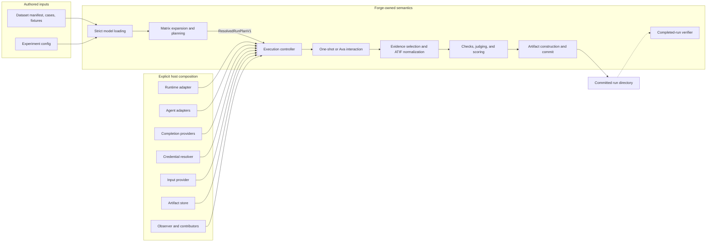
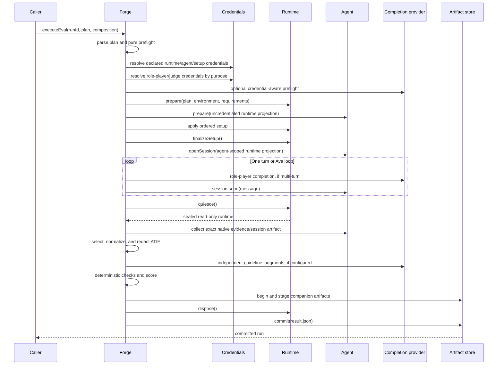

# Forge architecture

This document describes the implemented architecture of Forge v0.1. It is a
conceptual companion to the user-facing [README](../README.md): the README
explains how to author and run an evaluation, while this document explains the
boundaries, control flow, trust model, and extension points that make a run
reproducible.

For a file-by-file tour and concrete call graphs, see the
[Forge codebase guide](codebase-guide.md).

Forge is a portable execution harness for coding-agent evaluations. Given a
verified dataset, an experiment configuration, and one matrix selection, it:

1. resolves a complete, immutable run plan;
2. validates that the host can execute the plan without exercising authority;
3. prepares an isolated runtime and applies ordered setup;
4. drives a one-shot or Ava-mediated coding-agent session;
5. stops mutation and selects exact run-owned evidence;
6. evaluates deterministic checks and model-judged guidelines; and
7. commits a self-describing local result through one atomic boundary.

The central architectural rule is that Forge owns every score-affecting
decision and its ordering. Host integrations provide mechanisms through narrow
contracts, but they do not own benchmark semantics or lifecycle control.

## Architectural goals

Forge is designed around five properties.

**Reproducible semantics.** Cases say what is evaluated; experiments say how
cases run; resolved plans materialize all defaults and provenance for one run.
Runtime code does not infer omitted settings from ambient state.

**Portable mechanisms.** Runtime, coding-agent, credential, completion,
storage, input, and observation behavior enters through public contracts in
[`src/contracts`](https://github.com/stripe/forge/tree/main/src/contracts). The core does not discover private
implementations or branch on a host environment.

**Authority after validation.** Parsing, planning, setup preflight, agent
requirements, completion-provider requirements, and runtime preflight are pure.
Credential lookup, provider calls, runtime allocation, commands, and workspace
mutation happen only after the complete selection has passed that boundary.

**Evidence before scoring.** Mutable workspace or session state is never used
as grading evidence. Forge first quiesces the runtime, then exposes read-only
capabilities, selects the exact root session, normalizes it to ATIF, redacts
credentials, and derives evaluation inputs from that sealed state.

**Atomic, verifiable results.** Companion artifacts are staged with hashes and
sizes, runtime cleanup runs, and `result.json` plus the run directory become
visible at one rename boundary. A verifier re-reads all claimed bytes and
checks cross-artifact invariants before downstream publication.

## System overview



There are two kinds of dependency injection, kept intentionally separate:

- `ForgeEngine` fixes **semantics**: parsers, planning behavior, and the
  immutable registry of setup action implementations.
- `ForgeComposition` supplies **authority and mechanisms** for one execution:
  runtime, agents, completion providers, credentials, inputs, storage, and
  optional observation or supplemental artifacts.

This separation prevents a plan from being parsed with one setup action
implementation and executed with another, while also preventing executable
host capabilities from leaking into the benchmark document.

## The benchmark data model

Forge keeps four related objects distinct.

| Object | Responsibility | Important contents |
| --- | --- | --- |
| Dataset | Versioned evaluation payload | Manifest, cases, fixture files, exact sizes and SHA-256 hashes |
| Eval case | What is evaluated | Task or prompt, context, invariant setup, interaction mode, turn limit, checks, guidelines, example answer |
| Experiment config | How cases run | Dataset pin, treatments, agent/model matrix, runtime, harness models, resources, repetitions, retry policy, timeout |
| Resolved run plan | Complete input to one run | One case/treatment/agent/repetition, merged setup, materialized defaults, runtime and model selections, provenance |

The wire types live in [`src/model/types.ts`](https://github.com/stripe/forge/blob/main/src/model/types.ts); strict
parsing lives in [`src/model/parse.ts`](https://github.com/stripe/forge/blob/main/src/model/parse.ts).

### Dataset loading and integrity

[`loadDataset`](https://github.com/stripe/forge/blob/main/src/model/loaders.ts) treats the manifest as an exact
inventory, not a best-effort index:

- `manifest.json` identifies the dataset and every case and payload file;
- every payload must be a regular file with the declared size and hash;
- missing, extra, modified, symbolic-link, or special-file entries fail;
- paths must be canonical, dataset-relative POSIX paths;
- entry count, depth, individual document size, and total bytes are bounded;
- each case ID must agree with its manifest entry.

The experiment pins the dataset ID, version, and digest of the raw manifest
bytes. Planning refuses to combine a loaded dataset with a different pin.
`RunInputProvider` later gives setup and agent adapters read-only, path-safe
access to the same dataset payloads without exposing an arbitrary host
filesystem.

### Cases, treatments, and setup ordering

A case owns invariant setup because it is part of the task definition. A
treatment is one experimental arm and owns only its additional setup. When a
selection is resolved, Forge creates one ordered list:

```text
resolved setup = case setup + selected treatment setup
```

That order is score-affecting and cannot be changed by an adapter. A baseline
treatment may have an empty setup list; it is still an explicit matrix choice.

### Matrix expansion and selection

[`expandExperiment`](https://github.com/stripe/forge/blob/main/src/planning/planner.ts) expands in stable authored
order:

```text
case → treatment → agent → repetition
```

The experiment-level `retries` value is campaign policy and does not create a
new semantic selection. `executeEval` executes one resolved plan once; a
campaign runner is responsible for retrying that selection.

A `RunSelection` chooses exactly one case, treatment, agent/provider/model
triple, and zero-based repetition. The CLI requires filters to resolve to one
entry before `plan` or `run` proceeds.

### Plan resolution

[`resolveRunPlan`](https://github.com/stripe/forge/blob/main/src/planning/planner.ts) validates all references and
produces a deeply frozen `ResolvedRunPlanV1`. It:

- checks dataset and experiment compatibility;
- checks that the selection is present in the matrix;
- requires `models.role_player` for a multi-turn case;
- requires `models.judge` when success guidelines are non-empty;
- concatenates case and treatment setup;
- validates referenced dataset inputs and action-bundle pins;
- chooses the effective prompt and records its source;
- materializes the turn limit and other defaults;
- materializes an authored Docker `native` platform from an explicit
  host-supplied platform selection; and
- records exact dataset, experiment, case, installed Forge package, and
  action-bundle provenance.

Plans use canonical JSON with recursively sorted object keys and retained array
order. Their digest binds the semantics later summarized by `result.json`.

## Engines, action registries, and compositions

### `ForgeEngine`: immutable semantics

[`createForgeEngine`](https://github.com/stripe/forge/blob/main/src/engine.ts) constructs one immutable setup action
registry and closes over it for every operation:

- parse cases, experiment configs, setup steps, and resolved plans;
- load datasets and experiment configs;
- resolve run plans;
- preflight and execute runs; and
- verify completed runs.

The exported `defaultForgeEngine` contains built-in actions only. An embedding
host may import trusted action bundles and construct a different engine, but
YAML never names code to import. Bundle namespace, version, and implementation
digest must match at parsing, planning, execution, result, and verification
boundaries. See [setup action bundles](setup-action-bundles.md).

### `ForgeComposition`: explicit mechanisms and authority

[`ForgeComposition`](https://github.com/stripe/forge/blob/main/src/contracts/composition.ts) is supplied per host and
contains:

| Capability | Role | Authority |
| --- | --- | --- |
| `RuntimeAdapter` | Allocate, isolate, quiesce, and dispose the execution environment | Runtime mechanics and command execution |
| `AgentAdapter` map | Drive the selected coding agent and collect its exact session evidence | Agent-scoped runtime commands |
| `CompletionProvider` map/resolver | Host-side Ava and judge model calls | Declared completion credentials only; no workspace or commands |
| `CredentialResolver` | Resolve opaque references | Secret lookup only for explicitly requested references |
| `RunInputProvider` | Read dataset payloads | Read-only access below one dataset root |
| `RunArtifactStore` | Stage and atomically commit results | One run namespace in the result store |
| `RunObserver` | Receive lifecycle events | No control; failures are ignored |
| `RunArtifactContributor` list | Add supplemental files | Only below `extensions/<contributor-id>/` |

The composition does not define setup semantics. Conversely, the engine's
setup registry does not provide runtime authority.

## Execution lifecycle

[`executeEval`](https://github.com/stripe/forge/blob/main/src/execution/execute.ts) is the public automated
controller. It owns the following phase order.



### 1. Parse and pure preflight

Forge reparses the supplied resolved plan against the engine's action registry,
checks that its recorded Forge package version matches the installed package,
and reserializes it canonically. The authored experiment does not pin a Forge
version; a newer package can resolve a fresh plan for an older dataset. Forge
then:

- selects the agent adapter by exact ID;
- obtains and validates the agent's pure evidence identity;
- preflights every setup action and binds its later `apply` operation;
- merges agent and setup executable, state-directory, variable, and credential
  requirements;
- resolves completion providers for the explicit `role_player` and `judge`
  purposes and validates their pure requirements; and
- asks the selected runtime to synchronously validate the plan and combined
  requirements.

No credentials are resolved, providers called, runtime allocated, commands
run, or workspaces inspected during this phase. Ordinary `forge validate` uses
this same boundary for every matrix selection; a `native` Docker experiment is
preflighted as both supported concrete platforms without host discovery. The
explicit `forge validate --host` readiness check additionally queries the
Docker server, builds the selected image, and executes a network-disabled
disposable probe from its immutable image ID, but does not alter preflight or
execute an evaluation.

### 2. Resolve credentials and completion transports

Runtime credentials begin as opaque references. Forge assigns their scopes
from the declaration source rather than trusting an adapter-supplied scope:

- a setup action may request a setup-scoped credential;
- an agent requirement receives agent scope;
- a setup action may separately declare a credential the later agent needs.

The resolver is called only for the selected plan's declared bindings. Plain
variables remain structurally separate from resolved secrets, and the ambient
host environment is never copied wholesale.

Completion-provider credentials use a separate path. They are resolved per
purpose (`role_player` or `judge`), remain host-side, and are passed only to the
selected provider. An optional provider `preflight` runs here, after resolution
but before runtime allocation.

All resolved secret values become inputs to the output-safety boundary. Forge
redacts them from host-completion prompts and responses, normalized evidence,
interaction audit, and judge workspace evidence; setup receipts, ordinary core
artifacts, contributed artifacts, and result metadata must pass secret scans.
Native source artifacts are the deliberate restricted exception.

### 3. Prepare runtime and agent

The runtime receives the resolved environment and the combined executable and
state-directory requirements. It returns a `PreparedRuntime` with:

- mutable workspace and declared state directories;
- logical runtime paths;
- uncredentialed, setup-scoped, and agent-scoped command projections;
- `finalizeSetup`, `quiesce`, and idempotent `dispose` lifecycle methods.

The agent's `prepare` method gets a narrower projection: mutable state and an
uncredentialed command runner only. Built-in agents use it to verify the pinned
CLI version without receiving model credentials.

### 4. Apply and finalize setup

Setup actions execute strictly in plan order. Each prepared action receives:

- the mutable workspace and dataset input provider;
- only the state directories it declared;
- an uncredentialed runner, or exactly its declared setup credentials; and
- the already-fixed agent and runtime selections.

An action may return bounded, non-sensitive JSON for `setup.json`, such as a
plugin installation receipt. Static built-ins return no dynamic resolution.
After every action succeeds, Forge calls `finalizeSetup()`. This closes setup
command authority and asks the runtime to seal any state directory declared
immutable for interaction.

### 5. Run the interaction

Forge opens one persistent `AgentSession`. Every completed turn must report a
safe, stable session ID; changing identity between turns is a contract
violation. Agent text, tool calls, tool inputs, optional cost, and session
identity are snapshotted at the boundary so later adapter mutation cannot
change the driver ledger.

One-shot and multi-turn interaction are described separately below.

### 6. Quiesce before evidence

After interaction, Forge calls `quiesce()`. The runtime must stop new mutation,
wait for active commands, stop the execution environment, and return a
`SealedRuntime` containing read-only workspace and state-directory interfaces.

Neither native evidence collection nor evaluation receives the prepared
runtime. This type and lifecycle boundary makes “score mutable state” an
adapter contract violation rather than an optional convention.

### 7. Select and normalize evidence

When at least one agent turn completed, the selected adapter reads only the
exact root session identified by the driver. Forge validates session identity
and completed-turn coverage, chooses native or fallback evidence, normalizes it
to the pinned ATIF version, and redacts all resolved secrets. A zero-turn
role-player failure instead gets explicit system-only fallback evidence. The
full process is detailed in [Evidence architecture](#evidence-architecture).

### 8. Evaluate

Deterministic file checks read the sealed workspace. If guidelines exist, Forge
builds a positive, versioned projection of the redacted ATIF trajectory,
collects bounded workspace text, invokes the judge provider, and records the
exact evidence made available to it.

### 9. Stage, dispose, and commit

Forge constructs canonical companion artifacts and their descriptors, asks
optional contributors for namespaced supplemental artifacts, and stages all
bytes in an artifact transaction. It then disposes the runtime. A cleanup
failure at this late point becomes a warning in the final result rather than
hiding otherwise completed evidence.

Finally, the store writes `result.json`, syncs staged files, and renames the
staging directory into `runs/<run-id>`. Before that rename there is no completed
run. Any earlier failure rolls back staging and best-effort disposes the
runtime.

## Runtime architecture

The core runtime contract in [`src/contracts/runtime.ts`](https://github.com/stripe/forge/blob/main/src/contracts/runtime.ts)
is implementation-neutral. It models capabilities by lifecycle state:

```text
RuntimeAdapter
    prepare()
       │
       ▼
PreparedRuntime ── finalizeSetup() ── interaction continues
       │
       ├── dispose() on any path
       │
       └── quiesce()
              │
              ▼
         SealedRuntime
         (read-only evidence capabilities)
```

External runtimes are represented in the plan by a namespaced adapter ID,
adapter version, config version, platform, and bounded public JSON config. The
composition's adapter must match those pins and implement pure synchronous
preflight. Private paths, credentials, or inferred host settings do not belong
in runtime config.

### Built-in Docker runtime

[`src/runtime/docker`](https://github.com/stripe/forge/tree/main/src/runtime/docker) implements `forge/docker@1` using
the Docker CLI and a Forge-owned image. It:

- verifies packaged Docker assets against a compiled digest;
- builds one cached image per selected platform and records the immutable image
  ID;
- pins the installed Claude Code and Codex CLI versions;
- creates fresh host-backed workspace, home, state, and environment-file
  directories for every run;
- runs as a non-root user with a read-only root filesystem, all capabilities
  dropped, `no-new-privileges`, explicit CPU/memory/process limits, and a
  bounded temporary filesystem;
- bind-mounts only run-owned workspace, home, and declared state directories;
- passes commands as argv vectors through `docker exec`, never an implicit
  shell;
- writes a short-lived mode-`0600` env file containing only the variables
  allowed for that command projection;
- waits for active commands before setup finalization and quiescence; and
- removes the container and all run-owned temporary files during disposal.

If a state directory requests `sealAfterSetup`, Docker replaces the setup
container and remounts that directory read-only before interaction. Otherwise
the same container remains active until quiescence.

The built-in coding-agent CLIs run with their own approval/sandbox mechanisms
disabled because the Docker runtime is the isolation boundary. A custom runtime
must provide equivalent isolation appropriate to its environment.

## Setup architecture

Setup has two stages implemented by [`src/setup`](https://github.com/stripe/forge/tree/main/src/setup):

1. `preflight()` validates an action, declares requirements, and binds the
   exact later operation without authority.
2. `apply()` receives least-privileged runtime capabilities after preparation.

The executor normalizes and merges requirements, rejects conflicts in
executables, paths, variables, credential bindings, and state-directory
semantics, and freezes the prepared steps. It never looks up a different
handler during application.

The v0.1 built-ins are:

- `forge/write`: copy inline bytes or a manifest-listed dataset file to a
  safe workspace-relative path;
- `forge/command`: execute an explicit argv vector from a safe
  workspace-relative directory, without credentials; and
- `forge/plugin`: delegate native plugin installation to the selected agent
  adapter, currently Claude Code, and retain a verified installation receipt.

Action IDs are namespaced but have no individual version suffix. Breaking
changes to their payload or behavior require updating affected benchmark
inputs. Built-ins own the reserved `forge` and `stripe` namespaces. Trusted
extension bundles own exactly one other namespace, cannot replace built-ins,
and must produce canonical `with` payloads that are fixed points under their
parser. Bundle manifests still pin the host implementation by version and digest.

`forge/plugin` intentionally resolves the current marketplace entry at
execution time. Its `setup.json` receipt records the marketplace commit,
installed version and source, and installed-tree digest, but the plan does not
pin those bytes and plugin state remains writable during interaction. This is a
documented mutable-treatment semantic, not general plan reproducibility; see
[Marketplace plugin treatments](plugin-action.md).

## Interaction architecture

### Coding-agent adapters

An [`AgentAdapter`](https://github.com/stripe/forge/blob/main/src/contracts/agent.ts) owns four mechanisms:

1. pure runtime requirements and evidence identity;
2. pre-session initialization;
3. persistent coding-agent session execution; and
4. exact-session native evidence collection.

It does not choose the case prompt, setup order, turn policy, evidence
fallback, judge projection, score, or artifact layout.

Forge ships two adapters:

- **Claude Code** verifies the pinned CLI, starts with an explicit session ID,
  resumes that exact ID on later turns, parses `stream-json`, stores project
  logs in declared run-owned state, and supports native marketplace plugin
  installation.
- **Codex** verifies the pinned CLI, creates an isolated `CODEX_HOME`, explicitly
  selects its Responses-compatible provider and credential, ignores user
  config, uses `codex exec --json`, resumes the exact session ID, and reads the
  matching rollout file from run-owned state.

Both adapters support explicit logical layouts for external runtimes and reject
runtime paths that do not match the pinned adapter layout.

### One-shot mode

One-shot mode sends `plan.interaction.effective_prompt` exactly once to the
persistent session. The single completed turn is recorded with stop reason
`task_complete`. It needs no host completion provider unless guidelines later
require a judge.

### Ava multi-turn mode

[`AvaRolePlayer`](https://github.com/stripe/forge/blob/main/src/interaction/ava.ts) is an engine-owned state machine,
not an adapter or completion-provider feature. The provider supplies only
structured completions.

Ava privately derives up to six high-level needs from the case task and
context, focuses on one remaining need at a time, and emits short natural user
messages. Its private need model is never sent to the coding agent. A configured
initial prompt is sent verbatim before Ava initializes; otherwise Ava generates
the opening turn.

[`runConversation`](https://github.com/stripe/forge/blob/main/src/interaction/conversation.ts) alternates Ava decisions
and sends through one agent session. Ava assesses every completed response,
including the final allowed turn. The loop stops with:

- `task_complete` when no needs remain;
- `max_turns` after the final response has been assessed; or
- `role_player_error` after structured-output/request retry exhaustion.

Each Ava decision has at most three attempts with fixed one- and five-second
retry waits. Exhaustion is a recordable interaction outcome, not a fatal run
error. If it happens before the first agent turn, Forge emits a system-only
fallback trajectory and records a null agent session identity.

`interaction.json` is a post-run audit of public turns plus Ava's need and
decision history. It is never an execution input and is never supplied to the
guideline judge.

### Host-side completion providers

[`CompletionProvider`](https://github.com/stripe/forge/blob/main/src/contracts/completion.ts) is deliberately less
powerful than an agent adapter. It receives a provider-neutral prompt, explicit
model and purpose, strict response schema, resolved provider-owned credentials,
and an abort signal. It receives no workspace, command runner, agent session,
or Ava state.

The completion runtime:

- selects providers during pure preflight;
- resolves credentials independently for each purpose;
- runs optional credential-aware provider preflight before runtime allocation;
- redacts prompts before dispatch and responses before parsing;
- validates response size, usage, cost, and stop metadata; and
- retains only safe call summaries in `result.json`.

The built-in Anthropic provider uses Node's native `fetch` and the Messages API
with strict structured output. Compatible endpoints are explicit adapter
configuration; neither endpoints nor credentials enter plans or results.

## Evidence architecture

Agent-session evidence has three distinct records:

| Record | Purpose | Score-bearing? | Sensitivity |
| --- | --- | --- | --- |
| Driver turn ledger | Proves the user message and completed agent invocation for each turn | Used to validate coverage | Redacted in persisted audit |
| Canonical `trajectory.json` | Portable normalized ATIF evidence used to derive judging inputs | Yes | Credential-redacted |
| `native/<adapter>/session.*` | Exact selected root-session bytes for audit/debugging | No | Restricted and unredacted |

### Exact-session selection

After quiescence, Forge asks the adapter for evidence using the session ID
observed during interaction. Adapters must read that exact source; selecting the
newest session by directory scan is forbidden. Native artifact metadata must
match the selected session and, when normalized native evidence is available,
its source format.

[`selectAgentEvidence`](https://github.com/stripe/forge/blob/main/src/evidence/selection.ts) parses the adapter's ATIF
candidate and proves that it covers every completed driver turn. Coverage
requires ordered user messages and an agent step with visible response
evidence. Codex receives additional reconciliation between live tool categories
and native rollout activity.

If the adapter reports that native evidence is unavailable, invalid, or
incomplete, or if a structurally valid candidate fails completed-turn coverage,
Forge constructs bounded ATIF from the driver turns and marks completeness as
`fallback`. It records why fidelity was lost; fallback is never silent. A
malformed candidate labeled `available` is an adapter contract violation and
aborts the evidence phase. Optional native detail loss may instead produce
`partial` evidence with warnings.

### ATIF normalization

Forge pins ATIF v1.8 and a separate normalization version. The ATIF parser
rejects cyclic, exotic, sparse, non-finite, overly deep, or oversized JSON
graphs before recursive schema validation. The canonical trajectory may retain
agent messages, reasoning, tool calls/results, metrics, copied context, system
context, media references, and embedded subagent data when supplied by the
adapter and permitted by ATIF.

Before persistence or scoring, Forge redacts every resolved run and completion
secret from the normalized trajectory. Provenance in `result.json` records:

- source kind and native format;
- exact session ID when applicable;
- adapter ID and version;
- normalization completeness and warnings; and
- replacement count.

### Judge-visible projection

The judge does not receive the full trajectory. Forge derives a deterministic,
positive allowlist from the redacted root trajectory:

- include user and visible agent steps in original order;
- include step identity, source, messages, tool-call IDs/names/arguments, and
  tool-result content/error state;
- exclude system and copied-context steps;
- exclude reasoning, timestamps, metrics, model/provider metadata, arbitrary
  extras, and subagent references/trajectories; and
- omit agent steps without nonempty message/media or retained tool behavior.

Opaque tool arguments and results remain because they are observable behavior,
even when a nested key is named `reasoning_content`. Image and audio references
remain, but their bytes are not loaded into the text-only judge request.

The projection policy is versioned in
[`src/evaluation/judgeTranscript.ts`](https://github.com/stripe/forge/blob/main/src/evaluation/judgeTranscript.ts).
`judge-evidence.json` stores both that policy and the exact projected steps. The
verifier recreates the projection from `trajectory.json` and requires bytewise
canonical equivalence.

## Evaluation and scoring

Evaluation consumes only sealed, redacted evidence.

### Deterministic checks

[`src/evaluation/checks.ts`](https://github.com/stripe/forge/blob/main/src/evaluation/checks.ts) supports file-created,
file-exists/absent, and bounded content-regex checks. It reads only requested
workspace paths, does not follow symbolic links, records hashes and exact bytes
in `workspace-evidence.json`, and executes regular expressions in a bounded VM
context. This artifact is emitted only when at least one deterministic file
check exists; it is not a workspace snapshot.

### Guideline judging

Each success guideline is judged independently against:

- the versioned judge-visible transcript projection;
- bounded, eligible text collected from the sealed workspace; and
- the optional authored example answer.

Workspace collection skips symlinks, agent state, dependencies, build output,
lockfiles, and common binary formats, and applies entry, depth, time, byte,
per-file, and total-character limits. Truncation and unavailable evidence are
recorded explicitly.

At most four guidelines run concurrently. Each gets three attempts with fixed
one- and five-second retry waits and strict JSON output. Repeated malformed
output fails only that guideline closed. A final provider transport failure is
fatal: cleanup runs and no result is committed. Before dispatch, Forge verifies
that its final defensive redaction pass would not change the already-audited
judge evidence.

### Score and status

The numeric score is the fraction of success guidelines that pass. File checks
are independent pass constraints and do not change that ratio.

| Situation | Status | Score |
| --- | --- | --- |
| No guidelines; all checks pass | `passed` | `0` |
| No guidelines; a check fails | `failed` | `0` |
| All guidelines and checks pass | `passed` | `1` |
| Some guideline passes, or checks pass while guidelines do not all pass | `partial` | Guideline pass ratio |
| No guideline passes and checks do not establish partial success | `failed` | `0` |

Interaction stop reason and evaluation status are separate. For example, a
`max_turns` run can still pass its evidence-based evaluation.

## Result and artifact architecture

A completed run always contains:

```text
runs/<run-id>/
├── result.json
├── plan.json
├── setup.json
├── trajectory.json
└── interaction.json
```

Conditional and supplemental files are:

```text
workspace-evidence.json             # deterministic file checks exist
judge-evidence.json                 # one or more guidelines were judged
native/<adapter-id>/session.<ext>    # exact restricted root-session source
extensions/<contributor-id>/...     # optional host contribution
```

`result.json.evaluation` is the sole canonical evaluation result. The other
core files serve distinct audit roles:

- `plan.json`: exact canonical execution input;
- `setup.json`: ordered action audit and bounded runtime resolutions;
- `trajectory.json`: full selected, normalized, redacted ATIF trajectory;
- `interaction.json`: driver turns, stop reason, and Ava audit;
- `workspace-evidence.json`: exact requested bytes used by deterministic
  checks; and
- `judge-evidence.json`: exact reduced transcript and workspace evidence made
  available to guideline judges.

`result.json` summarizes run identity, selection, plan digest, Forge and bundle
versions, runtime and agent provenance, completion calls, interaction, evidence,
evaluation, timing, stop reason, warnings, and descriptors for every companion
file. It is the commit marker and therefore is not listed in its own artifact
array.

### Transactional local store

[`createArtifactStore`](https://github.com/stripe/forge/blob/main/src/results/localStore.ts) implements a two-phase
local transaction:

1. create a private `.staging/<run-id>-*` directory;
2. validate and exclusively write every companion file;
3. parse the final result and require descriptor equality with all staged
   files;
4. write and sync `result.json`;
5. sync the staging directory; and
6. rename it to `runs/<run-id>` and sync the parent directories.

Duplicate run IDs, paths, missing descriptors, descriptor mismatches, unsafe
paths, and collisions fail the transaction. Restricted native artifacts are
mode `0600`; ordinary artifacts are mode `0644`.

### Completed-run verification

[`verifyCompletedRun`](https://github.com/stripe/forge/blob/main/src/results/localStore.ts) does more than verify
hashes. It also requires:

- the directory name to match `run_id`;
- every declared artifact's size and SHA-256 to match;
- no undeclared files, symlinks, or special files;
- the plan bytes and digest to match the result;
- `setup.json` to match ordered plan actions and valid plugin receipts;
- `interaction.json` to match result summaries;
- trajectory session identity and completed-turn coverage to match the
  interaction;
- zero-turn role-player failures to use the system-only fallback shape;
- conditional canonical artifacts to exist exactly when required; and
- judge evidence to match the projection of the stored trajectory.

Publication is deliberately outside `executeEval`. A caller should verify the
committed local run before passing it to a host-owned publisher.

## Security and trust boundaries

Forge does not claim that every extension is untrusted. Instead, it makes trust
and authority explicit.

| Boundary | What is trusted | What Forge still enforces |
| --- | --- | --- |
| Authored YAML/JSON and dataset bytes | Untrusted data | Strict schemas, bounded input, canonical paths, exact inventory and hashes |
| Setup action bundle code | Trusted host code | Explicit import, pinned identity, namespace isolation, pure preflight, constrained apply capabilities |
| Runtime adapter | Trusted mechanism | Exact plan identity/version match, pure preflight, lifecycle-shaped capability projections |
| Agent adapter | Trusted integration, untrusted output | Exact selection match, bounded turns, stable session ID, native-evidence parsing and coverage |
| Completion provider | Trusted transport, untrusted response | Purpose-specific credentials, bounded requests/responses, strict output parsing and retries |
| Workspace and native logs | Untrusted evidence | Read only after quiescence, path and byte limits, no symlink traversal; normalized outputs are redacted while exact native bytes are restricted |
| Observer | Non-authoritative | Receives only lifecycle metadata; rejection cannot affect the run |
| Artifact contributor | Trusted extension | Namespaced paths, collision checks, secret scan, store validation |

Other important safeguards include:

- credentials are opaque references in authored data, plans, events, and
  results;
- command contracts are argv arrays, so shell parsing is opt-in and visible;
- provider/setup error details and setup-command output are not persisted as
  ordinary metadata;
- judge inputs are derived by allowlist after credential redaction;
- native source is explicitly marked restricted, excluded from judging and
  scoring, and selected by exact session identity rather than “newest session”;
  and
- serializers reject non-JSON values instead of silently projecting them.

## Failure, cancellation, and cleanup semantics

Every run combines the caller's abort signal with the plan timeout. Fatal
errors are mapped to stable `ForgeExecutionError` codes and the phase in which
they occurred. On any failure Forge:

1. rolls back an open artifact transaction;
2. disposes a prepared runtime if it has not already been disposed; and
3. surfaces an abort-specific error when the combined signal fired.

Cleanup does not rely on an already-aborted execution signal. Runtime disposal
is idempotent, and the Docker implementation waits for an in-progress quiesce
barrier before removing resources.

Two retry systems are internal score semantics, separate from experiment
campaign retries:

- Ava exhaustion commits `role_player_error` as a completed run; and
- malformed judge output fails a guideline closed, while exhausted judge
  transport failure aborts the run with no commit.

Observer failures never change execution. A runtime disposal failure after
artifact staging becomes a result warning so the completed evidence can still
be committed; failures before that point remain fatal.

## Public entry points and default CLI composition

The `@stripe/forge` ESM package root exports the engine, contracts, model,
planning, execution, evaluation, setup, and result APIs through
[`src/index.ts`](https://github.com/stripe/forge/blob/main/src/index.ts).
Specialized subpaths expose:

- `@stripe/forge/agents/claude-code`;
- `@stripe/forge/agents/codex`;
- `@stripe/forge/providers/anthropic`;
- `@stripe/forge/runtime/docker`;
- `@stripe/forge/atif` and `@stripe/forge/atif/v1.8`;
- `@stripe/forge/setup`;
- `@stripe/forge/testing`;
- `@stripe/forge/cli`; and
- `@stripe/forge/package.json`.

The public CLI in [`src/cli.ts`](https://github.com/stripe/forge/blob/main/src/cli.ts) is a thin host around the same
engine APIs:

- `validate` loads inputs, expands every selection, resolves plans, constructs
  the default composition, and runs pure preflight;
- `plan` selects one entry and prints canonical plan JSON; and
- `run` selects one entry, constructs a composition, and calls `executeEval`.

Its default composition registers the built-in Docker runtime, Claude Code and
Codex agent adapters, the Anthropic host completion provider, an explicit
environment-backed credential resolver, a directory input provider, and the
local artifact store. Embedding hosts can replace this composition or use an
external runtime without changing core lifecycle semantics.

## Repository map

| Path | Responsibility |
| --- | --- |
| [`src/model`](https://github.com/stripe/forge/tree/main/src/model) | Versioned wire types, strict parsing, hashes, path policy, and safe loaders |
| [`src/planning`](https://github.com/stripe/forge/tree/main/src/planning) | Matrix expansion, case-file selection, resolved plans, and plan digests |
| [`src/contracts`](https://github.com/stripe/forge/tree/main/src/contracts) | Public capability interfaces and authority boundaries |
| [`src/setup`](https://github.com/stripe/forge/tree/main/src/setup) | Built-in actions, immutable registries, requirement aggregation, and ordered execution |
| [`src/execution`](https://github.com/stripe/forge/tree/main/src/execution) | Lifecycle controller, completion runtime, phase events, and stable errors |
| [`src/interaction`](https://github.com/stripe/forge/tree/main/src/interaction) | Engine-owned Ava prompts/state machine and persistent conversation loop |
| [`src/agents`](https://github.com/stripe/forge/tree/main/src/agents) | Claude Code and Codex execution/evidence adapters |
| [`src/providers`](https://github.com/stripe/forge/tree/main/src/providers) | Host-side completion transports |
| [`src/runtime`](https://github.com/stripe/forge/tree/main/src/runtime) | Workspace/command mechanics and built-in Docker runtime |
| [`src/evidence`](https://github.com/stripe/forge/tree/main/src/evidence) | Native evidence validation, coverage, and driver fallback |
| [`src/atif`](https://github.com/stripe/forge/tree/main/src/atif) | Pinned ATIF v1.8 schema, parser, serializer, and normalization envelope |
| [`src/evaluation`](https://github.com/stripe/forge/tree/main/src/evaluation) | Workspace checks, judge projection/evidence, guideline judging, and scoring |
| [`src/results`](https://github.com/stripe/forge/tree/main/src/results) | Result schemas, two-phase local store, and cross-artifact verification |
| [`src/security`](https://github.com/stripe/forge/tree/main/src/security) | Credential redaction and secret scanning |
| [`src/testing`](https://github.com/stripe/forge/tree/main/src/testing) | Public fakes, memory adapters, fixtures, and conformance helpers |
| [`test`](https://github.com/stripe/forge/tree/main/test) | Package-level and end-to-end orchestration tests |
| [`examples`](https://github.com/stripe/forge/tree/main/examples) | Runnable datasets and experiments |

## What Forge intentionally does not own

The current architecture leaves several responsibilities outside the public
engine:

- campaign scheduling, concurrency, and experiment-level retries;
- remote result publication and access control;
- interactive or human-driven execution;
- dynamic setup plugin discovery or imports named by YAML;
- private infrastructure, service discovery, or implicit credential lookup;
- automatic pinning of rolling marketplace plugins or remote MCP services; and
- scoring of subagent traces that were not surfaced into root trajectory or
  selected workspace evidence.

These exclusions keep a single run's semantics portable and auditable. A host
may build orchestration around Forge, but it should treat the resolved plan,
engine-owned lifecycle, sealed evidence boundary, and committed result format
as the stable core.

## Invariants to preserve when changing Forge

Changes that cross module boundaries should preserve these properties:

1. Cases remain independent of experiments and environments.
2. A resolved plan is complete, canonical, deeply immutable, and free of
   ambient inference.
3. All pure validation finishes before credential resolution or allocation.
4. Setup actions run in case-then-treatment order and receive least privilege.
5. One persistent, exactly identified coding-agent session backs a run.
6. Mutation stops before evidence selection or evaluation.
7. Native evidence must cover the driver ledger or explicitly fall back.
8. Judge-visible transcript data is a positive, versioned projection of the
   redacted canonical trajectory.
9. Every persisted companion file is described, path-validated, and committed
   atomically; core and native artifacts retain their explicit size bounds.
10. Cleanup, observation, and publication cannot reorder or redefine scoring
    semantics.

The tests adjacent to each module cover its local contract. Cross-module and
end-to-end tests under [`test`](https://github.com/stripe/forge/tree/main/test) exercise the complete orchestration,
artifact inventory, and public package boundaries.
