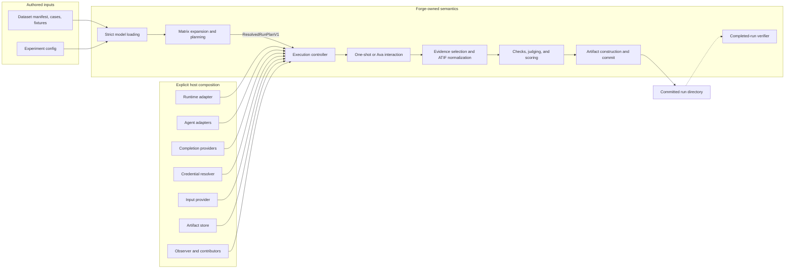
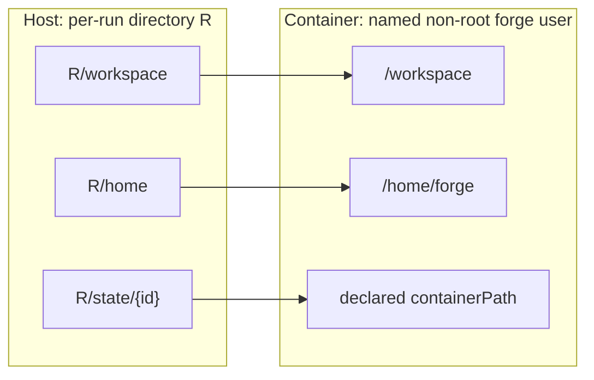

# Forge architecture

This document describes the implemented architecture of Forge. It is a
conceptual companion to the user-facing [README](../README.md): the README
explains installation, consuming published dataset releases, execution, and
results. This document explains the data model, boundaries, control flow, trust
model, and extension points behind Forge's audit records.

Forge records declared intent in `plan.json`, bounded non-sensitive setup
resolutions in `setup.json`, selected evidence, and the resulting evaluation.
Those records support audit and comparison; they do not guarantee identical
reruns or complete capture of external state. Models, network resources,
registries, and other external systems can change independently.

For a file-by-file tour and concrete call graphs, see the
[Forge codebase guide](codebase-guide.md).

Forge is a portable execution harness for coding-agent evaluations. Given a
verified dataset, an experiment configuration, and one matrix selection, it:

1. resolves a complete, immutable run plan;
2. validates that the host can execute the plan without exercising authority;
3. prepares an isolated runtime and applies ordered setup;
4. drives a one-shot or Ava-mediated coding-agent session;
5. stops mutation and selects exact run-owned evidence;
6. evaluates deterministic checks and model-judged criteria; and
7. commits a self-describing local result through one atomic boundary.

The central architectural rule is that Forge owns core interaction, evidence
selection, and scoring order. Host integrations provide mechanisms through
narrow contracts, while the engine preserves the shared lifecycle and scoring
semantics.

## Architectural goals

Forge is designed around five properties.

**Reproducible semantics.** Cases say what is evaluated; experiments say how
cases run; resolved plans materialize declared defaults and planning provenance
for one run. `setup.json` records bounded non-sensitive choices resolved while
realizing that plan. Runtime code does not infer omitted settings from ambient
state.

**Portable mechanisms.** Runtime, coding-agent, credential, completion,
storage, input, and observation behavior enters through public contracts in
[`src/contracts`](https://github.com/stripe/forge/tree/main/src/contracts). The core does not discover private
implementations or branch on a host environment.

**Authority after validation.** Parsing, planning, setup preflight, agent
requirements, completion-provider requirements, and runtime preflight are pure.
Credential lookup, provider calls, runtime allocation, commands, and workspace
mutation happen only after the complete selection has passed that boundary.

**Evidence before scoring.** Mutable workspace or session state is never used
as grading evidence. Forge first quiesces the runtime, then exposes read-only
capabilities, selects the exact root session, normalizes it to ATIF, redacts
credentials, and derives evaluation inputs from that sealed state.

**Atomic, verifiable results.** Companion artifacts are staged with hashes and
sizes, runtime cleanup runs, and `result.json` plus the run directory become
visible at one rename boundary. A verifier re-reads all claimed bytes and
checks cross-artifact invariants before downstream publication.

## System overview



There are two kinds of dependency injection, kept intentionally separate:

- `ForgeEngine` fixes **semantics**: parsers, planning behavior, and the
  immutable registry of setup action implementations.
- `ForgeComposition` supplies **authority and mechanisms** for one execution:
  runtime, agents, completion providers, credentials, inputs, storage, and
  optional observation or supplemental artifacts.

This separation prevents a plan from being parsed with one setup action
implementation and executed with another, while also preventing executable
host capabilities from leaking into the benchmark document.

## The benchmark data model

Forge keeps authored definitions, resolved inputs, and execution identities distinct.

| Object | Responsibility | Important contents |
| --- | --- | --- |
| Dataset | Versioned evaluation payload | Manifest, cases, fixture files, exact sizes and SHA-256 hashes |
| Eval case | What is evaluated | Task or prompt, context, invariant setup, interaction mode, turn limit, checks, judging criteria, example answer |
| Experiment | How cases run, defined by an experiment config | Dataset pin, treatments, agent/model matrix, runtime, harness models, resources, repetitions, retry policy, timeout |
| Experiment run | One resumable batch from an experiment | Experiment run ID, selected plans, checkpoint, attempt history, and aggregate report |
| Eval run | One execution attempt for a selected plan | Eval run ID, isolated lifecycle, committed artifacts, and evaluation outcome |
| Resolved run plan | Complete input to one eval run | One case/treatment/agent/repetition, merged setup, materialized defaults, runtime and model selections, provenance |

The wire types live in [`src/model/types.ts`](https://github.com/stripe/forge/blob/main/src/model/types.ts); strict
parsing lives in [`src/model/parse.ts`](https://github.com/stripe/forge/blob/main/src/model/parse.ts).
The installed Forge release defines their schemas; authored inputs have no
separate `schema_version` field. Dataset and experiment versions identify those
inputs independently of Forge format compatibility.

### Dataset loading and integrity

[`loadDataset`](https://github.com/stripe/forge/blob/main/src/model/loaders.ts) treats the manifest as an exact
inventory, not a best-effort index:

- `manifest.json` identifies the dataset and every case and payload file;
- every payload must be a regular file with the declared size and hash;
- missing, extra, modified, symbolic-link, or special-file entries fail;
- paths must be canonical, dataset-relative POSIX paths;
- entry count, depth, individual document size, and total bytes are bounded;
- the manifest lists case paths; IDs come from case definitions and must be
  unique within the loaded dataset release.

The experiment pins the dataset ID, version, and digest of the raw manifest
bytes. Its optional `dataset.path` locates those bytes for the CLI, relative to
the experiment file. Programmatic hosts can continue supplying a loaded dataset
directly; the location is excluded from resolved plans and execution semantics. Planning refuses to combine a loaded dataset with a different pin.
`RunInputProvider` later gives setup and agent adapters read-only, path-safe
access to dataset payloads. The directory provider accepts the verified
manifest, checks each returned buffer against its declared size and hash, and
requires directory listings to match the pinned inventory. The public CLI
supplies that manifest automatically. This closes the gap between initial
verification and later setup reads.

A release bundle can contain `experiment.yaml` beside its exact-manifest
`dataset/` tree. The experiment uses `dataset.path: ./dataset`, keeping runtime
choices outside the dataset inventory while allowing the complete bundle to be
archived and extracted without path changes. See the
[sample bundle](https://github.com/stripe/forge/blob/main/datasets/stripe-integration-public-evals/README.md)
for the layout and commands.

### Cases, treatments, and setup ordering

A case owns invariant setup because it is part of the task definition. A
treatment is one experimental arm and owns only its additional setup. When a
selection is resolved, Forge creates one ordered list:

```text
resolved setup = case setup + selected treatment setup
```

That order is score-affecting and cannot be changed by an adapter. A baseline
treatment may have an empty setup list; it is still an explicit matrix choice.

### Matrix expansion and selection

An experiment matrix declares either one flat Cartesian product or an ordered
list of groups, each with explicit case, treatment, and agent axes. Repetitions
and retry policy belong to the whole matrix. Strict parsing rejects mixed
forms, missing group axes, and duplicate selections after agent defaults.
The case axis contains canonical dataset-relative YAML file paths. Expansion
checks the loaded dataset pin and resolves manifest-listed paths to the IDs
read from their case definitions. IDs remain the selection and report identity; resolved
plan provenance records both the ID and manifest path.

A grouped matrix keeps case-specific treatment and model combinations separate:

<!-- grouped-matrix:start -->
```yaml
matrix:
  repetitions: 2
  retries: 0
  groups:
    - cases:
        - cases/examples/payment.case.yaml
      treatments:
        - baseline
        - payment-plugin
      agents:
        - adapter: claude-code
          provider: anthropic
          model: claude-sonnet-4-6
        - adapter: claude-code
          provider: anthropic
          model: claude-opus-4-6
    - cases:
        - cases/examples/marketplace/case.yaml
      treatments:
        - baseline
        - marketplace-plugin
      agents:
        - adapter: claude-code
          provider: anthropic
          model: claude-opus-4-6
```
<!-- grouped-matrix:end -->

This fragment assumes both case paths are in the manifest and all three
treatments are defined. It produces **12 selections**: eight for payment and
four for marketplace.

[`expandExperiment`](https://github.com/stripe/forge/blob/main/src/planning/planner.ts) expands each product in stable
authored order:

```text
group → case → treatment → agent → repetition
```

The flat form behaves as one group. Groups flatten into ordinary selections;
group identity does not enter plans, checkpoints, or reports. Membership checks
require the complete case/treatment/agent tuple to coexist in one group, which
prevents combinations from crossing group boundaries.

The experiment-level `retries` value is experiment run policy and does not
create a new semantic selection. `executeEval` executes one resolved plan once;
an experiment run controller is responsible for retrying that selection.

A `RunSelection` chooses exactly one case, treatment, complete agent selection,
and zero-based repetition. Codex selections include `hook_trust`; new plans
materialize its `native` default, while saved plans may omit it. The CLI requires
filters to resolve to one entry for `plan`. `run` resolves and purely preflights
every matching plan before executing them with bounded concurrency. The CLI loads the dataset from
the experiment config and permits selectors such as `--case` to restrict execution.

The shared controller exposed through `@stripe/forge/experiment` checkpoints
attempts in a strict `experiment.json` under
`results/experiments/<experiment-run-id>/`, outside the immutable eval run
directories. Every new invocation receives a distinct experiment run ID.
The checkpoint records its producing `forge` build identity and binds that ID
to its directory. Each entry records its selection, canonical plan SHA-256,
and ordered attempts with a unique eval run ID and `running`, `completed`, or
`errored` state. Errored attempts retain only a stable error code. A bounded
worker pool executes pending plans;
one coordinator serializes reservations, checkpoint mutations, and writes so
out-of-order completions cannot overwrite one another. `jobs` defaults to one
and is scheduling policy, excluded from plan identities. Checkpoint updates use
synced temporary files and atomic rename. A local lock directory is published
with a unique owner marker to prevent simultaneous writers. Recovery removes only the exited
owner's marker and an empty lock directory, so delayed cleanup cannot remove
a replacement owner's lock. Committed artifact locations are compared after
resolving filesystem aliases, including symlinked output directories.

`--resume <experiment-run-id>` requires an explicit ID and loads that
experiment run's saved selections. Bare `--resume` is rejected. The resolved
plans must retain their original checksums. Resume independently verifies prior eval run
artifacts and their plan checksum before
skipping an entry, including recovery after a commit/checkpoint interruption.
Execution errors, committed role-player failures, missing results, and invalid
artifacts receive new attempt IDs. Completed failed or partial evaluations are
kept. One errored entry does not stop other entries. Cancellation or coordinator
failure stops new scheduling and signals active callbacks; the controller waits
for every callback to finish cleanup before releasing its lock.

The controller also writes a derived `report.json` with its producing `forge`
build identity after workers
drain, while still holding the experiment run lock. It reads the last durable
checkpoint and uses the same verified latest-attempt recovery as resume,
reusing bounded inspection metadata from the invocation. The scorecard groups
repetitions by case/treatment/agent and separates execution coverage from
completed evaluation scores. Coverage uses only saved selections; combinations
absent from the matrix are outside its denominator. Aggregate scores follow the
selected distribution, and treatment comparisons require matched case and
complete agent coverage. Its checkpoint digest and generation time bind it
to that snapshot. Atomic replacement preserves the previous report if writing
fails. Reporting errors surface on normal completion; after cancellation or
coordinator failure, reporting is best effort and preserves the primary error.
Resume does not read the report, so it can regenerate a missing or corrupt
scorecard without rerunning valid completed evaluations. Report fields and
denominators are documented in the README's
[results and scores](../README.md#results-and-scores).

Embedding hosts supply resolved plans, an engine, a pure preflight composition,
and an execution callback. The callback may construct per-run host resources
and composition around execution by that same engine, honoring cancellation and
finishing cleanup before settling. The host retains input loading, command
grammar, publication, and evaluation exit policy. The shared
controller requires verified local artifacts below its selected root; it is
not a remote worker protocol. It does not alter `executeEval` or its scoring
semantics. See the README's
[experiment run workflow](../README.md#running-experiments).

The command stage exposed through `@stripe/forge/experiment/cli` composes shared
operational options with host-defined arguments, validates invocation rules,
selects experiment run IDs/roots, and restores saved selections before invoking the
host loader. The loader supplies resolved plans, pure capability descriptors,
and an execution closure. Generated inputs remain alive until workers drain;
the command stage then awaits prepared-input disposal. The loader owns partial
cleanup on rejection, and workers own scoped runtime/resource cleanup.

Bounded verified outcomes include skipped selections and separate evaluation
status from execution completion. Remote publication follows the shared stage,
with destination-specific retry state outside the execution checkpoint. A
read-only experiment run inspection API verifies latest immutable commits against
saved plan digests without regenerating inputs or altering execution state,
supporting independent publication retries. The public CLI uses this same
command stage while retaining its own grammar, input loader, rendering, and
exit policy.

### Plan resolution

[`resolveRunPlan`](https://github.com/stripe/forge/blob/main/src/planning/planner.ts) validates all references and
produces a deeply frozen `ResolvedRunPlanV1`. It:

- checks dataset and experiment compatibility;
- checks that the selection is present in the matrix;
- requires `models.role_player` for a multi-turn case;
- requires `models.judge` when judging criteria are non-empty;
- concatenates case and treatment setup;
- validates referenced dataset inputs and action-bundle pins;
- chooses the effective prompt and records its source;
- materializes the turn limit and other defaults;
- materializes an authored Docker `native` platform from an explicit
  host-supplied platform selection; and
- records the dataset manifest pin, experiment and case identities, installed
  Forge package, and action-bundle implementation pins.

Plans use canonical JSON with recursively sorted object keys and retained array
order. The `plan.json` artifact descriptor binds these bytes to `result.json`.

## Engines, action registries, and compositions

### `ForgeEngine`: immutable semantics

[`createForgeEngine`](https://github.com/stripe/forge/blob/main/src/engine.ts) constructs one immutable setup action
registry and closes over it for every operation:

- parse cases, experiment configs, setup steps, and resolved plans;
- load datasets and experiment configs;
- resolve run plans;
- preflight and execute runs; and
- verify completed runs.

The exported `defaultForgeEngine` contains built-in actions only. An embedding
host may import trusted action bundles and construct a different engine, but
YAML never names code to import. Bundle namespace, version, and implementation
digest must match at parsing, planning, execution, result, and verification
boundaries. See [setup action bundles](setup-action-bundles.md).

### `ForgeComposition`: explicit mechanisms and authority

[`ForgeComposition`](https://github.com/stripe/forge/blob/main/src/contracts/composition.ts) is supplied per host and
contains:

| Capability | Role | Authority |
| --- | --- | --- |
| `RuntimeAdapter` | Allocate, isolate, quiesce, and dispose the execution environment | Runtime mechanics and command execution |
| `AgentAdapter` map | Drive the selected coding agent and collect its exact session evidence | Agent-scoped runtime commands |
| `CompletionProvider` map/resolver | Host-side Ava and judge model calls | Declared completion credentials only; no workspace or commands |
| `CredentialResolver` | Resolve opaque references | Secret lookup only for explicitly requested references |
| `RunInputProvider` | Read dataset payloads | Read-only access below one dataset root |
| `RunArtifactStore` | Stage and atomically commit results | One run namespace in the result store |
| `RunObserver` | Receive lifecycle events | No control; failures are ignored |
| `RunArtifactContributor` list | Add supplemental files | Only below `extensions/<contributor-id>/` |

The composition does not define setup semantics. Conversely, the engine's
setup registry does not provide runtime authority.

## Execution lifecycle

[`executeEval`](https://github.com/stripe/forge/blob/main/src/execution/execute.ts) is the public automated
controller. It owns the following phase order.


### 1. Parse and pure preflight

Forge checks the supplied plan's recorded Forge package version before parsing
its contents against the engine's action registry and reserializing it
canonically. Versions must match exactly whenever either producer or reader is
outside the `X.Y.Z-dev.*` channel. Two development versions may use current
strict shapes on a best-effort basis, without a compatibility or reproducibility
guarantee. The authored experiment does not pin a Forge version; a newer package
can resolve a fresh plan for an older dataset. Forge then:

- selects the agent adapter by exact ID;
- obtains and validates the agent's pure evidence identity;
- preflights every setup action and binds its later `apply` operation;
- merges agent and setup executable, state-directory, variable, and credential
  requirements;
- resolves completion providers for the explicit `role_player` and `judge`
  purposes and validates their pure requirements; and
- asks the selected runtime to synchronously validate the plan and combined
  requirements.

No credentials are resolved, providers called, runtime allocated, commands
run, or workspaces inspected during this phase. Ordinary `forge validate` uses
this same boundary for every matrix selection; a `native` Docker experiment is
preflighted as both supported concrete platforms without host discovery. The
explicit `forge validate --host` readiness check additionally queries the
Docker server, builds the selected image, and executes a network-disabled
disposable probe from its immutable image ID, but does not alter preflight or
execute an evaluation.

### 2. Resolve credentials and completion transports

Runtime credentials begin as opaque references. Forge assigns their scopes
from the declaration source rather than trusting an adapter-supplied scope:

- a setup action may request a setup-scoped credential;
- an agent requirement receives agent scope;
- a setup action may separately declare a credential the later agent needs.

The resolver is called only for the selected plan's declared bindings. Plain
variables remain structurally separate from resolved secrets, and the ambient
host environment is never copied wholesale.

Completion-provider credentials use a separate path. They are resolved per
purpose (`role_player` or `judge`), remain host-side, and are passed only to the
selected provider. An optional provider `preflight` runs here, after resolution
but before runtime allocation.

All resolved secret values become inputs to the output-safety boundary. Forge
redacts them from host-completion prompts and responses, normalized evidence,
interaction audit, and judge workspace evidence; setup receipts, ordinary core
artifacts, contributed artifacts, and result metadata must pass secret scans.
Native source artifacts are the deliberate restricted exception.

### 3. Prepare runtime and agent

The runtime receives the resolved environment and the combined executable and
state-directory requirements. It returns a `PreparedRuntime` with:

- mutable workspace and declared state directories;
- an optional host-only bounded file import into declared state;
- logical runtime paths;
- uncredentialed, setup-scoped, and agent-scoped command projections;
- `finalizeSetup`, `quiesce`, and idempotent `dispose` lifecycle methods.

The agent's `prepare` method gets a narrower projection: mutable state and an
uncredentialed command runner only. Built-in agents use it to verify the pinned
CLI version without receiving model credentials.

### 4. Apply and finalize setup

Setup actions execute strictly in plan order. Each prepared action receives:

- the mutable workspace and dataset input provider;
- only the state directories it declared;
- an uncredentialed runner, or exactly its declared setup credentials; and
- the already-fixed agent and runtime selections.

An action may return bounded, non-sensitive JSON for `setup.json`, such as a
plugin installation receipt. A resolution records every material setup-time
choice not already fixed by the plan that could explain different realized
behavior, such as the installed plugin version and source revision. Digest
fields serve an expected-content check, artifact verification, or a documented
content-identity workflow such as comparing installed plugin snapshots.
Resolutions do not include credentials or private host paths. Static built-ins
return no dynamic resolution.
Once all actions succeed, Forge calls `finalizeSetup()` once. This closes setup
command authority and asks the runtime to seal any state directory declared
immutable for interaction.

### 5. Run the interaction

Forge opens one persistent `AgentSession`. Every completed turn must report a
safe, stable session ID; changing identity between turns is a contract
violation. Agent text, tool calls, tool inputs, optional cost, and session
identity are snapshotted at the boundary so later adapter mutation cannot
change the driver ledger.

One-shot and multi-turn interaction are described separately below.

### 6. Quiesce before evidence

After interaction, Forge calls `quiesce()`. The runtime must stop new mutation,
wait for active commands, stop the execution environment, and return a
`SealedRuntime` containing read-only workspace and state-directory interfaces.

Neither native evidence collection nor evaluation receives the prepared
runtime. This type and lifecycle boundary makes “score mutable state” an
adapter contract violation rather than an optional convention.

### 7. Select and normalize evidence

When at least one agent turn completed, the selected adapter reads only the
exact root session identified by the driver. Forge validates session identity
and completed-turn coverage, chooses native or fallback evidence, normalizes it
to the pinned ATIF version, and redacts all resolved secrets. A zero-turn
role-player failure instead gets explicit system-only fallback evidence. The
full process is detailed in [Evidence architecture](#evidence-architecture).

### 8. Evaluate

Deterministic file checks read the sealed workspace. If judging criteria exist,
Forge builds a positive projection of the redacted ATIF trajectory with an explicit policy,
collects bounded workspace text, invokes the judge provider, and records the
exact evidence made available to it.

### 9. Stage, dispose, and commit

Forge constructs canonical companion artifacts and their descriptors, asks
optional contributors for namespaced supplemental artifacts, and stages all
bytes in an artifact transaction. It then disposes the runtime. A cleanup
failure at this late point becomes a warning in the final result rather than
hiding otherwise completed evidence.

Finally, the store writes `result.json`, syncs staged files, and renames the
staging directory into `runs/<run-id>`. Before that rename there is no completed
run. Any earlier failure rolls back staging and best-effort disposes the
runtime.

## Runtime architecture

The core runtime contract in [`src/contracts/runtime.ts`](https://github.com/stripe/forge/blob/main/src/contracts/runtime.ts)
is implementation-neutral. It models capabilities by lifecycle state:

```text
RuntimeAdapter
    prepare()
       │
       ▼
PreparedRuntime ── finalizeSetup() ── interaction continues
       │
       ├── dispose() on any path
       │
       └── quiesce()
              │
              ▼
         SealedRuntime
         (read-only evidence capabilities)
```

External runtimes are represented in the plan by a namespaced adapter ID,
platform, and bounded public JSON config. The composition's adapter must match
that ID and implement pure synchronous preflight. Private paths, credentials,
or inferred host settings do not belong in runtime config.

### Built-in Docker runtime

[`src/runtime/docker`](https://github.com/stripe/forge/tree/main/src/runtime/docker) implements `forge/docker`
with the Docker CLI. Forge verifies its packaged Dockerfile and entrypoint,
builds an image with pinned Claude Code and Codex versions, and records the
built image ID. Image builds begin during runtime preparation or explicit
`validate --host`; ordinary validation, planning, and a resume that skips every
selection do not build an image. A runtime adapter shares its build per platform,
and Docker's content cache can reuse layers across invocations.

Each run uses a non-root container with a read-only image filesystem. On hosts
which expose a non-root Unix UID, Forge builds the image's named `forge` user
with that UID so host and container views of bind-mounted files have the same
owner. A root host keeps the non-root fallback UID `10001` and assigns
host-written runtime files to it. The effective UID is retained in runtime
metadata alongside the immutable image ID. Forge limits CPU, memory, processes,
and writable `/tmp`; drops Linux capabilities; blocks privilege escalation;
and does not mount the Docker socket. Commands go through `docker exec` as
argument lists, without an implicit shell.

#### Run-owned paths and mounts

For one run, `R` is the temporary host directory
`<temporaryRoot>/stripe-forge-run-<random>`. Forge uses bind mounts, not named
Docker volumes. The Docker daemon must be able to access `R`. The first three
rows are bind mounts; `/tmp` is a container-local tmpfs rather than a host
directory.

| Source | Container target | Purpose | Examples | Host access |
| --- | --- | --- | --- | --- |
| `R/workspace` | `/workspace` | The case working directory: setup populates it, the agent edits it, and checks evaluate it. | A file the case asks the agent to create; source files copied by `forge/write`; files changed by the agent. | `PreparedRuntime.workspace` is mutable until quiescence; `SealedRuntime.workspace` is read-only afterward. |
| `R/home` | `/home/forge` | An isolated writable `HOME` for the non-root agent process, without mounting the host user's real home. | Tool-owned settings and caches such as `.config/...` or `.cache/...`, except paths replaced by more-specific state mounts. | No general home filesystem capability is exposed by the runtime contract. The Docker adapter retains the backing path only to mount and clean it up. |
| `R/state/{id}` | The requirement's `containerPath` | Named state explicitly requested by an agent or setup action; each ID gets its own mount and lifecycle. | Claude `<session-id>.jsonl`; Codex `sessions/.../rollout-...jsonl`; `installed_plugins.json` and plugin caches; a host-imported tool under a sealed `/opt/...` target. | Available by ID through `PreparedRuntime.stateDirectories`; mutable until quiescence, or until setup finalization when sealed, then read-only through `SealedRuntime.stateDirectories`. Trusted host imports also target a declared state ID. |
| Memory-backed tmpfs | `/tmp` | Bounded ephemeral scratch space on an otherwise read-only container root filesystem. | Temporary files created by CLIs and subprocesses. | None. It has no path below `R` and disappears with the container. |

“Host access” describes the public runtime capability, not the Unix mode of the
backing directory. Those modes are listed below. The diagram shows only the
host-to-container bind mounts:



Forge sets these directory modes on the host:

| Host directories | Mode | Why |
| --- | --- | --- |
| `R`, `R/state` | `0700` | Other host users cannot reach the run's files. |
| `R/workspace`, `R/home`, nested home mount targets and their parents, each `R/state/{id}` | `0777` | The run-owned directories remain writable across native Linux and Docker file-sharing implementations. Their private `0700` ancestor prevents access by other host users. |

The container sees the mounted directories' modes. A sealed state mount becomes
read-only to the container even though its host directory remains `0777`.
Forge creates nested home mount targets and their parents before starting
Docker, so the daemon cannot leave root-owned directories that block agent
settings writes or host cleanup.

- **Setup:** All bind mounts are writable. A state mount goes under
  `/home/forge`, or under `/opt` when it will be sealed.
- **Agent interaction:** `finalizeSetup` closes imports, stops admission of new
  setup commands, and waits for active setup commands. If state must be sealed,
  Forge starts a new container with the same host files and makes only those
  state mounts read-only. Otherwise it keeps the setup container. Forge then
  verifies that every declared executable resolves to a regular file executable
  by the final container user. No files are copied.
- **Finish:** `quiesce` stops commands and the container before Forge reads
  evidence; `dispose` removes the container and `R`.

Trusted host code can use `PreparedRuntime.importHostFile` during setup to copy
a SHA-256-verified file into declared state. Setup actions and agents cannot
call it. This low-level capability currently verifies the copy
but does not add an import receipt to `setup.json`; that is a provenance gap for
integrations where the imported contents can affect evaluation behavior.

The built-in agents disable their own approval and sandbox mechanisms because
Docker provides the isolation boundary. A custom runtime must provide
equivalent isolation.

## Setup architecture

Setup has two stages implemented by [`src/setup`](https://github.com/stripe/forge/tree/main/src/setup):

1. `preflight()` validates an action, declares requirements, and binds the
   exact later operation without authority.
2. `apply()` receives least-privileged runtime capabilities after preparation.

The executor normalizes and merges requirements, rejects conflicts in
executables, paths, variables, credential bindings, and state-directory
semantics, and freezes the prepared steps. It never looks up a different
handler during application.

The built-ins are:

- `forge/write`: copy inline bytes or a manifest-listed dataset file to a
  safe workspace-relative path;
- `forge/command`: execute an explicit argv vector from a safe
  workspace-relative directory, without credentials; and
- `forge/plugin`: delegate native plugin installation to the selected agent
  adapter, currently Claude Code or Codex, and retain a verified installation receipt.

Action IDs are namespaced but have no individual version suffix. Breaking
changes to their payload or behavior require updating affected benchmark
inputs. Built-ins own the reserved `forge` and `stripe` namespaces. Trusted
extension bundles own exactly one other namespace, cannot replace built-ins,
and must produce canonical `with` payloads that are fixed points under their
parser. Bundle manifests still pin the host implementation by version and digest.

`forge/plugin` intentionally resolves the current marketplace entry at
execution time. Its `setup.json` receipt records the selected IDs, catalog
commit, installed version, reported source commit when available, and an
installation-time tree fingerprint. These identify the catalog snapshot and
observed installed contents; plugin state remains writable during interaction.
This is a documented mutable-treatment semantic, not general plan
reproducibility; see
[Marketplace plugin treatments](plugin-action.md). Supported Stripe plugin
selections also declare agent-scoped MCP credentials during pure preflight;
Forge configures their existing connection before fingerprinting the installation.
Other plugin selections do not request Stripe credentials.

## Interaction architecture

### Coding-agent adapters

An [`AgentAdapter`](https://github.com/stripe/forge/blob/main/src/contracts/agent.ts) owns four mechanisms:

1. pure runtime requirements and evidence identity;
2. pre-session initialization;
3. persistent coding-agent session execution; and
4. exact-session native evidence collection.

It does not choose the case prompt, setup order, turn policy, evidence
fallback, judge projection, score, or artifact layout.

Forge ships two adapters:

- **Claude Code** verifies the pinned CLI, starts with an explicit session ID,
  resumes that exact ID on later turns, parses `stream-json`, stores project
  logs in declared run-owned state, and supports native marketplace plugin
  installation.
- **Codex** verifies the pinned CLI, creates an isolated `CODEX_HOME`, explicitly
  selects its Responses-compatible provider and credential, supports native
  marketplace plugins, uses `codex exec --json`, resumes the exact session ID,
  and reads the matching rollout file from run-owned state. Before every send,
  it filters the run-owned user config to validated marketplace/plugin
  settings, project trust, and hook enablement/review state, then loads those
  settings. Plugins and sessions share the same writable home state. The
  selected hook policy applies on every turn; see
  [Marketplace plugin treatments](plugin-action.md) for its scope.

Both adapters support explicit logical layouts for external runtimes and reject
runtime paths that do not match the pinned adapter layout. Built-in adapters and
completion providers use the Forge package version as their implementation
identity; independently released integrations supply their own versions. Narrow
configuration metadata records endpoint and layout modes separately. Preflight
validates and snapshots this metadata before any credentials or resources are
resolved; results retain the snapshots rather than rereading mutable host objects.

### One-shot mode

One-shot mode sends `plan.interaction.effective_prompt` exactly once to the
persistent session. The single completed turn is recorded with stop reason
`task_complete`. It needs no host completion provider unless judging criteria
later require a judge.

### Ava multi-turn mode

[`AvaRolePlayer`](https://github.com/stripe/forge/blob/main/src/interaction/ava.ts) is an engine-owned state machine,
not an adapter or completion-provider feature. The provider supplies only
structured completions.

Ava privately derives up to six high-level needs, each at most 240 characters,
from the case task and context. It focuses on one remaining need at a time and
emits user messages of at most 500 characters. Its private need model is never
sent to the coding agent. A configured
initial prompt is sent verbatim before Ava initializes; otherwise Ava generates
the opening turn.

[`runConversation`](https://github.com/stripe/forge/blob/main/src/interaction/conversation.ts) alternates Ava decisions
and sends through one agent session. Ava assesses every completed response,
including the final allowed turn. The loop stops with:

- `task_complete` when no needs remain;
- `max_turns` after the final response has been assessed; or
- `role_player_error` after structured-output/request retry exhaustion.

Each Ava decision has at most three attempts with fixed one- and five-second
retry waits. Exhaustion is a recordable interaction outcome, not a fatal run
error. If it happens before the first agent turn, Forge emits a system-only
fallback trajectory and records a null agent session identity.

`interaction.json` is a post-run audit of public turns plus Ava's need and
decision history. It is never an execution input and is never supplied to the
criterion judge.

### Host-side completion providers

[`CompletionProvider`](https://github.com/stripe/forge/blob/main/src/contracts/completion.ts) is deliberately less
powerful than an agent adapter. It receives a provider-neutral prompt, explicit
model and purpose, strict response schema, resolved provider-owned credentials,
and an abort signal. It receives no workspace, command runner, agent session,
or Ava state.

The completion runtime:

- selects providers during pure preflight;
- resolves credentials independently for each purpose;
- runs optional credential-aware provider preflight before runtime allocation;
- redacts prompts before dispatch and responses before parsing;
- validates response size, usage, cost, and stop metadata; and
- retains only safe call summaries in `result.json`.

The built-in Anthropic provider uses Node's native `fetch` and the Messages API
with strict structured output. Compatible endpoints are explicit adapter
configuration; neither endpoints nor credentials enter plans or results.

## Evidence architecture

Agent-session evidence has three distinct records:

| Record | Purpose | Score-bearing? | Sensitivity |
| --- | --- | --- | --- |
| Driver turn ledger | Proves the user message and completed agent invocation for each turn | Used to validate coverage | Redacted in persisted audit |
| Canonical `trajectory.json` | Portable normalized ATIF evidence used to derive judging inputs | Yes | Credential-redacted |
| `native/<adapter>/session.*` | Exact selected root-session bytes for audit/debugging | No | Restricted and unredacted |

### Exact-session selection

After quiescence, Forge asks the adapter for evidence using the session ID
observed during interaction. Adapters must read that exact source; selecting the
newest session by directory scan is forbidden. Native artifact metadata must
match the selected session and, when normalized native evidence is available,
its source format.

[`selectAgentEvidence`](https://github.com/stripe/forge/blob/main/src/evidence/selection.ts) parses the adapter's ATIF
candidate and checks that it covers every completed driver turn: the same
logical turn count, the same ordered user prompts, and visible response or tool
activity for every completed invocation. Native text and tool payloads need not
be byte-identical to live output because the two protocols are lossy
projections. Codex additionally requires assistant text when the live response
had text, and at least the observed count of every comparable tool kind,
including each named MCP tool. Native-only tool discovery cannot compensate for
a missing executed tool. These are lower-bound coverage checks, not exact
one-to-one matching; they apply by native source format, including for custom
Codex adapter IDs.

If the adapter reports that native evidence is unavailable, invalid, or
incomplete, or if a structurally valid candidate fails completed-turn coverage,
Forge constructs bounded ATIF from the driver turns and marks completeness as
`fallback`. It records why fidelity was lost; fallback is never silent. A
malformed candidate labeled `available` is an adapter contract violation and
aborts the evidence phase. Optional native detail loss may instead produce
`partial` evidence with warnings.

Driver fallback preserves every ordered user prompt and a visible response
marker for every completed invocation. Assistant text, tool calls, or tool
arguments may be deterministically truncated to stay within ATIF safety bounds;
such loss adds a `value_omitted` warning. Scoring consumes this exact bounded
trajectory, and judging receives its declared root-behavior projection. If Ava
fails before any agent turn, the system-only fallback instead identifies
`role_player_error` and has no agent session ID.

When an adapter captured the exact root-session JSONL, those bytes remain a
restricted supplemental artifact even if normalization falls back. The built-in
adapters do not filter, redact, normalize, or reserialize that copy, and do not
crawl sibling sessions or subagent traces. It can contain prompts, credentials,
private reasoning, tool payloads, and file contents; it is excluded from judging
and scoring. Local storage writes it mode `0600`, and its descriptor carries
`sensitivity: restricted` for custom stores and publishers to respect.

### ATIF normalization

Forge pins `ATIF-v1.8` to Harbor v0.23.0 commit
`1e5c5c6db929a10a140d05e606882c671ae20729` and its RFC. Its package release
identifies normalization behavior. `schema_version` is required; explicit JSON
`null` is preserved where the pinned contract treats null and omission
equivalently, while conditional multimodal fields must be omitted when
inapplicable. The parser rejects cyclic, exotic, sparse, non-finite, overly deep,
or oversized JSON graphs before recursive schema validation. The canonical
trajectory may retain agent messages, reasoning, tool calls/results, metrics,
copied context, system context, media references, and embedded subagent data
when supplied by the adapter and permitted by ATIF.

Known non-conversation metadata is ignored explicitly. Unknown conversational
records, attachments without renderable or explicitly classified content,
unsupported content blocks, sidechains, and compaction make native evidence
incomplete and trigger whole-trajectory fallback. Loss of optional detail such
as an invalid timestamp instead adds a partial-evidence warning. Unsupported
record diagnostics identify a safe category and line number, never payload
values.

Claude attachment records with string-valued `rendered[].content` become ATIF
system steps in native order, retaining rendered text and valid timestamps;
`extra` identifies the native record and attachment types. They stay excluded
from criterion judging. A `hook_success` record is bookkeeping only when its
validated output has a single nonempty `additionalContext` repeated in the
immediately following rendered `hook_additional_context` record. That following
record supplies the system step; missing or mismatched pairs trigger fallback.
Empty session-context bookkeeping is ignored. Prompt snapshots stay in the
restricted native source and add a partial-detail warning until their per-call
semantics can be normalized faithfully.

Codex selects a single matching root UUID rollout under its isolated
`CODEX_HOME/sessions`, validates session metadata, and records source format
`codex-rollout-jsonl`. Actual user turns are distinguished from injected
AGENTS.md and environment context, which become system steps. Function and
custom-tool calls retain native call IDs, arguments, and correlated outputs;
tool-search calls and returned tool definitions remain correlated tool behavior.
Every MCP call requires a matching `McpToolCall` completion snapshot verified
against its call and result. A missing snapshot triggers fallback even if an
output includes `is_error`; another completion type cannot substitute. A
completed invocation does not override an MCP `isError` result.

Supported Codex MCP text and image blocks may carry opaque `annotations` and
`_meta` objects under the existing JSON graph bounds. Metadata in recorded
rendered output is preserved after credential redaction; snapshot-only metadata
is not added to judge evidence. Metadata alone does not reduce completeness.
Recognized MCP truncation retains exactly the shortened text, truncation, and
omitted-item markers recorded in native output. Forge verifies the retained
text and omission counts against the full snapshot without restoring hidden
text. A `value_omitted` warning marks that trajectory `partial`. Unknown or
mismatched truncation, including a clipped timing header that cannot be
reconstructed from the snapshot, triggers fallback.

Codex tool results may be strings or supported content-block arrays. Text stays
judge-visible. Native image bytes and URL references stay only in the restricted
source; normalized results contain an explicit omission marker and
`value_omitted` warning, retaining the text as `partial` evidence. Forge does not
fabricate image-file references, fetch image URLs, or attach those native bytes
to a text-only judge. Incomplete, compacted, ambiguous, or unsupported
conversation records still trigger whole-trajectory fallback.

Before persistence or scoring, Forge redacts every resolved run and completion
secret from the normalized trajectory. Provenance in `result.json` records:

- source kind and native format;
- exact session ID when applicable;
- adapter ID and version;
- normalization completeness and warnings; and
- replacement count.

### Judge-visible projection

The judge does not receive the full trajectory. Forge derives a deterministic,
positive allowlist from the redacted root trajectory:

- include user and visible agent steps in original order;
- include step identity, source, messages, tool-call IDs/names/arguments, and
  tool-result content/error state;
- exclude system and copied-context steps;
- exclude reasoning, timestamps, metrics, model/provider metadata, arbitrary
  extras, and subagent references/trajectories; and
- omit agent steps without nonempty message/media or retained tool behavior.

Opaque tool arguments and results remain because they are observable behavior,
even when a nested key is named `reasoning_content`. Image and audio references
remain, but their bytes are not loaded into the text-only judge request.
Tool results without a source-call ID remain visible, with correlation retained
when supplied. An exact boolean `observation.results[].extra.is_error` is
promoted to judge-visible `is_error`; other result extras are excluded. Subagent
work is visible only through root messages/tool results or separately selected
workspace text. The judge prompt instructs it not to infer or reward private
reasoning.

The projection policy is declared in
[`src/evaluation/judgeTranscript.ts`](https://github.com/stripe/forge/blob/main/src/evaluation/judgeTranscript.ts).
`judge-evidence.json` stores both that policy and the exact projected steps; its
producing Forge release governs their interpretation and verification. The
verifier recreates the projection from `trajectory.json` and requires bytewise
canonical equivalence. Embedded steps are required; a policy-only artifact is
invalid. Consumers can reproduce these exact bytes with
`createJudgeTranscriptProjection` from `@stripe/forge`: canonical serialization
of `transcript.steps` reproduces the transcript JSON supplied to each request.
`judgeCriteria` accepts a validated projection rather than an arbitrary
transcript string.

Projected transcript JSON is capped at 786,432 UTF-8 bytes, with bounded-JSON
graph preflight before recursive validation. The complete rendered criterion
prompt is capped at 1,048,576 UTF-8 bytes before a provider is invoked. Each
authored criterion is limited to 65,536 characters, matching the persisted
evaluation bound.

## Evaluation and scoring

Evaluation consumes sealed workspace evidence and the selected redacted
trajectory. Criterion judges receive a separately redacted workspace subset.

### Deterministic checks

[`src/evaluation/checks.ts`](https://github.com/stripe/forge/blob/main/src/evaluation/checks.ts) supports file-created,
file-exists/absent, and bounded content-regex checks. It reads only requested
workspace paths, does not follow symbolic links, records exact base64-encoded
bytes in `workspace-evidence.json`, and executes regular expressions in a
bounded VM context. The containing artifact checksum protects this evidence;
individual entries have no digest. This artifact is emitted only when at least
one deterministic file check exists; it is not a workspace snapshot.
An absence check requires a successful inspection establishing that the path
is missing. Failed reads retain any inspected file existence, with an issue;
unavailable content cannot pass a content check. Cancellation propagates
through evidence collection.

### Criterion judging

`judging_criteria` accepts strings or strict objects with nonblank `value`,
optional `label`, and optional `requirement_level`. Strings become unlabeled
objects with that text as `value`. Omitted levels default to SHOULD. Parsed
cases, resolved plans, and results always contain an explicit requirement level:

| Level | Meaning | Scored |
| --- | --- | --- |
| `MUST` | Required criterion | Yes |
| `SHOULD` | Recommended criterion; the default when omitted | Yes |
| `OPTIONAL` | Telemetry or insight | No |

Write each value as a complete, concrete expectation that can pass or fail.
For example, use “Sets `billing_mode` to `flexible`” instead of “Uses the proper
billing mode.” State prohibited behavior as an expectation of absence, such as
“Does not create a second subscription.” Prefer deterministic checks for
conditions they can establish through programmatic inspection.

A MUST criterion must contain the whole uppercase word `MUST`, including
`MUST NOT` for prohibited behavior. This writing guardrail runs during case,
plan, and result parsing. Scoring uses only `requirement_level`; it never infers
a level from wording. An omitted level remains SHOULD even when the text says
MUST. Labels are repeatable categories matching `[a-z][a-z0-9_]*` and do not
affect scoring. A case with criteria must keep at least one scored criterion.

```yaml
judging_criteria:
  - The integration creates a Checkout Session.
  - label: correctness
    requirement_level: MUST
    value: The integration MUST set billing_mode to flexible.
  - label: source
    requirement_level: OPTIONAL
    value: The agent consulted the subscription documentation.
```

Every criterion is judged, including OPTIONAL criteria. Only its text is sent
to the judge; authored metadata is attached to the ordered result afterward.
`result.json.evaluation.judging_criteria` retains every text, outcome,
explanation, requirement level, and optional label. Source-consultation criteria
are model judgments about the available evidence, not verified network telemetry.

Each judging criterion is judged independently against:

- the judge-visible transcript projection with its declared policy;
- bounded, eligible text collected from the sealed workspace; and
- the optional authored example answer.

Workspace collection skips symlinks, agent state, dependencies, build output,
lockfiles, and common binary formats. Its hard bounds are 10,000 listed entries,
depth 32, two seconds, 512,000 bytes read, 20,000 characters per file, and 80,000
rendered characters total. Truncation and unavailable evidence are recorded
explicitly. `judge-evidence.json` records the redacted workspace subset and
exact projected transcript for audit; it is not an input to a later judge call.

At most four criteria run concurrently, with temperature 0, a 1,024-token
response limit, and a strict one-criterion JSON schema. Each gets up to three
attempts with fixed one- and five-second retry waits. Repeated malformed
output fails only that criterion closed. A final provider transport failure is
fatal: cleanup runs and no result is committed. Before dispatch, Forge verifies
that its final defensive redaction pass would not change the already-audited
judge evidence.

### Score and status

The numeric score is the fraction of MUST and SHOULD judging criteria that pass,
with equal weight per criterion. `judging_criteria_passed` and
`judging_criteria_total` count those two groups. OPTIONAL criteria affect neither
score nor status. File checks are independent pass constraints and do not change
that ratio. Only `requirement_level` determines scoring inclusion.

Reports preserve per-run passed/total counts for all three classifications and
verify that MUST plus SHOULD match the scored counts and ratio. Each run's
`criterion_scores` reports Required (MUST) and Recommended (MUST + SHOULD), each
with Strict and Avg scores. Blend gates each evaluation on all MUST passing,
then uses only its SHOULD pass fraction. MUST-only evaluations receive `1` or `0`;
SHOULD-only evaluations use their pass fraction. Empty evaluations are unscored.
Blend aggregates average eligible evaluation scores after applying each gate.
These report views ignore checks and do not change saved evaluation scores or
status. Parsing verifies each view against the per-classification counts, then
verifies summary and case/configuration scores against the run rows. Aggregates
use only the latest completed effective outcome per selection. Disjoint
`criteria_by_requirement` groups preserve required failures, recommended failures,
and OPTIONAL telemetry. The README defines the
[score formulas and aggregate denominators](../README.md#understand-scores).

| Situation | Status | Score |
| --- | --- | --- |
| No judging criteria; all checks pass | `passed` | `0` |
| No judging criteria; a check fails | `failed` | `0` |
| All scored criteria and checks pass | `passed` | `1` |
| Some scored criteria pass, or checks pass while scored criteria do not all pass | `partial` | Criterion pass ratio |
| No scored criterion passes and checks do not establish partial success | `failed` | `0` |

Interaction stop reason and evaluation status are separate. For example, a
`max_turns` run can still pass its evidence-based evaluation.

## Result and artifact architecture

A completed run always contains:

```text
runs/<run-id>/
├── result.json
├── plan.json
├── setup.json
├── trajectory.json
└── interaction.json
```

Conditional and supplemental files are:

```text
workspace-evidence.json             # deterministic file checks exist
judge-evidence.json                 # one or more criteria were judged
native/<adapter-id>/session.<ext>    # exact restricted root-session source
extensions/<contributor-id>/...     # optional host contribution
```

The Forge package version defines core plans, results, setup receipts,
interaction, and evidence formats. Plans record their producer under
`provenance.forge`; results use `forge`. Standalone experiment run checkpoints and
reports also carry `forge`, while companion files inherit their release from
the result. Readers check release compatibility before interpreting generated
contents. ATIF trajectories retain their upstream `ATIF-v1.8` discriminator.

`FORGE_BUILD_IDENTITY` contains the installed package version and optional
`commit_sha` and `dirty` diagnostics captured at package build time. A build
without Git provenance still records its package version. Consumers never
derive producer identity from their own Git checkout. Source diagnostics are
provenance, not another compatibility gate; canonical hashes still bind the
exact recorded plan and artifact bytes.

`result.json.evaluation` is the sole canonical evaluation result, governed by
the producing Forge release. The other core files serve distinct audit roles:

- `plan.json`: exact canonical declared execution input;
- `setup.json`: ordered action audit and bounded material setup resolutions;
- `trajectory.json`: full selected, normalized, redacted ATIF trajectory;
- `interaction.json`: driver turns, stop reason, and Ava audit;
- `workspace-evidence.json`: exact requested bytes used by deterministic
  checks; and
- `judge-evidence.json`: exact reduced transcript and workspace evidence made
  available to criterion judges.

`result.json` summarizes run identity, selection, Forge and bundle
versions, runtime and agent provenance, completion calls, interaction, evidence,
evaluation, timing, stop reason, warnings, and descriptors for every companion
file. It is the commit marker and therefore is not listed in its own artifact
array.

### Transactional local store

[`createArtifactStore`](https://github.com/stripe/forge/blob/main/src/results/localStore.ts) implements a two-phase
local transaction:

1. create a private `.staging/<run-id>-*` directory;
2. validate and exclusively write every companion file;
3. parse the final result and require descriptor equality with all staged
   files;
4. write and sync `result.json`;
5. sync the staging directory; and
6. rename it to `runs/<run-id>` and sync the parent directories.

Duplicate run IDs, paths, missing descriptors, descriptor mismatches, unsafe
paths, and collisions fail the transaction. Restricted native artifacts are
mode `0600`; ordinary artifacts are mode `0644`.

### Completed-run verification

[`verifyCompletedRun`](https://github.com/stripe/forge/blob/main/src/results/localStore.ts) does more than verify
hashes. It also requires:

- producer-release compatibility before parsing result or companion contents;
- the directory name to match `run_id`;
- every declared artifact's size and SHA-256 to match;
- no undeclared files, symlinks, or special files;
- canonical plan bytes to match their artifact descriptor and result summary;
- recorded criterion text, labels, and requirement levels to match the plan;
- workspace evidence with no unknown fields;
- `setup.json` to match ordered plan actions and valid plugin receipts;
- `interaction.json` to match result summaries;
- trajectory session identity and completed-turn coverage to match the
  interaction;
- zero-turn role-player failures to use the system-only fallback shape;
- conditional canonical artifacts to exist exactly when required; and
- judge evidence to match the projection of the stored trajectory.

`criterionResultMatchesDefinition` from `@stripe/forge` compares a recorded
judgment's text, label, and requirement level
with its authored criterion. Embedding hosts with their own result envelopes
use the same check. String definitions and omitted levels mean SHOULD.

Publication is deliberately outside `executeEval`. A caller should verify the
committed local run before passing it to a host-owned publisher.
Standalone public setup, interaction, and judge-evidence parsers require
`{forgeVersion: result.forge.version}` as their explicit parse context. This
context inherits the producer release without repeating it in every companion
file; stored-run verification supplies it automatically.

## Security and trust boundaries

Forge does not claim that every extension is untrusted. Instead, it makes trust
and authority explicit. The installed Forge code and host Docker daemon remain
trusted.

| Boundary | What is trusted | What Forge still enforces |
| --- | --- | --- |
| Authored YAML/JSON and dataset bytes | Untrusted data | Strict schemas, bounded input, canonical paths, exact inventory and hashes |
| Setup action bundle code | Trusted host code | Explicit import, pinned identity, namespace isolation, pure preflight, constrained apply capabilities |
| Runtime adapter | Trusted mechanism | Exact plan adapter ID/config validation, pure preflight, lifecycle-shaped capability projections |
| Agent adapter | Trusted integration, untrusted output | Exact selection match, bounded turns, stable session ID, native-evidence parsing and coverage |
| Completion provider | Trusted transport, untrusted response | Purpose-specific credentials, bounded requests/responses, strict output parsing and retries |
| Workspace and native logs | Untrusted evidence | Read only after quiescence, path and byte limits, no symlink traversal; normalized outputs are redacted while exact native bytes are restricted |
| Observer | Non-authoritative | Receives only lifecycle metadata; rejection cannot affect the run |
| Artifact contributor | Trusted extension | Namespaced paths, collision checks, secret scan, store validation |

Other important safeguards include:

- credentials are opaque references in authored data, plans, events, and
  results;
- command contracts are argv arrays, so shell parsing is opt-in and visible;
- provider/setup error details and setup-command output are not persisted as
  ordinary metadata;
- judge inputs are derived by allowlist after credential redaction;
- native source is explicitly marked restricted, excluded from judging and
  scoring, and selected by exact session identity rather than “newest session”;
  and
- serializers reject non-JSON values instead of silently projecting them.

Redaction matches exact resolved secret values; it does not detect transformed
or partially leaked values. The evaluated agent receives its selected provider
credential and outbound network access, so it can intentionally disclose that
credential. Use restricted, short-lived keys with appropriate account limits.
The built-in runtime provides no domain allowlisting or offline execution mode;
custom network policy requires an explicit runtime implementation. Ava and judge
providers receive benchmark prompts and the evidence needed for their roles.

## Failure, cancellation, and cleanup semantics

Every run combines the caller's abort signal with the plan timeout. Fatal
errors are mapped to stable `ForgeExecutionError` codes and the phase in which
they occurred. On any failure Forge:

1. rolls back an open artifact transaction;
2. disposes a prepared runtime if it has not already been disposed; and
3. surfaces an abort-specific error when the combined signal fired.

Cleanup does not rely on an already-aborted execution signal. Runtime disposal
is idempotent, and the Docker implementation waits for an in-progress quiesce
barrier before removing resources.

Two retry systems are internal score semantics, separate from experiment run
retries:

- Ava exhaustion commits `role_player_error` as a completed run; and
- malformed judge output fails a criterion closed, while exhausted judge
  transport failure aborts the run with no commit.

Observer failures never change execution. A runtime disposal failure after
artifact staging becomes a result warning so the completed evidence can still
be committed; failures before that point remain fatal.

## Public entry points

| Entry point | Purpose |
| --- | --- |
| `@stripe/forge` | Schemas, loaders, planning, execution, evaluation, results, setup, and composition contracts |
| `@stripe/forge/atif` | Current ATIF parser, serializer, normalization types, and constants |
| `@stripe/forge/atif/v1.8` | Explicitly versioned ATIF v1.8 surface |
| `@stripe/forge/cli` | CLI runner and injectable composition seam for host-owned wrappers |
| `@stripe/forge/experiment` | Shared local scheduling, checkpoints, resume, automatic scorecards and their parser/types, verified outcomes, and read-only inspection |
| `@stripe/forge/experiment/cli` | Extensible shared run/resume command stage and operational option definitions |
| `@stripe/forge/agents/claude-code` | Claude Code adapter, stream parser, and evidence loader |
| `@stripe/forge/agents/codex` | Codex adapter, stream parser, and exact-rollout evidence loader |
| `@stripe/forge/providers/anthropic` | Direct Anthropic and Messages-compatible host completion provider |
| `@stripe/forge/runtime/docker` | Forge Docker adapter and pinned runtime metadata |
| `@stripe/forge/setup` | Built-in handlers plus action-bundle and setup-executor contracts |
| `@stripe/forge/testing` | In-memory inputs/workspaces/stores, fake runtime and agent adapters, scripted completion providers, test plans, and runtime conformance checks |
| `@stripe/forge/package.json` | Package metadata |

## Default CLI composition

The `@stripe/forge` ESM package root exports the engine, contracts, model,
planning, execution, evaluation, setup, and result APIs through
[`src/index.ts`](https://github.com/stripe/forge/blob/main/src/index.ts).
See [public entry points](#public-entry-points) for the complete
export inventory and specialized implementations.

The public CLI in [`src/cli.ts`](https://github.com/stripe/forge/blob/main/src/cli.ts) is a thin host around the same
engine APIs:

- `validate` loads inputs, expands every selection, resolves plans, constructs
  the default composition, and runs pure preflight;
- `plan` selects one entry and prints canonical plan JSON; and
- `run` supplies its argument validation and input loader to the shared
  experiment run command stage for bounded execution and explicit resume.

Its default composition registers the built-in Docker runtime, Claude Code and
Codex agent adapters, the Anthropic host completion provider, an explicit
environment-backed credential resolver, a directory input provider, and the
local artifact store. Embedding hosts can replace this composition or use an
external runtime without changing core lifecycle semantics.

## Repository map

| Path | Responsibility |
| --- | --- |
| [`src/model`](https://github.com/stripe/forge/tree/main/src/model) | Wire types, strict parsing, hashes, path policy, and safe loaders |
| [`src/planning`](https://github.com/stripe/forge/tree/main/src/planning) | Matrix expansion, case-file selection, and canonical resolved plans |
| [`src/contracts`](https://github.com/stripe/forge/tree/main/src/contracts) | Public capability interfaces and authority boundaries |
| [`src/setup`](https://github.com/stripe/forge/tree/main/src/setup) | Built-in actions, immutable registries, requirement aggregation, and ordered execution |
| [`src/execution`](https://github.com/stripe/forge/tree/main/src/execution) | Lifecycle controller, completion runtime, phase events, and stable errors |
| [`src/interaction`](https://github.com/stripe/forge/tree/main/src/interaction) | Engine-owned Ava prompts/state machine and persistent conversation loop |
| [`src/agents`](https://github.com/stripe/forge/tree/main/src/agents) | Claude Code and Codex execution/evidence adapters |
| [`src/providers`](https://github.com/stripe/forge/tree/main/src/providers) | Host-side completion transports |
| [`src/runtime`](https://github.com/stripe/forge/tree/main/src/runtime) | Workspace/command mechanics and built-in Docker runtime |
| [`src/evidence`](https://github.com/stripe/forge/tree/main/src/evidence) | Native evidence validation, coverage, and driver fallback |
| [`src/atif`](https://github.com/stripe/forge/tree/main/src/atif) | Pinned ATIF v1.8 schema, parser, serializer, and normalization envelope |
| [`src/evaluation`](https://github.com/stripe/forge/tree/main/src/evaluation) | Workspace checks, judge projection/evidence, criterion judging, and scoring |
| [`src/results`](https://github.com/stripe/forge/tree/main/src/results) | Result schemas, two-phase local store, and cross-artifact verification |
| [`src/security`](https://github.com/stripe/forge/tree/main/src/security) | Credential redaction and secret scanning |
| [`src/testing`](https://github.com/stripe/forge/tree/main/src/testing) | Public fakes, memory adapters, fixtures, and conformance helpers |
| [`datasets`](https://github.com/stripe/forge/tree/main/datasets) | Versioned sample release bundles with runnable experiments and exact-manifest dataset trees |
| [`test`](https://github.com/stripe/forge/tree/main/test) | Package-level and end-to-end orchestration tests, with eval inputs under `fixtures/` |
| [`examples`](https://github.com/stripe/forge/tree/main/examples) | Offline external-runtime composition demo |

## Current limitations

The public CLI and built-in composition currently have these limits:

- Claude Code and Codex are the built-in agents. Cursor and interactive human
  controllers are not included. Codex uses API-key execution, without ChatGPT
  login.
- Multi-turn automation uses fixed Ava semantics. Anthropic is the only
  built-in host completion provider; other providers require an explicit
  [completion-provider implementation](#host-side-completion-providers) and
  cannot replace Ava's lifecycle.
- Deterministic evaluation supports file creation, existence, and regex content
  checks. Post-agent test commands and static-analysis checks are not built in.
- The Docker adapter accepts the Forge-owned image. Custom images, mounts, and
  network policies need a host-supplied [runtime adapter](#runtime-architecture).
- Execution is local, with bounded concurrency and explicit resume. There is no
  distributed scheduler, automatic experiment retry loop, remote publisher, or
  hosted execution service. `matrix.retries` does not schedule automatic attempts.
- Marketplace plugins follow the current public catalog entry. Exact authored
  pins, private repository authentication, transitive dependencies, and
  user-defined plugin options are unsupported; see the authoritative
  [plugin limitations](plugin-action.md#credentials-and-limitations).
- Host-file imports verify transferred bytes without emitting a core setup
  receipt; this leaves a provenance gap when imported contents affect evaluation.
- Subagent traces affect scoring only through visible root-session behavior or
  selected workspace evidence. The [judge projection](#judge-visible-projection)
  defines the exact boundary.

A host may build orchestration around Forge, but should preserve the resolved
plan, engine-owned lifecycle, sealed evidence boundary, and committed result
format as the stable core. Docker build timing and cold-build network
requirements are described under [the built-in runtime](#built-in-docker-runtime).

## Invariants to preserve when changing Forge

Changes that cross module boundaries should preserve these properties:

1. Cases remain independent of experiments and environments.
2. A resolved plan completely captures declared semantics, is canonical and
   deeply immutable, and is free of ambient inference.
3. Material non-sensitive setup-time resolutions not fixed by the plan are
   recorded in `setup.json`; changing external state is explicit rather than
   mistaken for deterministic replay.
4. All pure validation finishes before credential resolution or allocation.
5. Setup actions run in case-then-treatment order and receive least privilege.
6. One persistent, exactly identified coding-agent session backs a run.
7. Mutation stops before evidence selection or evaluation.
8. Native evidence must cover the driver ledger or explicitly fall back.
9. Judge-visible transcript data is a positive projection of the redacted
   canonical trajectory; its declared policy is part of the judge-evidence schema.
10. Every persisted companion file is described, path-validated, and committed
   atomically; core and native artifacts retain their explicit size bounds.
11. Cleanup, observation, and publication cannot reorder or redefine scoring
    semantics.

The tests adjacent to each module cover its local contract. Cross-module and
end-to-end tests under [`test`](https://github.com/stripe/forge/tree/main/test) exercise the complete orchestration,
artifact inventory, and public package boundaries.
