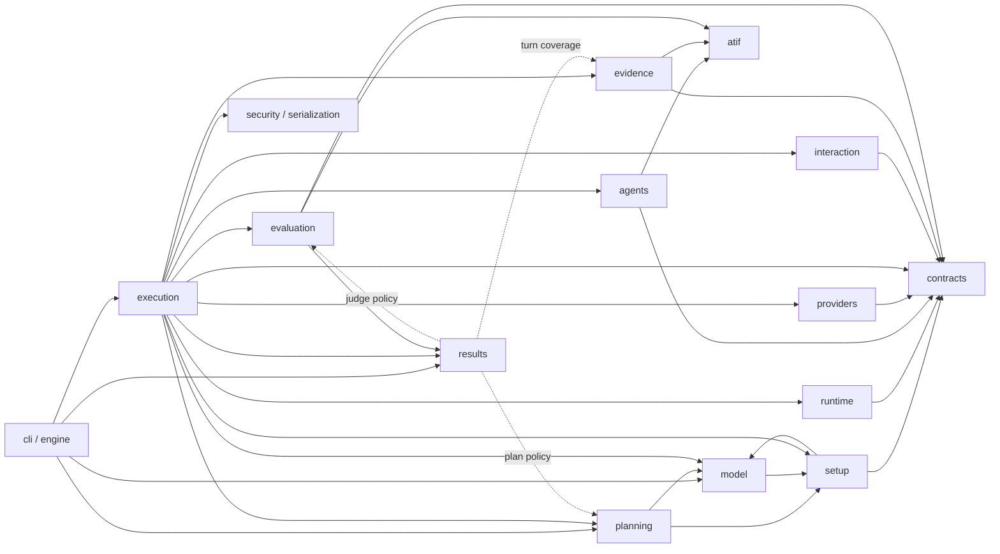
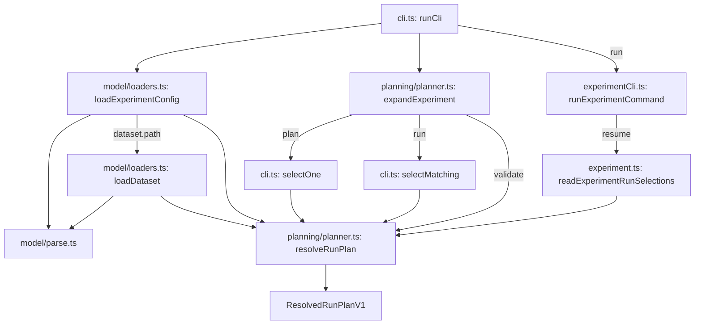
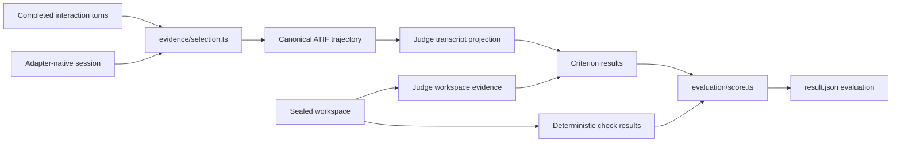

# Forge codebase guide

This guide explains how the Forge source tree fits together at the file and
symbol level. Read [Forge architecture](architecture.md) first for the design
and lifecycle invariants; use this document when you are developing a change,
navigating code, tracing a request, or deciding where a change belongs.

Forge is mostly organized by responsibility rather than by feature. An eval run moves
through several directories:

```text
model → planning → execution → interaction → evidence → evaluation → results
                     │              │             │
                     └──── contracts and host-provided adapters ────┘
```

The arrows are a useful reading order, not a strict acyclic layering rule.
`execution` coordinates almost every subsystem, and `results` imports selected
evidence and evaluation policies so it can independently verify a committed
run.

## Development and verification

Development uses Node.js 22.12 or newer and the pinned package manager:

```sh
corepack enable
pnpm install --frozen-lockfile
pnpm build
```

Use `node dist/cli.js` to run the built CLI with the README's
[sample walkthrough](../README.md#run-your-first-experiment). `pnpm test` runs
Vitest directly against TypeScript sources; it does not build the package or
typecheck tests. Use `pnpm typecheck` for type checking. Run the narrowest
relevant tests while iterating, or use `pnpm test:watch` for watch mode:

```sh
pnpm test path/to/file.test.ts
```

`pnpm lint` checks formatting, import organization, and lint rules with Biome
without changing files. Use `pnpm lint:fix` to apply safe fixes, or `pnpm format`
to format only. The [Biome configuration](https://github.com/stripe/forge/blob/main/biome.json)
excludes dataset releases, test fixtures, and packaged Docker assets so their
bytes are not rewritten.

`pnpm check` runs Biome, type checking, tests, build, dataset validation,
documentation validation, and package checks. PRs targeting `main`, including drafts, run the
same checks through the [PR workflow](https://github.com/stripe/forge/blob/main/.github/workflows/pr-checks.yml).
The publishing workflow checks and publishes versioned development snapshots
after pushes to `main`; stable release commits are skipped.

`pnpm check:docs` checks documentation links, the public export inventory, and
structured snippets. `pnpm check:cases` validates checked-in datasets and
harness fixtures through the public loader without model calls. It also
compares each manifest with its copy at the merge-base with `origin/main`
(override with `-- --base <ref>`) and fails when a case version or membership
change keeps the dataset version.
Each dataset keeps only its latest version; earlier versions live in Git
history. Sample datasets live under [`datasets`](https://github.com/stripe/forge/tree/main/datasets),
their experiments under [`experiments`](https://github.com/stripe/forge/tree/main/experiments),
and harness inputs under [`test/fixtures`](https://github.com/stripe/forge/tree/main/test/fixtures).

### Opt-in live tests

The single live suite under
[`scripts/live-e2e.mjs`](https://github.com/stripe/forge/blob/main/scripts/live-e2e.mjs)
is separate from `pnpm test` and `pnpm check`. Both modes require Docker and
network access. Setup mode exercises real setup actions and plugin installation
without model credentials or upstream model calls:

```sh
FORGE_LIVE=1 FORGE_LIVE_MODE=setup pnpm test:live
```

Full mode is the default and makes potentially billable calls. Run it only when
credentialed, billable execution is authorized, using the provider credentials
appropriate to the selected agent:

```sh
FORGE_LIVE=1 ANTHROPIC_API_KEY=your-restricted-key pnpm test:live
```

For an Anthropic-compatible endpoint, use `ANTHROPIC_BASE_URL` and
`ANTHROPIC_AUTH_TOKEN` instead. To exercise Codex:

```sh
FORGE_LIVE=1 FORGE_LIVE_AGENT=codex CODEX_API_KEY=your-restricted-key pnpm test:live
```

Optional `OPENAI_BASE_URL` selects a Responses-compatible endpoint. Codex full
mode uses scripted host completions for multi-turn coverage, so it needs no
Anthropic credential. Set `FORGE_LIVE_AGENT=codex` with setup mode to test Codex
setup without upstream calls.

OpenCode setup mode exercises the real pinned CLI against a deterministic
authenticated Chat Completions endpoint, including plugin/no-plugin treatments, tools, one-shot and Ava turns,
exact-session exports, restricted artifacts, and cleanup. It also installs the
published Stripe bundle and verifies native skill discovery, then uses local
Git and MCP fixtures to check bearer auth, discovery, tool use, and rejected keys:

```sh
FORGE_LIVE=1 FORGE_LIVE_MODE=setup FORGE_LIVE_AGENT=opencode pnpm test:live
```

It needs Docker with `host.docker.internal` support and network access for
runtime installation, but no upstream model credentials or billable calls.
OpenCode full mode is not yet available. For upstream acceptance, run the public
CLI with the desired model and a paired experiment after this suite passes.
Keep endpoint configuration and credentials outside the experiment, and verify
both completed runs. Ava and judging retain their separate Anthropic provider.

The live helpers can create temporary authenticated host bridges for Codex
Responses, OpenCode Chat Completions, and loopback Claude endpoints. The real upstream key
stays host-side; the container receives a per-run bridge credential. The host
running the bridge must already be able to reach the upstream endpoint.

The container reaches the bridge through `host.docker.internal`, which Docker
Desktop provides. On Linux Docker Engine, `docker run` may need
`--add-host=host.docker.internal:host-gateway`. The suite does not add this
mapping automatically. `FORGE_DOCKER_EXECUTABLE` can select a Docker wrapper
that inserts it for `run` and passes other subcommands through unchanged.
Verify connectivity from a container: a successful host-side request does not
establish that the container can resolve or reach the bridge.

This is test-suite behavior: the public CLI creates no bridge and requires
endpoints reachable from the container. See the README's
[endpoint configuration](../README.md#requirements--credentials).

Results default to `results/live`. `FORGE_LIVE_RUN_ID` sets the suite/run ID
prefix; `FORGE_LIVE_RESULTS_ROOT` changes the root; `FORGE_LIVE_TIMEOUT_MS` sets
the positive overall timeout (30 minutes by default); and
`FORGE_DOCKER_EXECUTABLE` selects another Docker CLI. Both modes verify removal
of containers and host runtime files; completed evals with cleanup warnings fail
live verification. The helpers under `scripts/live/` are safe to import; Docker
or model calls begin only when the entry point runs a selected mode.

## Directory interaction map

The solid arrows below point from a caller/dependent to code it uses. The dotted
verification arrows show policies that `results` reuses when it audits stored
output.



## Start here

For a first pass through the codebase, read these files in order:

1. [`src/model/types.ts`](https://github.com/stripe/forge/blob/main/src/model/types.ts) — the benchmark and plan data
   model.
2. [`src/contracts/composition.ts`](https://github.com/stripe/forge/blob/main/src/contracts/composition.ts) — the host
   capabilities supplied to a run.
3. [`src/engine.ts`](https://github.com/stripe/forge/blob/main/src/engine.ts) — how one immutable action registry binds
   parsing, planning, execution, and verification.
4. [`src/planning/planner.ts`](https://github.com/stripe/forge/blob/main/src/planning/planner.ts) — how authored inputs
   become one resolved plan.
5. [`src/execution/execute.ts`](https://github.com/stripe/forge/blob/main/src/execution/execute.ts) — the end-to-end run
   controller.
6. [`src/contracts/runtime.ts`](https://github.com/stripe/forge/blob/main/src/contracts/runtime.ts) and
   [`src/contracts/agent.ts`](https://github.com/stripe/forge/blob/main/src/contracts/agent.ts) — the two most important
   adapter boundaries.
7. [`src/evidence/selection.ts`](https://github.com/stripe/forge/blob/main/src/evidence/selection.ts) — how agent output
   becomes score-bearing evidence.
8. [`src/results/localStore.ts`](https://github.com/stripe/forge/blob/main/src/results/localStore.ts) — how a result is
   committed and later verified.

If you are following the public executable, start instead at
[`runCli`](https://github.com/stripe/forge/blob/main/src/cli.ts), then move to `ForgeEngine.resolveRunPlan` and
`ForgeEngine.executeEval`.

## Top-level source files

| File | Main symbols | Role and relationships |
| --- | --- | --- |
| [`src/index.ts`](https://github.com/stripe/forge/blob/main/src/index.ts) | Root re-exports | Defines the stable package-root API. Specialized implementations such as Docker and agent adapters are exported through package subpaths instead. |
| [`src/engine.ts`](https://github.com/stripe/forge/blob/main/src/engine.ts) | `ForgeEngine`, `createForgeEngine`, `defaultForgeEngine` | Snapshots a setup action registry and binds model parsing, loading, planning, preflight, execution, and verification to that exact registry. Delegates to `model`, `planning`, `execution`, and `results`. |
| [`src/cli.ts`](https://github.com/stripe/forge/blob/main/src/cli.ts) | `runCli`, `createDefaultCliComposition` | CLI host for `validate`, `plan`, and `run`. Loads inputs, filters matrix entries, creates adapters, and calls the engine or experiment run controller. It is composition code, not benchmark semantics. |
| [`src/experiment.ts`](https://github.com/stripe/forge/blob/main/src/experiment.ts) | `runExperiment`, `readExperimentRunSelections`, `inspectExperimentRun` | Experiment run controller, checkpoint/report persistence under the lock, bounded verified outcome collection, and read-only inspection of latest attempts. |
| [`src/experimentModel.ts`](https://github.com/stripe/forge/blob/main/src/experimentModel.ts) | Checkpoint schemas and attempt types | Strict execution checkpoint model shared by the controller and report schemas. |
| [`src/experimentReport.ts`](https://github.com/stripe/forge/blob/main/src/experimentReport.ts) | `parseExperimentRunReport`, report types, internal builder/serializer | Bounded scorecard schema, case/configuration aggregation, and verification that statistics match run rows. Public parser/types are re-exported through the experiment subpath. |
| [`src/experimentCli.ts`](https://github.com/stripe/forge/blob/main/src/experimentCli.ts) | `runExperimentCommand`, `parseExperimentArgs`, `createExperimentCliOptions` | Operational options, experiment run IDs/roots, saved selection restoration, host loading, and prepared-input cleanup. Used by the public CLI and available to other command hosts. |
| [`src/version.ts`](https://github.com/stripe/forge/blob/main/src/version.ts) | `FORGE_VERSION`, `FORGE_BUILD_IDENTITY`, release compatibility helpers | Reads package and build metadata without host Git discovery. Shared by planning, execution, artifact readers, and experiment runs. |
| [`src/serialization.ts`](https://github.com/stripe/forge/blob/main/src/serialization.ts) | `serializeCanonicalJson` | Shared deterministic JSON serializer. Sorts object keys, retains array order, appends a newline, and rejects values that are not plain JSON. Used by plans, setup resolutions, ATIF-related artifacts, results, and receipts. |

### `ForgeEngine` as the semantic facade

`createForgeEngine({setupActionBundles})` calls
`createSetupActionRegistry`, then closes over the returned immutable registry.
Each engine method is a small adapter around a registry-aware implementation:

```text
ForgeEngine method                 Delegates to
──────────────────────────────────────────────────────────────────────
parseEvalCase/Yaml             →  model/parse.ts
parseExperimentConfig/Yaml     →  model/parse.ts
parseResolvedRunPlan           →  model/parse.ts
loadDataset/config             →  model/loaders.ts
resolveRunPlan                 →  planning/planner.ts, then reparses
preflightEval/executeEval      →  execution/execute.ts
verifyCompletedRun             →  results/localStore.ts
```

That closure is why setup action semantics cannot change between parsing and
execution. Package-level convenience functions use the same built-in-only
default registry.

## The main call paths

### CLI to resolved plan



For `--case-file`, `runCli` additionally calls
`planning/caseFile.ts:resolveManifestCaseIdFromFile`, which maps the exact file within the configured dataset back to the case ID
read from its manifest-listed definition. `run` executes all matching selections through `experiment.ts`; `plan`
requires one. The experiment's `dataset.path` is resolved relative to its file.
Experiment run resume selects a saved experiment run by its explicit ID.
`--jobs` controls the experiment run worker count without changing resolved plans.
After workers drain, the controller atomically saves `report.json` from verified
latest outcomes before releasing the lock; a resume refreshes the scorecard.
Hosts with their own input formats can use `@stripe/forge/experiment/cli` with their
own argument definitions and loader, or call `@stripe/forge/experiment` directly.
The command-host contracts are defined in
[`src/experimentCli.ts`](https://github.com/stripe/forge/blob/main/src/experimentCli.ts).

### Resolved plan to committed run

The orchestration in `execute.ts` can be read as this call tree:

```text
executeEvalWithTestHooks
├── parseResolvedRunPlanWithSetupActions
├── createRunEventEmitter
├── buildEvalPreflight
│   ├── selectedAgent
│   ├── agent.evidenceIdentity
│   ├── setupExecutor.preflight
│   ├── agent.requirements
│   ├── completionBindingsForPlan
│   └── runtime.preflight
├── resolveEnvironment
├── prepareCompletionRuntime
│   ├── credentialResolver.resolve
│   └── completionProvider.preflight
├── runtime.prepare
├── agent.prepare
├── preparedSetup.apply
│   └── each PreparedSetupStep.apply in plan order
├── preparedRuntime.finalizeSetup
├── agent.openSession
├── executeInteraction
│   ├── one-shot: AgentSession.send
│   └── multi-turn: AvaRolePlayer + runConversation + AgentSession.send
├── preparedRuntime.quiesce
├── agent.collectNativeArtifact / collectEvidence
├── selectAgentEvidence
├── redactNormalizedTrajectory
├── evaluation
│   ├── collectJudgeWorkspaceEvidence
│   ├── createJudgeTranscriptProjection
│   ├── judgeCriteria
│   └── evaluateRunEvidence
├── buildCoreArtifacts / buildResult
├── contributors[].contribute
├── artifactStore.begin / transaction.write
├── preparedRuntime.dispose
└── transaction.commit
```

`verifyCompletedRun` is a separate post-commit path; `executeEval` does not call
it automatically.

### Evidence to score and artifacts



When an adapter supplies exact native source bytes, they are copied separately
as a restricted supplemental artifact. That copy does not feed the scoring
branch.

## `src/model`: wire formats and trusted loading

This directory defines the data Forge accepts before any execution capability
is selected.

| File | Main responsibility | Interacts with |
| --- | --- | --- |
| [`types.ts`](https://github.com/stripe/forge/blob/main/src/model/types.ts) | TypeScript wire types for manifests, cases, experiments, selections, setup steps, runtimes, and resolved plans | Imported across nearly every directory; contains data only |
| [`parse.ts`](https://github.com/stripe/forge/blob/main/src/model/parse.ts) | Strict Zod schemas, YAML/JSON decoding, defaults, cross-field checks, and action-specific `with` parsing | Uses `setup/registry.ts` to validate setup action semantics; called by loaders, engine, planner boundaries, and result verification |
| [`matrix.ts`](https://github.com/stripe/forge/blob/main/src/model/matrix.ts) | `getMatrixGroups` and shared agent identity after defaults | Provides shared matrix views and agent identity for parsing and planning. |
| [`loaders.ts`](https://github.com/stripe/forge/blob/main/src/model/loaders.ts) | Filesystem-safe dataset and experiment loading, exact manifest case inventory, and case parsing | Calls `parse.ts`; returns `LoadedDatasetV1` and `LoadedExperimentConfigV1` to CLI/planning |
| [`paths.ts`](https://github.com/stripe/forge/blob/main/src/model/paths.ts) | Shared predicates for dataset paths, workspace paths, IDs, action names, versions, repositories, and bounded metadata | Used by parsers, setup, runtime, results, agents, and provider adapters |
| [`hashes.ts`](https://github.com/stripe/forge/blob/main/src/model/hashes.ts) | SHA-256 validation and helpers | Used for dataset pins, bundle identity checks, plugin snapshot fingerprints, and artifact verification |
| [`checks.ts`](https://github.com/stripe/forge/blob/main/src/model/checks.ts) | Detect whether a plan actually contains deterministic workspace checks | Used by execution and result inventory verification |
| [`errors.ts`](https://github.com/stripe/forge/blob/main/src/model/errors.ts) | `BenchmarkModelError` and stable model/loading error codes | Thrown by safe loaders and exposed through `model/index.ts` |
| [`index.ts`](https://github.com/stripe/forge/blob/main/src/model/index.ts) | Public model barrel | Re-exported by the package root |

### Important model objects

The object progression is:

```text
raw YAML/JSON
   │ parse.ts
   ▼
EvalCaseV1 / ExperimentConfigV1 / DatasetManifestV1
   │ loaders.ts checks the case inventory and setup inputs and adds source paths
   ▼
LoadedDatasetV1 + LoadedExperimentConfigV1
   │ planning/planner.ts
   ▼
ResolvedRunPlanV1
```

Do not add runtime behavior to these types. A resolved plan is plain,
canonicalizable data that can be persisted and parsed again without a host
composition.

## `src/planning`: matrix selection and plan construction

| File | Main symbols | Role and relationships |
| --- | --- | --- |
| [`planner.ts`](https://github.com/stripe/forge/blob/main/src/planning/planner.ts) | `expandExperiment`, `resolveRunPlan`, `serializeResolvedRunPlan`, `resolvedRunPlanSha256`, `PlanningError` | Combines loaded model objects and one selection. Uses the action registry to validate bundle pins and returns a deeply frozen plan. |
| [`caseFile.ts`](https://github.com/stripe/forge/blob/main/src/planning/caseFile.ts) | `resolveManifestCaseIdFromFile`, `ManifestCaseFileError` | Maps a user-selected manifest-listed file to its loaded case ID while defending against symlink, identity, and containment mistakes. Called only by the CLI/file-selection path. |
| [`index.ts`](https://github.com/stripe/forge/blob/main/src/planning/index.ts) | Public planning barrel | Re-exported by the package root |

`planner.ts` is intentionally pure after loading. It does not resolve
credentials, inspect the runtime, or select a composition adapter. Its setup
registry dependency exists only to bind the plan to registered action
implementations and their bundle identities. It stamps the resolved plan with
the installed Forge build identity; experiments do not author that identity.
`expandExperiment(experiment, dataset)` maps the matrix's manifest-listed case
paths to declared IDs and walks groups before their case/treatment/agent/
repetition axes. Selection membership checks keep the complete tuple within
one group; downstream execution and reporting consume ordinary selections.
See the architecture guide's
[matrix contract](architecture.md#matrix-expansion-and-selection).

## `src/contracts`: host capability boundaries

The contracts directory is the best place to understand what host code can do.
Most files define interfaces, while a few also provide safe default
implementations.

| File | Key interfaces/functions | Consumers and implementations |
| --- | --- | --- |
| [`composition.ts`](https://github.com/stripe/forge/blob/main/src/contracts/composition.ts) | `ForgeComposition`, `CompletionProviderCollection` | Consumed by `execution`; constructed by the CLI or embedding host |
| [`runtime.ts`](https://github.com/stripe/forge/blob/main/src/contracts/runtime.ts) | `RuntimeAdapter`, `PreparedRuntime`, `SealedRuntime`, workspace interfaces | Implemented by `runtime/docker` and testing fakes; projected by `execution` into narrower agent/setup views |
| [`agent.ts`](https://github.com/stripe/forge/blob/main/src/contracts/agent.ts) | `AgentAdapter`, `AgentSession`, native evidence types, runtime projections | Implemented by coding-agent adapters and testing fakes; consumed by `execution` and `evidence` |
| [`completion.ts`](https://github.com/stripe/forge/blob/main/src/contracts/completion.ts) | `CompletionProvider`, requests/responses, strict schema and usage types | Implemented by `providers/anthropic` and scripted tests; managed by `execution/completionRuntime.ts` |
| [`credentials.ts`](https://github.com/stripe/forge/blob/main/src/contracts/credentials.ts) | `CredentialResolver`, environment requirement types, normalization, `createEnvironmentResolver`, `createEnvironmentCredentialResolver` | Used by agent/setup/provider declarations and execution; default CLI resolver maps opaque references to explicitly named host variables |
| [`command.ts`](https://github.com/stripe/forge/blob/main/src/contracts/command.ts) | `CommandRunner`, `CommandResult`, `CommandExecutionError` | Implemented by Docker command controller and testing fakes; consumed by runtime, setup, and agents |
| [`inputs.ts`](https://github.com/stripe/forge/blob/main/src/contracts/inputs.ts) | `RunInputProvider`, `createDirectoryRunInputProvider` | Used by setup and agent contexts; directory providers enforce path, symlink, and byte-limit safety |
| [`artifacts.ts`](https://github.com/stripe/forge/blob/main/src/contracts/artifacts.ts) | Store transaction, contributor, committed run, publisher interfaces | Local store implements transactions; execution invokes contributors; publication remains caller-owned |
| [`observability.ts`](https://github.com/stripe/forge/blob/main/src/contracts/observability.ts) | `RunPhase`, `RunEvent`, `RunObserver` | `execution/events.ts` emits events and isolates observer failures |
| [`plugin.ts`](https://github.com/stripe/forge/blob/main/src/contracts/plugin.ts) | `AgentPluginInstaller`, prepared install operation, receipt shape | Implemented by Claude Code, Codex, and OpenCode; selected by `setup/forgePlugin.ts` |
| [`pluginReceipt.ts`](https://github.com/stripe/forge/blob/main/src/contracts/pluginReceipt.ts) | `parseAgentPluginInstallationReceipt` | Called by plugin setup before it returns a resolution and by completed-run verification |
| [`metadata.ts`](https://github.com/stripe/forge/blob/main/src/contracts/metadata.ts) | Adapter/provider configuration metadata types and strict internal snapshot schemas | Shared by pure execution preflight and result parsing |
| [`index.ts`](https://github.com/stripe/forge/blob/main/src/contracts/index.ts) | Public contracts barrel | Re-exported by the package root |

### Capability narrowing

The runtime contract deliberately changes shape over time:

```text
PreparedRuntime
├── workspace: MutableWorkspace
├── stateDirectories: MutableWorkspace map
├── importHostFile?: host-only bounded file transfer
├── commands.uncredentialed
├── commands.setup(exact names)
└── commands.agent

execution projects it to:
├── AgentPrepareRuntime   → uncredentialed commands only
├── SetupApplyContext     → per-step state and credential projection
└── AgentSessionRuntime   → agent-scoped commands only

after quiesce:
└── AgentEvidenceRuntime  → read-only workspace/state, no commands
```

When adding a capability, put it on the narrowest lifecycle interface that
actually needs it rather than expanding `ForgeComposition` or `PreparedRuntime`
globally.

## `src/setup`: action registration, preflight, and execution

Setup splits parsing semantics, pure requirement declaration, and authorized
application across several files.

| File | Main symbols | Role and relationships |
| --- | --- | --- |
| [`registry.ts`](https://github.com/stripe/forge/blob/main/src/setup/registry.ts) | `SetupActionDefinition`, `SetupActionBundle`, `SetupActionRegistry`, `defineSetupActionBundle`, `createSetupActionRegistry` | Owns namespaces, bundle identities, immutable registration, and exact-reference checks. Used by model parsing, planning, engine, and execution. |
| [`builtins.ts`](https://github.com/stripe/forge/blob/main/src/setup/builtins.ts) | `builtInSetupActions` | Defines strict `with` parsers for built-in actions and pairs each parser with its handler from `forge*.ts`. Loaded by the registry. |
| [`types.ts`](https://github.com/stripe/forge/blob/main/src/setup/types.ts) | `SetupStepHandler`, `PreparedSetupStep`, `SetupExecutor`, setup contexts and requirements | Shared contract between action definitions, executor, and execution controller |
| [`executor.ts`](https://github.com/stripe/forge/blob/main/src/setup/executor.ts) | `createSetupExecutorForRegistry`, `PreparedSetup` implementation | Calls each action's pure `preflight`, merges requirements, freezes prepared operations, and later applies them in order with least-privileged projections. Called by `execute.ts`. |
| [`forgeWrite.ts`](https://github.com/stripe/forge/blob/main/src/setup/forgeWrite.ts) | `writeSetupHandler` | Copies inline or dataset bytes/trees through `RunInputProvider` into `MutableWorkspace`. |
| [`forgeCommand.ts`](https://github.com/stripe/forge/blob/main/src/setup/forgeCommand.ts) | `commandSetupHandler` | Runs a bounded argv command through the uncredentialed per-step runner. |
| [`forgeCredentials.ts`](https://github.com/stripe/forge/blob/main/src/setup/forgeCredentials.ts) | `credentialsSetupHandler` | Declares agent-scoped credentials from runtime environment names; application performs no commands or mutations. |
| [`forgePlugin.ts`](https://github.com/stripe/forge/blob/main/src/setup/forgePlugin.ts) | `pluginSetupHandler` | Resolves a registered plugin for the selected agent, declares credentials and installer requirements, installs, and validates its receipt. |
| [`resolution.ts`](https://github.com/stripe/forge/blob/main/src/setup/resolution.ts) | `normalizeSetupStepResolution` | Enforces bounded canonical JSON for dynamic action resolutions before `setup.json`. |
| [`index.ts`](https://github.com/stripe/forge/blob/main/src/setup/index.ts) | Public setup barrel | Exposes bundle APIs, handlers, executor types, and errors |

The interaction between registry and executor is important:

```text
SetupActionDefinition
├── parseWith()     called while parsing authored/setup plan data
└── preflight()     called by SetupExecutor before authority
       └── returns PreparedSetupStep.apply()
               called later during the setup phase
```

The executor binds `PreparedSetupStep.apply` during preflight. It does not look
the action up again at execution time.

## `src/execution`: the orchestration hub

| File | Main symbols | Role and relationships |
| --- | --- | --- |
| [`execute.ts`](https://github.com/stripe/forge/blob/main/src/execution/execute.ts) | `preflightEval`, `executeEval`, lifecycle helpers | Owns the full lifecycle and imports every score-affecting subsystem. This is the main integration file. |
| [`completionRuntime.ts`](https://github.com/stripe/forge/blob/main/src/execution/completionRuntime.ts) | `completionBindingsForPlan`, `prepareCompletionRuntime`, `PreparedCompletionRuntime` | Resolves purpose-specific providers and credentials, performs provider preflight, invokes/redacts/validates completions, and records safe call summaries. Used by Ava and criterion judging through `execute.ts`. |
| [`events.ts`](https://github.com/stripe/forge/blob/main/src/execution/events.ts) | `createRunEventEmitter` | Wraps lifecycle phases in start/completion events and uses `Promise.allSettled` so observers cannot control execution. |
| [`errors.ts`](https://github.com/stripe/forge/blob/main/src/execution/errors.ts) | `ForgeExecutionError`, `executionError`, `throwIfAborted` | Stable secret-safe phase/error surface used by the controller. |
| [`index.ts`](https://github.com/stripe/forge/blob/main/src/execution/index.ts) | Public execution barrel | Re-exports execution entry points and stable errors |

### How to read `execute.ts`

The top third contains the public entry points and lifecycle. Start with
`executeEvalWithTestHooks`; it is the implementation behind public
`executeEval`. The middle contains `executeInteraction` and preflight/
requirement merging. The lower half contains capability projection, redaction,
artifact construction, result construction, and error mapping helpers.

The local `phase` variable is not just logging. It determines the stable error
code returned when an implementation throws. The `prepared`, `sealed`,
`transaction`, and `runtimeDisposed` variables track cleanup ownership across
the main `try/catch`.

## `src/interaction`: engine-owned multi-turn behavior

| File | Main symbols | Role and relationships |
| --- | --- | --- |
| [`prompt.ts`](https://github.com/stripe/forge/blob/main/src/interaction/prompt.ts) | Ava prompt builders and stop sentinel | Pure rendering of initialization and continuation system prompts |
| [`completion.ts`](https://github.com/stripe/forge/blob/main/src/interaction/completion.ts) | Provider-neutral interaction request/invoker types | Connects Ava to `PreparedCompletionRuntime.invoke` without exposing provider or credentials |
| [`ava.ts`](https://github.com/stripe/forge/blob/main/src/interaction/ava.ts) | `AvaRolePlayer`, `AvaTurn`, need/error types | Maintains private needs/history, requests strict structured completions, validates messages, and implements retry/terminal decisions |
| [`conversation.ts`](https://github.com/stripe/forge/blob/main/src/interaction/conversation.ts) | `runConversation`, audit/result types, `snapshotAgentToolCalls` | Alternates Ava decisions with one persistent `AgentSession`, enforces max-turn semantics, aggregates cost, and produces the driver ledger/audit |
| [`index.ts`](https://github.com/stripe/forge/blob/main/src/interaction/index.ts) | Internal interaction barrel | Imported by `execution/execute.ts`; interaction is not a package subpath |

The central relationship is:

```text
executeInteraction
  └── new AvaRolePlayer(prompt inputs, completion invoker)
        └── runConversation({session, ava})
              ├── ava.nextTurn(last agent response)
              │     └── PreparedCompletionRuntime.invoke('role_player')
              └── AgentSession.send(ava message)
```

`AvaRolePlayer` never receives an agent session or workspace. `runConversation`
never receives provider credentials. `execute.ts` is the only layer that binds
those two sides.

## `src/runtime`: portable mechanics and Docker

### Shared runtime helpers

| File | Main symbols | Role and relationships |
| --- | --- | --- |
| [`workspace.ts`](https://github.com/stripe/forge/blob/main/src/runtime/workspace.ts) | `createOwnedWorkspace` | Safe host-backed mutable workspace: canonical root, no symlink traversal, stable listing, bounded reads, and atomic writes. Used by Docker. |
| [`processCommandRunner.ts`](https://github.com/stripe/forge/blob/main/src/runtime/processCommandRunner.ts) | `createHostCommandRunner` | Shell-free host subprocess runner with timeout, output cap, abort, and process-tree termination. Used by Docker CLI operations. |

### `src/runtime/docker`

| File | Main symbols | Role and relationships |
| --- | --- | --- |
| [`runtime.ts`](https://github.com/stripe/forge/blob/main/src/runtime/docker/runtime.ts) | `createDockerRuntimeAdapter` | Implements `RuntimeAdapter`: validates runtime config, builds a host-UID-aligned non-root image, creates run-owned directories, starts/restarts/stops the container, validates final executables, projects workspaces and commands, quiesces, and disposes. |
| [`hostFileImport.ts`](https://github.com/stripe/forge/blob/main/src/runtime/hostFileImport.ts) | `importHostFileIntoState` | Streams and verifies trusted host file imports into declared run-owned state. |
| [`platform.ts`](https://github.com/stripe/forge/blob/main/src/runtime/docker/platform.ts) | `detectDockerRuntimePlatform` | Queries the selected Docker server and maps its architecture to the concrete platform used when planning an authored `native` experiment. |
| [`commandRunner.ts`](https://github.com/stripe/forge/blob/main/src/runtime/docker/commandRunner.ts) | `DockerCommandController` | Implements scoped `CommandRunner`s over `docker exec`, creates temporary env files, tracks active commands, and closes setup/all command authority at lifecycle barriers. |
| [`assets.ts`](https://github.com/stripe/forge/blob/main/src/runtime/docker/assets.ts) | CLI version and asset digest constants | Consumed by Docker runtime and built-in agent adapters for pin verification. Updated with packaged assets. |
| [`assets/Dockerfile`](https://github.com/stripe/forge/blob/main/src/runtime/docker/assets/Dockerfile) | Forge-owned image | Installs the pinned CLIs and runtime dependencies. Copied into the package at build time. |
| [`assets/entrypoint.sh`](https://github.com/stripe/forge/blob/main/src/runtime/docker/assets/entrypoint.sh) | Container entrypoint | Keeps the prepared container available for `docker exec`. |
| [`index.ts`](https://github.com/stripe/forge/blob/main/src/runtime/docker/index.ts) | Public Docker subpath | Exports adapter and platform helpers plus pin metadata |

`DockerCommandController` receives the fully resolved environment, but each
runner created from it exposes only one scope. `runtime.ts` owns the controller
and hands projected runners to `PreparedRuntime`; execution narrows those again
before an action or agent sees them.

## `src/agents`: coding-agent adapters

Each adapter has the same broad shape:

```text
index.ts
├── requirements and version/layout validation
├── prepare() verifies CLI
├── openSession() invokes CLI and parses live turn output
├── collectEvidence() normalizes exact native session to ATIF
└── collectNativeArtifact() returns exact source bytes
```

### `src/agents/claude-code`

| File | Main responsibility | Called by / calls into |
| --- | --- | --- |
| [`index.ts`](https://github.com/stripe/forge/blob/main/src/agents/claude-code/index.ts) | `createClaudeCodeAdapter`; wires requirements, CLI version check, session start/resume, evidence, and plugin installer | Registered in `ForgeComposition.agents`; implements `AgentAdapter` |
| [`layout.ts`](https://github.com/stripe/forge/blob/main/src/agents/claude-code/layout.ts) | Normalize and validate workspace/home/config paths; derive Claude project directory | Called by adapter construction, prepare, session, evidence, and plugin code |
| [`stream.ts`](https://github.com/stripe/forge/blob/main/src/agents/claude-code/stream.ts) | Parse Claude `stream-json` stdout into bounded `AgentTurn` | Called by `AgentSession.send` in `index.ts` |
| [`evidence.ts`](https://github.com/stripe/forge/blob/main/src/agents/claude-code/evidence.ts) | Read the exact session JSONL, classify native records, render context/tool behavior, and build ATIF or an unavailable result | Called after quiescence by adapter methods; returns contract types to `evidence/selection.ts` |
| [`plugins.ts`](https://github.com/stripe/forge/blob/main/src/agents/claude-code/plugins.ts) | Implement `AgentPluginInstaller`: register marketplace, validate source, install through native CLI, verify installed state | Constructed by `index.ts`; invoked through `setup/forgePlugin.ts` |
| [`pluginReceipt.ts`](https://github.com/stripe/forge/blob/main/src/agents/claude-code/pluginReceipt.ts) | Map Claude source receipts and re-export shared installed-tree verification | Called by `plugins.ts` while constructing the setup resolution |

Claude's live stream and persisted JSONL are parsed independently. The live
stream produces the driver turn immediately; the JSONL parser runs only after
quiescence and must reconcile with that ledger through the shared evidence
selector.

### `src/agents/codex`

| File | Main responsibility | Called by / calls into |
| --- | --- | --- |
| [`index.ts`](https://github.com/stripe/forge/blob/main/src/agents/codex/index.ts) | `createCodexAdapter`; wires isolated `CODEX_HOME`, Responses provider configuration, hook policy, CLI verification, exec/resume, evidence, and plugin installer | Registered in `ForgeComposition.agents`; implements `AgentAdapter` |
| [`layout.ts`](https://github.com/stripe/forge/blob/main/src/agents/codex/layout.ts) | Normalize and validate workspace/home/config paths | Called from all adapter lifecycle methods |
| [`pluginConfig.ts`](https://github.com/stripe/forge/blob/main/src/agents/codex/pluginConfig.ts) | Bound and filter run-owned TOML to native plugin, project trust, and hook state | Called before native installation and every session send |
| [`plugins.ts`](https://github.com/stripe/forge/blob/main/src/agents/codex/plugins.ts) | Implement `AgentPluginInstaller`: native commands, catalog/source verification, installed inventory and receipt | Constructed by `index.ts`; invoked through `setup/forgePlugin.ts` |
| [`stream.ts`](https://github.com/stripe/forge/blob/main/src/agents/codex/stream.ts) | Parse `codex exec --json` output into one bounded `AgentTurn` and validate session continuity | Called by `AgentSession.send` in `index.ts` |
| [`evidence.ts`](https://github.com/stripe/forge/blob/main/src/agents/codex/evidence.ts) | Locate the exact rollout by session ID, parse/validate JSONL records, normalize messages/reasoning/tools to ATIF | Called after quiescence by adapter methods |
| [`toolEvidence.ts`](https://github.com/stripe/forge/blob/main/src/agents/codex/toolEvidence.ts) | Normalize command/file/MCP/search outputs and validate native MCP snapshots | Used only by `evidence.ts` |
| [`nativeJson.ts`](https://github.com/stripe/forge/blob/main/src/agents/codex/nativeJson.ts) | Extract bounded compact JSON fragments from native source without a broad reserialization | Low-level helper for evidence validation |
| [`truncation.ts`](https://github.com/stripe/forge/blob/main/src/agents/codex/truncation.ts) | Relate original and observed UTF-8 text when Codex reports truncated output | Used by native tool evidence parsing |

Codex has extra evidence helpers because its rollout protocol contains several
representations of tool activity. `evidence.ts` is the coordinator; the helper
files should remain unaware of Forge lifecycle or result storage.

All three plugin installers use
[`src/agents/pluginTree.ts`](https://github.com/stripe/forge/blob/main/src/agents/pluginTree.ts)
to bound installed contents, reject unsafe entries, and compute the shared
tree receipt.

### `src/agents/opencode`

`plugins.ts` installs the standard Stripe bundle at the official catalog's source
pin. `pluginConfig.ts` validates its manifest and MCP declaration and merges the
native configuration with the authored model definition. These use the shared
plugin credential policy and tree fingerprinting; the receipt variant records
the actual standard-bundle source path.

`index.ts` owns routing, isolated state, version verification, stdin execution,
exact-session resumption, and pre-quiescence exports. `config.ts` validates the
authored model definition; `launcher.ts` supplies the prompt file to stdin.
`stream.ts` validates completed live part snapshots. `evidence.ts` reads the
sealed export and converts supported native content to ATIF, using bounded
JSON helpers in `native.ts`. `layout.ts` validates external-runtime paths.
See the architecture's [adapter contract](architecture.md#coding-agent-adapters)
for supported configuration and evidence limits.

## `src/providers`: host-side model transport

[`src/providers/anthropic/index.ts`](https://github.com/stripe/forge/blob/main/src/providers/anthropic/index.ts) is the
current built-in `CompletionProvider`. It contains construction, model
capability validation, request validation and schema projection, fetch,
bounded-response reading, provider-response parsing, usage normalization, and
safe error classes in one file.

It is used only through `execution/completionRuntime.ts`. Ava and criterion
judging depend on the provider-neutral completion contract, not this provider.
That distinction lets an embedding host register another provider without
changing `interaction` or `evaluation`.

## `src/atif`: canonical trajectory format

| File | Main responsibility | Interacts with |
| --- | --- | --- |
| [`types.ts`](https://github.com/stripe/forge/blob/main/src/atif/types.ts) | Exact ATIF v1.8 TypeScript wire types | Used by agent evidence, selection, evaluation, and result provenance |
| [`schema.ts`](https://github.com/stripe/forge/blob/main/src/atif/schema.ts) | Recursive Zod implementation of ATIF v1.8 invariants | Called by `parser.ts` |
| [`parser.ts`](https://github.com/stripe/forge/blob/main/src/atif/parser.ts) | Bounded-JSON graph preflight plus schema parsing and structured errors | Called by normalization, judge projection, results, and adapter helpers |
| [`normalization.ts`](https://github.com/stripe/forge/blob/main/src/atif/normalization.ts) | Forge's evidence envelope: source/adapter provenance, completeness and warnings | Constructed by `evidence/selection.ts`; summarized in `result.json` |
| [`serializer.ts`](https://github.com/stripe/forge/blob/main/src/atif/serializer.ts) | Canonical trajectory serialization | Called before writing `trajectory.json` |
| [`timestamp.ts`](https://github.com/stripe/forge/blob/main/src/atif/timestamp.ts) | ATIF timestamp validation | Used by the schema and adapter normalization |
| [`upstream.ts`](https://github.com/stripe/forge/blob/main/src/atif/upstream.ts) | Pinned upstream provenance metadata | Exported for consumers and conformance |
| [`index.ts`](https://github.com/stripe/forge/blob/main/src/atif/index.ts) | Public ATIF subpath barrel | Imported throughout internal evidence/evaluation code |

Adapter `evidence.ts` files produce JSON-shaped ATIF candidates. The shared ATIF
parser, not an adapter, is the authoritative schema boundary.

## `src/evidence`: native-versus-fallback selection

[`src/evidence/selection.ts`](https://github.com/stripe/forge/blob/main/src/evidence/selection.ts) is a single-file
subsystem because selection policy must stay centralized. Its important symbols
are:

- `parseAgentEvidenceIdentity`: validates the pure identity declared before
  allocation;
- `selectAgentEvidence`: validates an adapter candidate, checks exact session
  identity and completed-turn coverage, and chooses native or driver fallback;
- `trajectoryCoversCompletedTurns`: shared structural reconciliation used both
  during execution and completed-run verification; and
- private fallback builders that bound assistant text, tool counts, and tool
  arguments before constructing ATIF.

This directory depends on `contracts/agent` and `atif`, but not on runtime,
storage, or a specific adapter. Both execution and result verification call the
same coverage policy so a stored trajectory cannot pass weaker checks than the
one originally selected.

## `src/evaluation`: checks, judge evidence, and scoring

| File | Main symbols | Role and relationships |
| --- | --- | --- |
| [`checks.ts`](https://github.com/stripe/forge/blob/main/src/evaluation/checks.ts) | `collectWorkspaceEvidence`, `runWorkspaceChecks`, `evaluateRunEvidence` | Reads exact configured paths from sealed workspace, runs deterministic checks, validates criterion-result alignment, then calls `scoreEvaluation`. |
| [`judgeWorkspace.ts`](https://github.com/stripe/forge/blob/main/src/evaluation/judgeWorkspace.ts) | `collectJudgeWorkspaceEvidence`, `boundJudgeWorkspaceEvidence`, `renderJudgeWorkspaceEvidence` | Lists eligible sealed-workspace files under hard bounds and renders the exact text appended to judge prompts. Called by execution. |
| [`judgeTranscript.ts`](https://github.com/stripe/forge/blob/main/src/evaluation/judgeTranscript.ts) | `createJudgeTranscriptProjection`, `parseJudgeTranscriptProjection` | Positive allowlist from redacted root ATIF to judge-visible steps. Used by execution, public judging helpers, result schemas, and verifier. |
| [`criterionJudge.ts`](https://github.com/stripe/forge/blob/main/src/evaluation/criterionJudge.ts) | `judgeCriteria`, prompt/response helpers | Renders one prompt per criterion, runs bounded concurrent workers, retries, and parses strict judgments. Receives an invocation callback from execution. |
| [`score.ts`](https://github.com/stripe/forge/blob/main/src/evaluation/score.ts) | `scoreEvaluation` | Purely combines criterion and check results into score/status. |
| [`index.ts`](https://github.com/stripe/forge/blob/main/src/evaluation/index.ts) | Public evaluation barrel | Re-exported at package root |

There are two workspace evidence paths with different purposes:

```text
checks.ts             → exact bytes for explicitly configured deterministic paths
judgeWorkspace.ts     → bounded eligible text from a broader workspace scan
```

Do not merge them. Their artifact schemas, selection rules, and consumers are
different.

## `src/results`: wire schemas, local transactions, and verification

| File | Main symbols | Role and relationships |
| --- | --- | --- |
| [`types.ts`](https://github.com/stripe/forge/blob/main/src/results/types.ts) | Result/artifact/audit wire types and embedded evaluation types | Used by execution, evaluation, storage, and consumers |
| [`parse.ts`](https://github.com/stripe/forge/blob/main/src/results/parse.ts) | Strict parsers for result and audit artifacts | Checks Forge release compatibility before interpretation; companion parsers receive the parent run's release context. |
| [`localStore.ts`](https://github.com/stripe/forge/blob/main/src/results/localStore.ts) | `createArtifactStore`, `verifyCompletedRun`, store errors | Implements two-phase local commit and independent cross-artifact verification |
| [`index.ts`](https://github.com/stripe/forge/blob/main/src/results/index.ts) | Public results barrel | Re-exported by package root |

`localStore.ts` has two distinct halves:

1. `createArtifactStore` implements `RunArtifactStore` and knows only staged
   bytes, descriptors, and the final parsed result at commit time.
2. `verifyCompletedRunWithPlanParser` reopens a completed directory and checks
   files plus semantic relationships between result, plan, setup, interaction,
   trajectory, and judge evidence.

The verifier deliberately imports:

- strict plan parsing and canonical serialization from `model` and `planning`;
- release compatibility from `version.ts`;
- turn coverage from `evidence/selection.ts`;
- ATIF parsing from `atif`;
- judge projection policy from `evaluation`; and
- plugin receipt validation from `contracts`.

Those dependencies make verification a second semantic boundary rather than a
generic checksum utility.

## `src/security`: secret handling

[`src/security/redaction.ts`](https://github.com/stripe/forge/blob/main/src/security/redaction.ts) contains exact-value
redaction and secret assertions:

- `redactSecrets` recursively clones JSON-compatible content, redacts string
  values and object keys, and reports replacement count;
- `assertNoSecretsInJsonValue` validates JSON-shaped structures; and
- `assertNoSecrets` scans text/bytes and throws `SecretLeakError`.

`execution/completionRuntime.ts` redacts provider prompts/responses.
`execution/execute.ts` redacts canonical evidence and interaction artifacts,
redacts judge workspace evidence, and scans setup/core/result/contributed
artifacts. Exact agent-native artifacts intentionally bypass redaction;
execution classifies them as `restricted`, and the artifact store preserves
that classification.

## `src/testing`: public test fixtures and conformance

| File | Main symbols | Use |
| --- | --- | --- |
| [`plans.ts`](https://github.com/stripe/forge/blob/main/src/testing/plans.ts) | `createTestResolvedRunPlan` | Produces a valid parsed plan with focused overrides |
| [`memoryWorkspace.ts`](https://github.com/stripe/forge/blob/main/src/testing/memoryWorkspace.ts) | `createMemoryWorkspace` | In-memory mutable/read-only workspace fixture |
| [`memoryInputs.ts`](https://github.com/stripe/forge/blob/main/src/testing/memoryInputs.ts) | `createMemoryRunInputProvider` | In-memory dataset input fixture |
| [`fakes.ts`](https://github.com/stripe/forge/blob/main/src/testing/fakes.ts) | Static credentials, memory artifact store, scripted agent, fake runtime | Builds full compositions without Docker or network and exposes recorded calls/state |
| [`completionProvider.ts`](https://github.com/stripe/forge/blob/main/src/testing/completionProvider.ts) | `createScriptedCompletionProvider` | Scripts strict completion responses/failures and records provider calls |
| [`conformance.ts`](https://github.com/stripe/forge/blob/main/src/testing/conformance.ts) | `assertRuntimeAdapterConforms` | Reusable external runtime lifecycle/capability conformance suite |
| [`index.ts`](https://github.com/stripe/forge/blob/main/src/testing/index.ts) | Public testing subpath | Exposes supported fixtures to adapter authors |

Production unit tests sit beside their source as `*.test.ts`. Cross-module,
CLI, package, and embedding tests live under [`test`](https://github.com/stripe/forge/tree/main/test):

- `quickstart.e2e.test.ts`: one-shot CLI execution;
- `multiTurn.e2e.test.ts` and `multiTurnExample.test.ts`: Ava execution and multi-turn planning;
- `externalRuntime.e2e.test.ts`: external runtime composition;
- `claudeCode.e2e.test.ts`, `codex.e2e.test.ts`, and `opencode.e2e.test.ts`: actual adapter integration
  through a fake command transport and verified local artifacts;
- `cliProcess.test.ts` and `experimentProcess.test.ts`: real CLI subprocesses and
  experiment run recovery after process death;
- `liveE2eScript.test.ts`: live configuration, orchestration, verification, and
  real gateway sockets, using importable helpers under `scripts/live/`.

Tests use `node:assert/strict` with explicit field assertions for partial objects.
Keep native parser inputs and expected canonical bytes independent of the
implementation being tested. Checked-in eval inputs under
[`test/fixtures`](https://github.com/stripe/forge/tree/main/test/fixtures) serve
deterministic tests and the opt-in live suite; their manifests are validated
by `pnpm check:cases` and loader tests.

The normal suite combines focused unit tests, deterministic integration tests,
real local subprocesses, and loopback HTTP transport tests. Subprocess tests
use `tsx` to load source files; the separate package smoke test exercises
built JavaScript from an installed tarball with plain Node.js. The normal suite
requires no Docker, provider credentials, or external network access. See
[opt-in live tests](#opt-in-live-tests) for real-runtime commands, credentials,
gateway behavior, and suite configuration.

## Other top-level directories and files

| Path | Role |
| --- | --- |
| [`datasets`](https://github.com/stripe/forge/tree/main/datasets) | Sample datasets. Each holds only its latest version; earlier versions live in Git history. |
| [`experiments`](https://github.com/stripe/forge/tree/main/experiments) | Runnable experiments for the sample datasets. Each `experiment.yaml` pins its dataset with `dataset.path` and selects treatments and models. |
| [`examples`](https://github.com/stripe/forge/tree/main/examples) | Offline external-runtime composition demo. |
| [`docs`](.) | [Architecture](architecture.md) and contributor guides. `plugin-action.md` and `setup-action-bundles.md` own their feature contracts. |
| [`vitest.config.ts`](https://github.com/stripe/forge/blob/main/vitest.config.ts) | Vitest discovery, Node environment, process isolation, and mock restoration. |
| [`scripts/copy-assets.mjs`](https://github.com/stripe/forge/blob/main/scripts/copy-assets.mjs) | Copies packaged Docker assets after TypeScript compilation. |
| [`scripts/build-info.mjs`](https://github.com/stripe/forge/blob/main/scripts/build-info.mjs) | Captures source commit and dirty state into packaged build metadata when Git is available. |
| [`scripts/package-smoke.mjs`](https://github.com/stripe/forge/blob/main/scripts/package-smoke.mjs) | Verifies published package entry points and assets. |
| [`scripts/live-e2e.mjs`](https://github.com/stripe/forge/blob/main/scripts/live-e2e.mjs) | Opt-in real Docker/agent/provider suite. |
| [`package.json`](../package.json) | Public exports, binary, Node/package-manager pins, scripts, and package file inventory. |
| [`tsconfig.json`](https://github.com/stripe/forge/blob/main/tsconfig.json) | Strict NodeNext development/test typechecking. |
| [`tsconfig.build.json`](https://github.com/stripe/forge/blob/main/tsconfig.build.json) | Production declaration/JavaScript build. |

## Public versus internal imports

Inside the package, source files often import a concrete sibling file to avoid
barrel cycles. Relative TypeScript imports use `.ts` extensions;
`rewriteRelativeImportExtensions` rewrites them to `.js` in emitted JavaScript.
External consumers must use only exports declared in
[`package.json`](../package.json), documented in the architecture guide's
[public entry points](architecture.md#public-entry-points).

Do not make consumers import `dist/...` or an internal source path. Adding a
public file is not sufficient: update `package.json` exports, barrel/export
tests, package smoke tests, and the architecture export inventory together.

## Where a change should go

### Add or change a benchmark field

Usually touch:

1. `model/types.ts` for the TypeScript wire shape;
2. `model/parse.ts` for strict parsing, defaults, and invariants;
3. `planning/planner.ts` if the field affects a resolved plan;
4. `execution` or the relevant subsystem that consumes it;
5. `results/types.ts` and `results/parse.ts` if persisted output changes;
6. verifier logic in `results/localStore.ts` when artifacts must agree; and
7. adjacent tests, affected dataset snapshots and eval fixtures, experiment dataset versions,
   and the architecture guide's [data model](architecture.md#the-benchmark-data-model).

Do not let runtime code infer a new default. Materialize it during parsing or
planning.

### Add a built-in setup action

Usually touch:

1. `model/types.ts` for a typed built-in shape, if it belongs in the closed
   built-in union;
2. a new or existing `setup/<action>.ts` handler;
3. `setup/builtins.ts` for strict `with` parsing and registration;
4. `setup/index.ts` if the handler is public;
5. result verification if the action records a dynamic receipt; and
6. parser/setup/execution tests plus public documentation.

Keep `parseWith` and `preflight` pure. Declare every executable, state path,
plain variable, and credential before `apply` runs.

### Add an agent adapter

Implement `contracts/agent.ts:AgentAdapter`, then:

1. declare pure requirements and evidence identity;
2. verify binary/layout in `prepare` using the uncredentialed projection;
3. keep one stable session ID across `AgentSession.send` calls;
4. return bounded completed turns from the live protocol;
5. read exact-session evidence only from `AgentEvidenceRuntime` after quiescence;
6. normalize native evidence to ATIF or return an explicit unavailable reason;
7. optionally return exact source bytes as a restricted native artifact; and
8. add a package subpath only if it is intended as a supported implementation.

Use `testing` fakes and conformance helpers; do not add adapter-specific cases
to the lifecycle controller.

### Add a runtime adapter

Implement `RuntimeAdapter` and run `assertRuntimeAdapterConforms`. Pay special
attention to:

- pure synchronous preflight;
- exact plan adapter/config validation;
- command scope isolation;
- workspace and state-directory path safety;
- finalization of setup authority;
- a real mutation barrier in `quiesce`;
- read-only sealed capabilities; and
- idempotent cleanup that does not depend on an aborted run signal.

External runtime-specific configuration stays in the plan's public bounded
`config`; credentials remain capabilities.

### Add a completion provider

Implement `contracts/completion.ts:CompletionProvider`. The provider should
declare credential references in `requirements`, optionally validate resolved
credentials in `preflight`, and implement a bounded `complete`. Register it in
the host composition by `ModelRefV1.provider` ID. Do not modify Ava or criterion
judging to add transport-specific behavior.

### Change evidence or judging

Treat these changes as cross-cutting and score-affecting. Review together:

- adapter native parsing;
- `evidence/selection.ts` coverage/fallback;
- `atif` schema and normalization behavior;
- `evaluation/judgeTranscript.ts` projection policy;
- `evaluation/criterionJudge.ts` prompt behavior;
- result wire schemas and conditional artifacts;
- `results/localStore.ts` verification; and
- README/architecture documentation and end-to-end tests.

Changing what the judge sees requires reviewing Forge release compatibility
and stored-run verification; it is not a local refactor.

### Add or change an artifact

Update the producer in `execution/execute.ts`, types and parser in `results`,
canonical inventory and semantic verification in `results/localStore.ts`, and
README/architecture inventory. Keep host-owned files below
`extensions/<contributor-id>/`; keep agent-native bytes below
`native/<adapter-id>/` and restricted.

## Debugging by phase

`ForgeExecutionError.phase` identifies the part of the controller that failed:

| Phase | Start reading | Common collaborating files |
| --- | --- | --- |
| `preflight` | `execution/execute.ts:buildEvalPreflight` | model parser, setup executor, agent requirements, completion runtime, runtime preflight |
| `runtime_prepare` | selected `RuntimeAdapter.prepare` | Docker runtime/controller, credentials, workspace helpers |
| `setup` | `setup/executor.ts:PreparedSetup.apply` | selected handler, input provider, workspace, command projection |
| `interaction` | `execution/execute.ts:executeInteraction` | selected agent `index.ts`, stream parser, Ava/conversation, completion runtime |
| `quiesce` | selected runtime `quiesce` | active command controller and sealed workspace/state |
| `evidence` | adapter `collectEvidence`, then `evidence/selection.ts` | adapter evidence parser, ATIF parser/normalization |
| `evaluation` | `evaluation/checks.ts` and `criterionJudge.ts` | judge transcript/workspace projection, completion runtime |
| `artifact_stage` | artifact store transaction and `buildSupplementalArtifacts` | result descriptors, contributors, secret scans |
| `runtime_dispose` | selected runtime `dispose` | container/process cleanup; late failures become warnings |
| `result_commit` | `results/localStore.ts:commit` | result parser, descriptor equality, directory rename |

For a verification-only failure, start in
`results/localStore.ts:verifyCompletedRunWithPlanParser`; it is intentionally
independent of the execution phase mapping.

## Dependency rules worth preserving

- `model` contains data and parsing, not runtime authority.
- `planning` resolves semantics, not capabilities.
- `contracts` stay provider/runtime-neutral.
- `execution` owns lifecycle ordering; adapters do not call back into it.
- `interaction` owns Ava behavior but knows nothing about provider credentials.
- `evaluation` accepts sealed evidence and does not mutate runtime state.
- `evidence` decides fallback centrally; adapters report candidates.
- `results` revalidates cross-artifact semantics rather than trusting the
  producer.
- setup extension code is selected at engine construction, never discovered
  from YAML.
- package subpaths are explicit API commitments; internal barrel files are not.

Keeping those directions makes it possible to replace a runtime, agent, or
completion transport without changing what an evaluation means.
